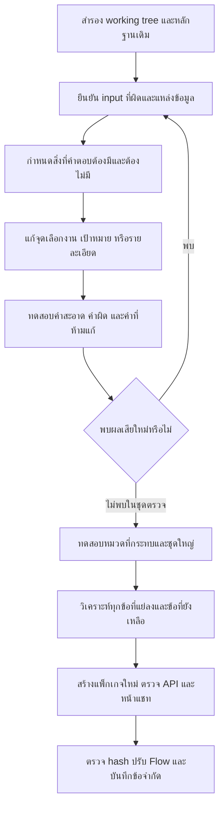

# รายงานทำตาม Flow และผลทดสอบสุดท้าย — r20

วันที่สรุป: 1 ตุลาคม 2026 (Asia/Bangkok) งานเริ่ม 30 กันยายนและทดสอบต่อเนื่องข้ามวัน

## 1. สิ่งที่ส่งมอบและความหมายของคำว่าเสร็จ

จัดทำ Flow รวมใน `docs/117_reliability_flow_ten_reviews_20261001.md` ทบทวนเชิงออกแบบ **10 รอบ** ก่อนลงมือ แล้วปรับตามปัญหาจากการทดสอบจริงอีก **4 รอบ** เก็บฉบับแต่ละรอบใน `reports/reliability_flow_20261001/flow_reviews/` พร้อม review logs ไม่ใช่การอ้างว่ารันชุดใหญ่ครบสิบครั้ง

ลงมือแก้ส่วนที่มีหลักฐานจาก source/working tree และทดสอบครบตาม gate ที่กำหนด สร้างแพ็กเกจใหม่แยกจาก r18/r19 โดยยังมีข้อที่ตอบผิดหรือยังตอบไม่ได้ตามรายการท้ายรายงาน ผลนี้รับรองพฤติกรรมในขอบเขตทดสอบ ไม่รับรองความถูกต้องทุกคำถามหรือสถานะเครื่องจริงจาก WordPress

แพ็กเกจ: `owner_local_delivery_20261001_reliability_flow_r20/PSU_Esports_Chatbot_Local` รุ่น `2026.10.01-reliability-flow-r20` เปิดด้วย `Open-PSU-Esports-Chatbot.cmd` ภายในแพ็กเกจนี้ การเปิดแพ็กเกจเก่าจะยังได้โค้ดเก่า ทดสอบรุ่นใหม่ที่พอร์ต 8096 และหยุดเฉพาะระบบทดลองแล้ว ระบบเดิมของผู้ใช้ไม่ได้ถูกสลับเป็น r20 อัตโนมัติ

## 2. Flow ที่ใช้ทำงาน

Flow การตอบผู้ใช้และตารางเลือก static/live/ราคา/การจองอยู่ในเอกสาร 117 แผนภาพนั้นเป็นพฤติกรรมเป้าหมาย ส่วนที่ยังไม่ได้ทำเป็นระบบกลางทั้ง request ระบุในตารางสถานะข้อ 9 ของรายงานนี้

## 3. สิ่งที่แก้จริงและเหตุผล

| ปัญหาเดิม | สิ่งที่เปลี่ยน | ขอบเขตและเงื่อนไข |
|---|---|---|
| `gmes/equpment` ทำให้คำถามรายการหลุดไป live | ให้ live gate และ pipeline ใช้ผลกู้คำบอกงานแบบมีบริบทร่วมกัน | คำถามเกม/อุปกรณ์ไม่ควรดึงช่องจองเพียงเพราะมี available/now |
| ผิดหลายจุดแล้วตอบแค่งานแรก | กู้คำบอกงาน/คำเชื่อมเป็นหลาย spans และเพิ่ม trace แต่ละงาน | สูงสุด 3 spans/4 edits **ต่อการเรียก**; splitter เดิมสูงสุด 3 งาน |
| จองต้องใช้ข้อมูลอะไร แต่ตอบขั้นตอนทั่วไป | เสริมการกู้ information/booking และแยก booking information/payment facets | ใช้ FAQ และข้อมูลเดิม ไม่สร้างรายละเอียดจองใหม่ |
| ถามจ่ายเมื่อใดแต่ถูกคิดเป็นราคา | แยก payment deadline/method ออกจาก fee amount ในทางอังกฤษ | pay คำเดียวไม่พอเป็นคำถามราคา; ถามราคาอย่างชัดยังเข้าคำนวณเดิม |
| ถามวิธีจองแต่ public-access guard ตอบแค่อนุญาตให้ใช้ | ให้คำบอกขั้นตอนจองที่ชัดไป handler ขั้นตอน | ไม่เปลี่ยนนโยบายบุคคลทั่วไป; คำถามราคาที่คำบาทเสียยังมีปัญหาบางข้อ |
| alcoholic ไม่เข้า modifier เดิม | รวมรูปคำ alcoholic กับ alcohol topic ที่มี source รองรับอยู่ | ไม่เปลี่ยนกฎเรื่องเครื่องดื่ม |
| คำสั้นถูกแก้เกิน เช่น boot → book | เพิ่มเงื่อนไขแป้นข้างเคียงสำหรับ substitution ของ grammar cue สั้น พร้อม syntax anchors/คำจริงที่ต้องคง | insertion/deletion/transposition ใช้ OSA ตามขอบเขตเดิม; ไม่ใช้ nearest word อย่างเดียว |
| หลายบริการอังกฤษหรือคำเชื่อมเสียทำให้ข้อมูลขาด | ปรับการแยก for/in/on และ cue สั้นในกรอบคำถามชัด | ไม่แก้ชื่อเกม วันเวลา รหัสเครื่อง หรือคำปฏิเสธด้วยกฎนี้ |
| คะแนนผ่านถูกตีความว่าเนื้อหาถูกทั้งหมด | เพิ่ม outcome/evidence fields ใน scorer v2 และ unknown mode | ไม่เปลี่ยน frozen GT/overlay; runtime API ยังเป็น schema เดิม |

Runtime modules ที่แก้: `app/core/intent_cue_recovery.py`, `app/pipeline/engine.py`, `app/pipeline/protected_intents.py`, `app/pipeline/bilingual_english.py`, `app/booking/live_status.py` และปรับ `tools/eval_contract_v2.py` แยกจาก runtime เก็บรุ่นก่อนแก้ใน `reports/reliability_flow_20261001/before/`

ไม่มีการลด threshold รวมเพื่อให้ตอบมากขึ้น ไม่มีการเพิ่ม alias ให้ทุกประโยคทดสอบ ไม่มีการเปลี่ยนตารางราคา ปฏิทิน/วันปิด หรือข้อมูลที่เจ้าของกรอก

### วิธีอ่านคะแนนการกู้คำ

OSA distance คือจำนวนการขาด/เพิ่ม/แทน/สลับตัวอักษร เงื่อนไขแป้นข้างเคียงคือการคัด candidate ไม่ใช่โอกาสที่คำตอบถูก ค่าความมั่นใจ heuristic เช่น preflight 0.85 หรือ structured 0.98 ก็ไม่ใช่ accuracy 85%/98% การยืนยันคำตอบต้องดูงานที่ถาม เป้าหมาย รายละเอียดที่ต้องมี และ source ร่วมกัน

## 4. วงรอบที่ทำจริงหลังออกแบบสิบรอบ

| รอบหลังทดสอบ | พบอะไร | แก้และปรับ Flow อย่างไร |
|---|---|---|
| 11 | focused v1 ผ่าน 22/24; alcoholic และขั้นตอนจองถูก permission guard แซง | แก้ modifier/ลำดับ guard; ปรับคำตรวจ fixture busy ให้รับ “ไม่ว่างตลอดช่วง” ซึ่งตรงข้อมูลจำลอง แล้วรัน baseline r19 ใหม่ด้วย contract เดียวกัน |
| 12 | full candidate v2 ผ่านคำผิด 1,641/2,000; อังกฤษยังหลุดคำเชื่อม/บุพบท/payment | เพิ่ม grammar cue แบบจำกัดบริบทและแยก payment facets; เพิ่ม pilot ใหม่ 7 ข้อ |
| 13 | แม้ pilot31/tests115ผ่าน แต่ probe พบ `boot a PC` กลายเป็นจอง | เพิ่ม keyboard substitution veto และ negative controls; หยุด TH v3 ที่ยังไม่ครบ เก็บไฟล์ partial แล้วเริ่ม final full gate ใหม่ทั้งไทย/อังกฤษ |
| 14 | API/UI ใช้งานได้ แต่อังกฤษหนึ่งเกมยังใช้พหูพจน์ | บันทึก style limitation แยกจาก semantic pass; แยก API เวลา/UI/fixture/real booking truth ในเกณฑ์ส่งมอบ |

ไฟล์ `paired_th_r20_final.jsonl` เป็นผล **ไม่ครบก่อนแก้ boot veto** และ `paired_en_r20_final.jsonl` เป็นรุ่นก่อน gate สุดท้าย เก็บไว้ตรวจย้อนหลัง ผลส่งมอบใช้ชื่อ `paired_th_r20_gate.jsonl` และ `paired_en_r20_gate.jsonl` เท่านั้น

## 5. ผลทดสอบอัตโนมัติและหน้าแชท

| ชุดตรวจ | ผล | สิ่งที่ผลนี้ยืนยัน |
|---|---|---|
| Focused baseline r19 กับ candidate ด้วย contract เดียวกัน | 9/24 → 24/24 | ตัวอย่างปัญหาเดิมตอบงาน/เนื้อหาที่กำหนดได้ดีขึ้น |
| Pilot เพิ่มหลังวิเคราะห์ชุดใหญ่ | 31/31 | รวมกรณี grammar/payment ใหม่; 7 ข้อใหม่ไม่มี baseline24 จึงไม่เทียบตัวหารตรงกัน |
| Final unit/regression/fixture suites | **117 ผ่าน** | รวม r19 targets, cue/protected intents, calendar, live fixture, scoring และ multi-error |
| Structured smoke | **24 checks ผ่าน** | ตรวจเส้นทาง structured เดิม |
| Members smoke | **17 checks ผ่าน** | ตรวจกรณีบุคคลที่ชุดนี้ครอบคลุม ไม่รับรองทุกความหมายของ president |
| Generated holdout | **196/196** (อังกฤษ166 ไทย30) | delete/duplicate/keyboard substitution/swap ของ cue ที่มี source-supported contract; ตรวจผ่าน pipeline ไม่ใช่แค่เทียบคำ |
| แพ็กเกจจริง HTTP API | **29/29** | 27 static pilot + 2 live-disabled checks รุ่นและ source ตรง gate |
| HTTP negative เพิ่ม | **2/2** | boot a PC/PS5 ไม่ถูกตอบเป็นวิธีจอง |
| หน้าแชทจริง | **2/2** | Auto `What gmes are available in Cockpit` แสดง Gran Turismo 7; ไทยถามราคา+เกม+จอง PS5 แสดงครบสามส่วน |

หลักฐาน: `unit_r20_gate.log`, `structured_smoke_gate.log`, `members_smoke_gate.log`, `holdout_r20_gate.jsonl`, `api_r20_gate.jsonl`, `api_boot_negatives.jsonl`, `ui_observations.json` ในโฟลเดอร์รายงาน ไม่ได้กดปุ่ม feedback ของเจ้าของเพื่อสร้างหลักฐานว่าคนยืนยันแล้ว

Holdout เป็นคำผิดที่สร้างอัตโนมัติในบริบทที่กำหนด ไม่ใช่ประโยคธรรมชาติใหม่จากคน 196 คน และไม่รับรองคำวิบัติทั่วไปทุกชนิด

## 6. ชุดใหญ่ไทยหนึ่งพัน อังกฤษหนึ่งพัน

ชุด frozen: `data/eval/master_gt_bilingual_multi_error_2000_20260929_r15.jsonl` แต่ละข้อรันทั้ง clean/noisy รวม **4,000 inputs ต่อรุ่น** ปิด LLM answer assist, RAG fallback และ live integration ทั้ง baseline ที่เทียบและ candidate final รันสองภาษาพร้อมกันบนเครื่องผู้ใช้; ภายในแต่ละภาษารันทีละข้อ

### 6.1 เกณฑ์ legacy เดิมเพื่อเทียบรุ่น

| กลุ่ม | r18 clean | r20 clean | r18 noisy | r20 noisy |
|---|---:|---:|---:|---:|
| รวม 2,000 คู่ | 1,790 (89.50%) | **1,790 (89.50%)** | 1,621 (81.05%) | **1,655 (82.75%)** |
| r20 ไทย 1,000 คู่ | — | 894 | — | 825 |
| r20 อังกฤษ 1,000 คู่ | — | 896 | — | 830 |

ข้อที่ clean ผ่านแต่ noisy ตกลดจาก **181 → 147** พบ noisy ที่ดีขึ้น 34 IDs และ **ไม่มี ID ที่ clean/noisy เคยผ่าน r18 แล้วตกใหม่ในชุดนี้** ไม่พบ pipeline exception หรือเวลาที่เกินเพดาน benchmark20วินาที

สองข้อในผลดีขึ้น34เป็นการแก้ r19 ที่มีอยู่ก่อนรอบนี้ จึงไม่อ้างว่าทั้ง34เกิดจากงานรอบนี้ สำหรับ baseline r19 มีเฉพาะหมวดที่กระทบ334คู่: clean297→297, noisy271→275, ไม่มีข้อแย่ลง ไม่ได้มี full2k r19 ให้เทียบ

### 6.2 ใช้ scorer v2 ฉบับเดียวกันตรวจ output ทั้งสองรุ่น

| Metric | r18 output | r20 output |
|---|---:|---:|
| Clean pass | 1,740/2,000 | 1,740/2,000 |
| Noisy pass | 1,576/2,000 | **1,608/2,000** |
| Clean passed/noisy failed ใน r20 | — | 145 |

ตัวเลข v2 ไม่ควรเทียบตรงกับ legacy เพราะนิยาม outcome/การตรวจต่างกัน ผลทั้งสองใช้ output เดียวกันและ overlayเดิม4ข้อ ไม่แก้คำตอบอ้างอิงเพื่อให้คะแนนสูง

มีเพียง **894/2,000 contracts** ที่กำหนดเนื้อหาเชิงบวกไว้ในรูปแบบที่ scorerตรวจ ไม่ได้แปลว่าทั้ง894ถูกเจ้าของรับรอง การจัดระดับหลักฐานของ noisy output: content_not_checked805, candidate_content_contract869, external_blocked161, localization_pending165 รวม2,000

ดังนั้น “ผ่าน” บางข้อคือ route/status/ข้อห้ามผ่าน แม้ไม่มีเกณฑ์ตรวจว่าคำตอบครบทุกรายละเอียด ตัวอย่างสำคัญคือสมาชิก/president ในข้อ 7.2: clean ผ่าน legacy แต่ไม่บอกจำนวนและยังมีความกำกวมเรื่องตำแหน่ง ต้องเพิ่ม relation/content contracts แทนการใช้เปอร์เซ็นต์รวมกลบปัญหา

### 6.3 เวลาที่วัดได้

| ช่องทาง | Median | P95 | สูงสุด |
|---|---:|---:|---:|
| Full pipeline ไทย (clean+noisy2,000 inputs) | 0.4502s | 1.2914s | **15.1089s** |
| Full pipeline อังกฤษ (clean+noisy2,000 inputs) | 0.1087s | 0.2755s | 1.3987s |
| HTTP API29 checks | 0.165s | ไม่ใช้ชุดเล็กนี้รับรอง P95 | 2.992s |

API wall time ต่ำสุด0.036s จุดช้าที่สุดของ full ไทย: `MASTER-GT-TH-02476` — “ช่วยตอบจาข้อมูลที่ยืนยันได้หน่อย: Counter-Strike 2 คือเกมอะไน” จบแบบ no_answer ชุดใหญ่ไม่มี stage traceเพียงพอจะแยกว่าช้าที่ recoverer/route/การอ่านข้อมูล ต้องตรวจรายขั้นก่อนสรุปสาเหตุ

เพดาน benchmark20s กับ runtime API deadline9s เป็นคนละการวัด ไม่ควรกล่าวว่าทุกคำถามจบใน9s ผลนี้ไม่ใช่ load test/SLA หรือ latency ของ WordPress จริง

Answer assist/RAG ปิดระหว่าง API checks แต่ `/health` ตอนเริ่มมี local-model preflight สำเร็จใช้ประมาณ6.611s จึงไม่อ้างว่าไม่มีการเรียกโมเดลเลย และเวลานี้ไม่ควรรวมเป็นเวลาแต่ละคำถามตามตาราง

## 7. ข้อที่ยังพลาด: แยกอาการ สาเหตุ และสิ่งที่ควรตอบ

### 7.1 จำนวนที่เหลือและสิ่งที่ไม่ควรนับปนกัน

Legacy noisy ตก **345/2,000**; clean ตก210/2,000; เฉพาะ cleanผ่าน/noisyตกมี147 ข้อ ไม่ใช่345ข้อทั้งหมดเกิดจากพิมพ์ผิด ข้อที่ cleanก็ตกมีทั้ง coverage, translation, route label และ contractที่ยังต้องตรวจ

147 regression แบ่งตาม domain: studio_rules_penalties24, compound_context_boundary22, games_catalog_availability20, members_overview_contact20, service_fee16, schedule_calendar12, reservation_policy11, game_detail7, equipment5, live_booking5, competition_rules5

Modes ที่พบมาก: English no_answer48, ไทย no_answer29, candidate_margin_clarification25, missing_english_localization11; ส่วนที่เหลือมีทั้งตอบผิดหมวด ขาดบางงาน และถามกลับอย่างปลอดภัย Domain/mode counts บอกตำแหน่งอาการ ไม่พิสูจน์ว่าทุกข้อมีสาเหตุเดียวกัน

Review labels ของ147: generated_paraphrase_pending_review63, inherited_gold_candidate67, source_grounded_gold_candidate17 ยังไม่มี human-approved goldใหม่ในรอบนี้

### 7.2 กรณีสำคัญที่ต้องแก้ก่อนเพิ่มการกู้คำทั่วไป

| Input/ID | สิ่งที่ตอบจริงและหลักฐาน | สาเหตุที่รองรับ/ข้อที่ยังไม่ทราบ | ควรตอบและแนวแก้ |
|---|---|---|---|
| EN-04874 `How many memberss are there, and who is the president` | เหลือ record อธิการบดีหนึ่งคน ไม่มีจำนวนสมาชิก; cleanก็แสดงรายชื่อทั้งหมดแทนจำนวน และ presidentเลือกอธิการบดี | noun typoทำให้ไม่ split; คำ presidentกำกวมระหว่างมหาวิทยาลัยกับประธานคณะกรรมการ; clean contractไม่ได้จับข้อบกพร่องนี้ | ต้องตอบจำนวนของกลุ่มที่ระบุและตำแหน่งที่ตรงกลุ่ม; ถ้าไม่ระบุให้ถามว่าหมายถึงคณะกรรมการ/ทีมงาน/มหาวิทยาลัย ใช้ relation+scope checks; ไม่เปลี่ยนชื่อบุคคลตามเดา |
| EN-04820 `Do you offer vernight accommodation?` | ตอบรายการอุปกรณ์แม้ไม่มีการยืนยันบริการค้างคืน | คำ overnightเสีย ทำให้ ruleเฉพาะไม่เข้าและ broad offer patternจับ inventory | บอกยังไม่มีข้อมูลยืนยันบริการนี้/ถามว่าหมายถึงบริการใด; gate operation/objectก่อน broad catalog handler |
| TH-00032 `บุคคลทั่วไป เล่น PC 30 นาที เสียกี่บบาท` | permissionใช้PCแทนราคา; cleanคำนวณ70บาทจาก local tableที่มีอยู่ | cueราคาเสียแล้ว public-access guardชนะ ไม่มี fee taskที่ชัด | รักษาบริการ/กลุ่ม/30นาที กู้ cueราคาแบบมีบริบทแล้วคำนวณจากแหล่งเดิม; ต้องมี negative “เล่นได้ไหม” คู่กัน ไม่อนุมัติราคาใหม่ |
| TH-04611 `นางาาวกมลวรรณ นวลสาย ทำำแหน่งอะไร` | ถามกลับเรื่องเกม/ปุ่ม/ราคาแบบกว้าง | ทั้งชื่อและคำบอกงานเสีย; scopedcueรอบนี้ไม่ครอบคลุม ไม่ยืนยันว่าคะแนน candidateใดชนะโดยไม่มี trace | ถามชื่อ/ตำแหน่งที่ต้องการแบบเจาะจง หรือจับ exactส่วนชื่อที่ยังมั่นคง; ไม่ auto-correctชื่อบุคคลทุกตัว |
| TH-03829 `ขอข้อมูลเรื่องทรัพย์สสินส่วนตัว สูญหาย` | candidate-margin clarification | content nounเสีย ไม่ใช่เพียง taskword; ควรตรวจ policy qualifierร่วมกับsource | ตอบ policyสูญหายที่ sourceรองรับโดยคงเงื่อนไข หรือถาม qualifierที่ขาด; เพิ่ม topicspan/negation controls |
| TH-02083 `มั Counter-Strike 2 ไหม` | no_answer | availability operationเสีย แม้ชื่อเกมตรง | ใช้ targetที่ตรง+คำถามมี/ไม่มีแบบมีบริบท แล้วตอบ catalog; ไม่ถือว่าเกมชื่อavailableเป็นslot |
| TH-00024 `PC กับ VR อันไหนแพงกว่่า` | no_answer | comparisoncueเบิ้ลและต้องเทียบหน่วย/กลุ่มให้ตรง | กู้คำเปรียบเทียบและถามกลุ่ม/ระยะเวลาหากยังไม่ชัด ใช้ราคาเดียวกันทั้งสองเป้าหมาย |
| EN-02255 `How do you pay Moving Out 2` | ถามกลับว่า playหรือ fee | payเป็นคำจริงและอาจหมายถึงจ่ายเงิน; labelคาดanswerไม่ใช่หลักฐานว่าผู้ใช้ตั้งใจplay | คงคำถามกลับที่เจาะจง ตรวจlabelก่อนบังคับแก้pay→play |
| EN-04891 `rice` แทน `Price` | no_answer | riceเป็นคำจริง บริบทอาจยังไม่พอ | ใช้ context/ถามกลับ ไม่แก้คำจริงอัตโนมัติเพียงเพื่อให้pass |

IDs ย่อในตารางให้เติม `MASTER-GT-` ด้านหน้า ผลเต็มทุกข้อที่ cleanหรือnoisyตกเก็บใน `failures_r20_gate.jsonl` พร้อม gate failures ไม่ตั้งสาเหตุเดียวจากข้อความ errorของscorer

### 7.3 ประเภทปัญหาและลำดับแก้

1. **ตอบผิดเรื่อง/ผิดขอบเขตบุคคล หรือขาดงานสำคัญ:** เพิ่ม task/object/scope guard และ child completeness; เริ่ม member count+president, OODaccommodation, priceที่หลุดpermission มี negativeคนละความหมายคู่กัน
2. **คำบอกงาน/qualifierที่กู้ไม่ถึง:** เสริม spanตามหลักฐานและบริบท ไม่แก้ทุก token ไม่ลดthresholdรวม คงชื่อ รหัส ตัวเลข เวลา และคำปฏิเสธ
3. **Context/หลายเป้าหมาย:** จับ scope this game/it/serviceให้ชัด ไม่ส่งต่อtargetจนกลบ targetใหม่; เพิ่มคู่ clean/noisyและตรวจครบทุกงาน
4. **Coverage/localization:** แยกมีsourceแต่ยังไม่มีhandler/คำแปล กับไม่มีsourceจริง; เติมเฉพาะข้อความที่มีสถานะรองรับ รักษา localization_pending
5. **เกณฑ์วัดและlabel:** ขยาย positive content/relation contractsใน reviewed subset ตรวจจำนวน/บุคคล/ราคา/หน่วย/เวลาที่ต้องสัมพันธ์กัน ไม่ถือ routeผ่านคือคำตอบครบ
6. **เวลาและภาษาแสดงผล:** ตรวจ stageของไทย15.1s และขัด singular/pluralอังกฤษ เช่น `1 verified games`, `1 people` แยก styleจากสาระ
7. **ข้อมูลจริงและการประเมินโดยคน:** ทำเมื่อพร้อมตามข้อ8 ไม่เอาfixtureหรือhealthมาแทนoracleจริง

## 8. จองจริง: เชื่อมต่อสำเร็จกับตอบถูกเป็นคนละหลักฐาน

- Tests fixtureตรวจช่องว่าง/ถูกจองที่รู้ค่า ทั้งไทยอังกฤษ เครื่องเฉพาะ/หมวด และผิดวัน/ผิดsource ผ่าน รวม regressionปฏิทินเดิมและวันปิดที่ชุดนั้นมีoracle
- HTTP APIรอบนี้ปิดliveเพื่อทดสอบการบอกว่ายืนยันไม่ได้ จึงไม่มีข้ออ้างว่า WordPressตอบข้อมูลจองจริงถูกแล้ว
- HTTP200, source marker หรือ generated_atเพียงอย่างเดียวไม่รับรองว่าช่องนั้นว่างจริง หรือเวลาexportสดจริง
- การเก็บ realWordPress oracleยังพักตามคำขอผู้ใช้ ไม่มีการสร้าง/ยกเลิกbookingหรือเปลี่ยนplugin/nโยบายเพื่อให้ผลทดสอบผ่าน

เมื่อพร้อม ข้อมูลที่ต้องถามเจ้าของอย่างเจาะจงคือ: (1) ณวันเวลาใด ช่วงใด PC1/Cockpit1และหมวดรวมมีสถานะใดที่เจ้าของตรวจได้ (2) generated_atในexportคือเวลาอ่านWordPressหรือเวลาสร้างไฟล์จากcache (3) ฉบับราคาlocalupdateที่ใช้อยู่มีผลวันใดและยังอนุมัติหรือไม่ (4) กฎแข่งขันอังกฤษ/ปุ่มเกมบนเครื่องจริงฉบับใดรับรอง ข้อมูลเหล่านี้ไม่จำเป็นต่อlogic/fixtureที่ทำเสร็จในรอบนี้ แต่จำเป็นก่อนอ้างผลใช้งานจริง

## 9. สถานะเทียบ Flow เป้าหมาย

| ส่วน | สถานะ r20 | สิ่งที่ยังเหลือ |
|---|---|---|
| Backup/hash/เก็บlog/แยกpackage | ทำและตรวจแล้ว | ไม่resetหรือcommitแทนเจ้าของ |
| Bounded cue recoveryไทยอังกฤษและkeyboard veto | ทำและตรวจในชุดที่ระบุ | ไม่ใช่universalspellchecker; ภาษาไทยholdout30ข้อยังขอบเขตจำกัด |
| Static/live, bookingfacets, multi-task≤3 | แก้กรณีที่ยืนยันและทดสอบแล้ว | compound/contextบางแบบยังผิดตามรายงาน |
| Global protected-span parser | ยังไม่ได้เพิ่มเป็นระบบกลาง | ปัจจุบันอาศัยguard/บริบท/negativecontrolsเดิม ต้องablationก่อนขยาย |
| งบกู้คำรวมทั้งrequest/jointcandidate ranking | ยังไม่ได้ทำ | จำกัดต่อcall; children/recoverersเดิมอาจเรียกหลายครั้ง |
| Parent/childtraceและvalidation | เพิ่มแล้ว | runtimeยังไม่ได้บังคับrequired-contentcontractsทุกคำตอบ |
| Typed outcome | เพิ่มในevaluatoradapter | runtimeAPIยังschemaเดิม |
| Contractครบ2,000ข้อและhumanapproval | ยังไม่ครบ | positivecontracts894; ต้องreviewrelation/labelเพิ่ม |
| Live bookinglogic/closeddayfixtures | ทดสอบแล้ว | ไม่ใช่realbookingtruth |
| WordPressfreshness/currentavailability | พักไว้ | ต้องsource semantics+oracleที่ตรวจได้จริง |
| LLM/RAGfullpath/load | ไม่ได้ทดสอบรับรองรอบนี้ | รุ่นทดสอบปิดanswerassist/RAG; healthpreflightไม่ใช่answerquality |
| API/UIแพ็กเกจใหม่ | ทดสอบแล้ว | สองUIcasesไม่ใช่ทุกflow; ยังมีstyleissue |

## 10. รักษาไฟล์และวิธีตรวจย้อนหลัง

ขอสิทธิ์เขียนโปรเจกต์ผ่านระบบก่อนแก้ ตรวจhashของ **154ไฟล์ข้อมูลเจ้าของ/fixture** เทียบก่อนทำงานแล้วไม่เปลี่ยน เก็บsourceก่อนแก้จากworkingtreeจริง รวมงานที่ยังไม่commit ตรวจ5runtime modulesตรงทั้งfinalmanifestและแพ็กเกจ รายละเอียดอยู่ `preservation_and_package_gate.json`

หลักฐานสุดท้ายที่ควรใช้:

- `final_gate_manifest.json` — source/tool/fixture hashesและconfigก่อนfullfinal
- `paired_th_r20_gate.jsonl` + `.summary.json` — ครบ1,000คู่
- `paired_en_r20_gate.jsonl` + `.summary.json` — ครบ1,000คู่
- `analysis_r20_gate.json` — เปรียบเทียบlegacy/v2/r19subsetและรายการIDsดีขึ้น
- `failures_r20_gate.jsonl` — outputจริงและอาการทุกคู่ที่มีฝั่งตก
- `unit_r20_gate.log`, `holdout_r20_gate.jsonl`, `api_r20_gate.jsonl`, `ui_observations.json`
- `git_status_before.txt`, `before_manifest.json`, `additional_backup_manifest.json` — การรักษาสถานะก่อนแก้

Toolsใหม่: `tools/eval_reliability_focused_20261001.py`, `tools/eval_reliability_holdout_20261001.py`, `tools/analyze_reliability_flow_20261001.py`, `tools/spotcheck_reliability_r20_20261001.py`; fixture/assertionsใหม่ใน `tests/test_reliability_flow_20261001.py` ใช้ชื่อoutputใหม่เสมอ ตรวจoptionsของtoolก่อนรัน ไม่ใช้ไฟล์finalเดิมเป็นปลายทาง

## 11. ข้อสรุปสำหรับตัดสินใจ

Flowผ่านการทบทวนและนำไปทำจริงแล้ว r20ช่วยให้คำถามพิมพ์ผิดผ่านเกณฑ์มากขึ้นโดยไม่พบข้อที่เคยผ่านแล้วตกใหม่ในชุด2,000คู่ที่ใช้เทียบ ยืนยันชุดfocused/fixture/APIและUIตามขอบเขตที่ระบุได้

ยังมี345noisyfail และข้อที่legacyผ่านแต่ตอบไม่ครบ จึงต้องใช้คิวข้อ7.3ต่อ โดยเพิ่มการตรวจงาน/ขอบเขต/เนื้อหาที่สัมพันธ์กันก่อนขยายการกู้คำทั่วไป ส่วนคำจริงกำกวม ข้อมูลเจ้าของ การจองสด และการอนุมัติอังกฤษต้องแยกจากsoftwarepassให้ชัด ไม่เปลี่ยนคำถามหรือlabelเพียงเพื่อให้ตัวเลขดูดีขึ้น
