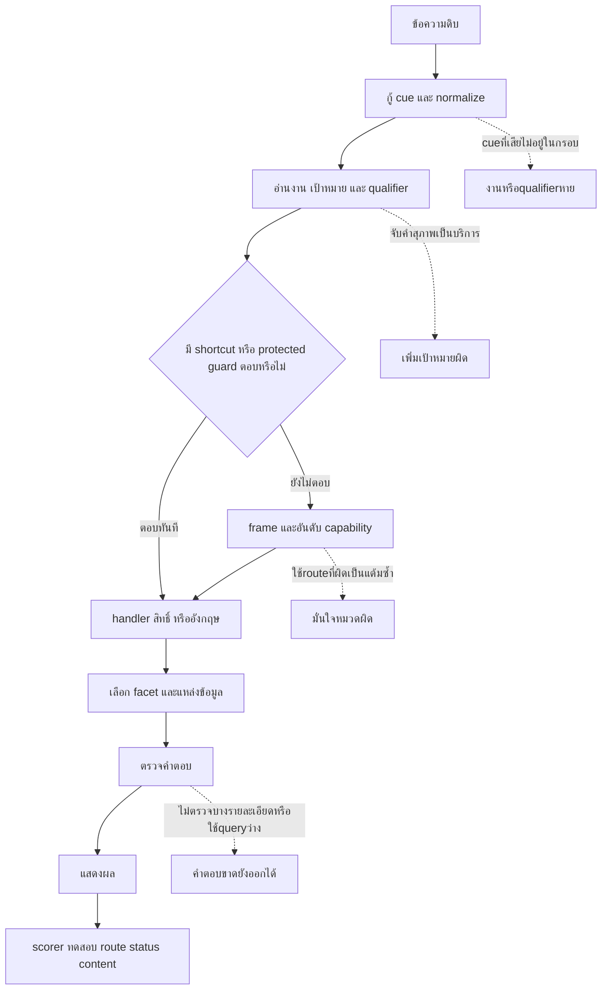

# ทำไม r20 ยังผิด: วิเคราะห์จากคำตอบจริง trace คะแนน และโค้ด

วันที่: 1 ตุลาคม 2026 — การวิเคราะห์หลังส่งมอบ r20 โดยยังไม่เปลี่ยน runtime หรือข้อมูลเจ้าของ

## 1. ข้อสรุปที่หลักฐานรองรับ

ข้อมูลมีอยู่ไม่ได้ทำให้ตอบถูกโดยอัตโนมัติ ระบบต้องอ่าน **งานที่ถาม → เป้าหมาย → รายละเอียด/เงื่อนไข → แหล่งข้อมูล → คำตอบที่ครบ** ให้ตรงกันทุกขั้น ตอนนี้ยังมีทั้งการจับคำแบบตรงตัวหลายจุด การกู้คำที่ครอบคลุมเฉพาะบางกรอบ การเลือก handler ก่อนระบบตรวจส่วนกลาง และเกณฑ์ประเมินที่ยังไม่ตรวจความสัมพันธ์ทั้งหมด

ข้อผิดพลาดรอบนี้ไม่สามารถแก้ด้วยการเพิ่ม alias หรือปรับคะแนนจุดเดียวได้ เพราะบางข้อไม่ได้แพ้คะแนน บางข้อรู้แล้วว่าเป็นราคาแต่ guard อีกจุดเลือกสิทธิ์ บางข้อเลือกหมวดเกมถูกแต่ตัวตอบย่อยตอบ catalog แทน detail และบางข้อปฏิเสธเพราะคำแปล/source ไม่พร้อมอย่างถูกต้อง

งาน r20 ก่อนหน้านี้เป็นการแก้ cue/grammar/compound/booking facets ที่มีหลักฐาน พร้อม negative controls ไม่ได้สร้างตัวเข้าใจทุก operation หรือ global protected-span parser ใหม่ การทบทวน Flowสิบรอบช่วยตรวจแบบและขอบเขต แต่ไม่ได้ทำให้ 345 ข้อที่เหลือหายไปเอง การทดสอบเต็มได้เปิดเผยช่องที่ยังไม่ได้ลงมือแก้

## 2. วิเคราะห์ด้วยอะไร และยืนยันได้แค่ไหน

- ใช้ final frozen r20 ไทย1,000คู่ อังกฤษ1,000คู่ แต่ละคู่มี clean/noisy รวม4,000 inputs
- รันซ้ำ **ทุก noisy ที่ตก345ข้อ** พร้อมคำถามสะอาดเทียบ24ข้อ รวม **369 inputs** เก็บ trace/entities/route/คะแนน/validation/source
- ทุก369ข้อได้ modeและข้อความคำตอบตรงผล final เดิม จึงใช้ traceนี้อธิบายเส้นทางผลเดิมได้ ไม่เอาผลจากรุ่นที่แก้ใหม่มาแทน
- ตรวจ source/tool/fixture hashes ตรง `final_gate_manifest.json` ก่อนและหลัง replay; ปิด LLM answer assist, RAG fallback, live integration และ performance log writer
- เพิ่ม helper probes แยกคำสุภาพ/ชื่อโซน อ่านสถานะ localizationจริง และ profileกรณีช้า ไม่เปลี่ยนโค้ด runtime/GT/ไฟล์เจ้าของ ไม่แตะlogเก่า

ผลรวมทั้งหมดเป็นการจัดประเภทอาการเชิงกล ส่วนสาเหตุเฉพาะกรณีที่อธิบายด้านล่างตรวจด้วย trace+code/source โดยตรง ข้ออื่นเก็บ traceและระบุ root-cause review pending ใน audit ไม่อ้างว่าอ่านสาระทุก345ข้อแล้วรับรองถูก/ผิดโดยคน

หลักฐานใหม่อยู่ `reports/r20_deep_failure_analysis_20261001/`:

| ไฟล์ | ใช้ทำอะไร |
|---|---|
| `failure_statistics.json` | นับทุกข้อจาก final gateเดิม |
| `traces_th.jsonl`, `traces_en.jsonl` + summaries | Replayครบ345 noisy +24 clean พร้อมtraceเต็ม |
| `trace_findings.json` | สรุป branch/คะแนน/validationและcause notesที่ตรวจ |
| `residual_audit_345.jsonl` | รายการ345ข้อพร้อมอาการ คะแนน sourceและสถานะตรวจสาเหตุ |
| `helper_source_probes.json` | ทดสอบ เลย→เพลย์ และสถานะคำแปล/sourceสมาชิก |
| `slow_case_profile.json` | ต้นทุน CPUของกรณีช้า; มี overheadจากprofiling |

## 3. ตัวเลขที่ต้องแยกก่อนเรียกว่า “ผิด”

### 3.1 Clean/noisy ไม่ใช่ปัญหากลุ่มเดียวกัน

| ผลต่อคู่คำถาม | จำนวน | ความหมาย |
|---|---:|---|
| สะอาดผ่าน / ผิดผ่าน | 1,643 | ผ่านเกณฑ์เดิมทั้งสองแบบ |
| สะอาดผ่าน / ผิดตก | **147** | จุดที่คำผิดทำให้ผลตามเกณฑ์แย่ลง |
| สะอาดตก / ผิดตก | **198** | มีปัญหาเดิมแม้ยังไม่เติมคำผิด |
| สะอาดตก / ผิดผ่าน | 12 | คำที่เสียอาจบังเอิญเข้ากฎอื่นที่ผ่าน ต้องอ่านสาระก่อนถือว่าดีขึ้น |

รวม noisyตก345 =147+198 ส่วน noisyผ่าน1,655 =1,643+12 ดังนั้นไม่ใช่345ข้อทั้งหมดเป็นความผิดของ spell correction

### 3.2 345 ข้อจบด้วยพฤติกรรมแบบใด

ใช้ outcome adapter v2ฉบับเดียวกันจัด outputที่ตกเกณฑ์legacy:

| พฤติกรรมสุดท้าย | จำนวน | การตีความที่ถูกต้อง |
|---|---:|---|
| ไม่พบข้อมูล/ยืนยันไม่ได้ | 148 | มีทั้งอ่านcueไม่ถึง ขอบเขต/sourceไม่รองรับ และlabelที่ต้องทบทวน |
| คำแปลอังกฤษยังไม่พร้อม | 92 | ไม่ควรบังคับตอบจากdraftเพื่อให้คะแนนผ่าน |
| ถามกลับ | 58 | บางข้อควรถามกลับ แต่บางข้อถามกว้างจนไม่ได้ช่วยผู้ใช้ |
| ตอบเป็นเนื้อหา | 47 | มีผิดtopic/ขาดfacetจริงและอาจมีบางข้อถูกสาระแต่route/ข้อความเกณฑ์ไม่ตรง; ไม่ใช่47ข้อผิดข้อเท็จจริงทั้งหมด |

92 localization modeแบ่ง domain: กฎแข่งขัน72, อุปกรณ์7, รายการเกม7, ราคา3, compound1, live1, detail1 ใน92นี้ cleanก็ตก81 และ cleanผ่าน/noisyตก11 Modeนี้อาจเป็นอาการปลายทางหลังเลือกงานผิดด้วย เช่น price→rice ไปgame detailแล้วชนtranslation ไม่ใช่92ข้อมีรากเหตุเดียวกัน

### 3.3 Gate ไหนทำให้ตก

| Gateที่ตกพร้อมกัน | จำนวน |
|---|---:|
| สถานะอย่างเดียว | 124 |
| หมวด+สถานะ | 98 |
| หมวดอย่างเดียว | 36 |
| หมวด+สถานะ+เนื้อหา | 34 |
| เนื้อหาอย่างเดียว | 29 |
| สถานะ+เนื้อหา | 18 |
| หมวด+เนื้อหา | 6 |

Gateเป็นอาการ ไม่ใช่จำนวน root causes หมวดอย่างเดียว36ข้อมี19ข้อจบ no_answer และ17ข้อจบanswerตามadapter บางข้อคือการปฏิเสธที่เหมาะสมแต่labelไม่ตรง บางข้อคือหลุดหมวดจริง

## 4. แผนที่สาเหตุจาก input ถึง output

ทุก345ข้อที่ตกมี `intent_cue_preflight=unchanged` ในreplay แปลว่ากฎ preflightชุดใหม่ไม่ได้กู้ข้อความเหล่านี้ ไม่ได้แปลว่า recovererอื่นทั้งหมดไม่มีการทำงาน และไม่ควรกู้ทุกข้อเพราะบางคำที่เสียกลายเป็นคำจริงหรืออยู่ในขอบเขตที่ไม่รองรับ

## 5. สาเหตุที่ 1 — จุดต่าง ๆ อ่าน “งานที่ถาม” ไม่ตรงกัน

### ตัวอย่างราคา: TH-00032

Input: **บุคคลทั่วไป เล่น PC 30 นาที เสียกี่บบาท**

Traceอ่านได้: service=pc, user_group=adult, duration=30_minutes และ **price_intent=true** แต่ `protected_intents._has_price_signal` ตรวจคำ “กี่บาท” แบบตรงตัว จึงได้falseสำหรับ “กี่บบาท” ขณะที่ “บุคคลทั่วไป”+“เล่น” ยังตรง public-access

ลำดับใน `engine.py:1380` เรียก protected guardก่อนการจัดอันดับ แล้วคืนคำตอบทันที:

> บุคคลทั่วไปสามารถจองใช้บริการ PC Zone ได้ …

คำตอบมีข้อมูลsourceรองรับเรื่องสิทธิ์ แต่ไม่ได้ตอบจำนวนเงิน ไม่มีการแข่งขันคะแนนกับcalculatorในข้อผิดนี้ ค่า0.98มาจาก protected branchที่กำหนดไว้ ไม่ใช่การคำนวณว่าเข้าใจเจตนา98%

Cleanคู่กันตอบ70บาทจาก localตารางที่มีอยู่ในระบบสำหรับ30นาที/1session ตัวเลขนี้ใช้เป็น expectedจากsourceปัจจุบัน ไม่ใช่การอนุมัติราคาจริงใหม่จากเจ้าของ

**รากเหตุ:** Entity extractor กับ protected cue detectorใช้คำบอกราคาคนละชุด และ protected guardไม่ใช้ข้อมูล price_intentที่อ่านได้แล้ว **ตัวเสริม:** ตอนคืนคำตอบมี warning `service_fee_answer_missing_service_fee_source` แต่ `validation.ok=true` ไม่มี errorบังคับแก้

**แนวแก้:** ส่ง task/price facetที่ยืนยันแล้วเข้าguard ให้ข้อถามamountไม่ถูกpermissionกลบ; เพิ่มrequired group/amount/duration/unit/source ที่สัมพันธ์กัน ต้องมี negative “บุคคลทั่วไปเล่นPCได้ไหม” เพื่อไม่แก้priceguardจนคำถามสิทธิ์ไปตอบราคา

## 6. สาเหตุที่ 2 — Cue/qualifierเสียแล้วเหลือหมวดกว้างที่แข็งแรงกว่า

### 6.1 PUBGถามสถานที่ แต่ตอบเวลา: TH-01667

`PUBG: BATTLEGROUNDS เล่นได้ทที่ไหน` ไม่ตรง “เล่นได้ที่ไหน” ที่ใช้เลือก availability อย่างไรก็ตามยังมี “เล่นได้” ซึ่งrouterใช้เป็นschedule term (`router.py:754`)

Cleanเลือกgames/availabilityและตอบPC ส่วนnoisyเลือกschedule/schedule_lookup แล้วตอบ09:00–12:00/13:00–16:00แทนสถานที่

คะแนนnoisy: structured.schedule0.926, รองลงมาfast.domain_handlers0.489; margin0.437ชัดมาก แต่domain/operation/frame/toolrouterต่างได้รับอิทธิพลจากcueเดียวที่ผิด แล้วบวกแต้มให้กันอีกหลายครั้ง คะแนนสูงจึงไม่ได้แสดงว่ามีหลักฐานอิสระหลายชุดยืนยันความหมาย

**ควรตอบ:** PUBGเล่นได้ที่PCที่sourceระบุ **แนวแก้:** ระบุspatial operationแม้คำเชื่อมขาด/ซ้ำ โดยใช้ชื่อเกมตรง+คำถามสถานที่เป็นanchor; ไม่ให้ “เล่นได้” เพียงอย่างเดียวเป็นเวลา และล็อก operationร่วมกับtarget ไม่ล็อกชื่อเกมอย่างเดียว

### 6.2 ระยะเวลาVRกลายเป็นรายการอุปกรณ์: TH-01622

`VR Zone รอบละกีน่าที` เก็บVRไว้ได้ แต่operationขอdurationหาย เหลือequipment/list จึงเลือกstructured.equipment0.990 สูงกว่าสchedule0.501และแสดงPS5/VR2

Cleanตอบรอบ30/60นาทีจากsourceเดิม นี่คนละเรื่องกับกติกาที่การใช้VR30นาทีกินช่องavailabilityเต็มชั่วโมง ไม่ควรแก้sessionduration/ราคาปะปนกับslotoccupancy

**แนวแก้:** กู้ qualifierหน่วย/คำถามระยะเวลาแบบมีserviceanchor และบังคับว่าถ้าขอdurationคำตอบต้องมีduration ไม่ผ่านด้วยรายชื่ออุปกรณ์

### 6.3 บ่ายหายแต่ยังอยู่schedule: EN-01405

`afteronon` ทำให้time_slotsว่าง ต่างจากcleanที่มีafternoon ทั้งสองยังจบstructured_schedule_en/confidence0.98 แต่noisyให้ตารางวันทำงานกว้าง ๆ ไม่มี13:00–16:00

**รากเหตุ:** หมวดถูกแต่qualifierหาย — การทดสอบrouteอย่างเดียวตรวจไม่เจอ **แนวแก้:** กู้ time-period qualifierแบบจำกัดบริบท คงวันจริงและmaintenanceไว้ แล้วตรวจช่วงเวลาที่ถามในrequired content

### 6.4 จำนวนsessionหายแล้วตอบวิธีจอง: EN-00531

`How many sessioons can one booking include` ไม่ตรงregex `sessions?` ที่เลือกsessionlimit จึงลงruleขั้นตอนจองทั่วไปconfidence0.99 ทั้งที่คำตอบต้องบอกเพดาน3sessionsตามruleเดิม

**แนวแก้:** เก็บfacet=count/limitของbookingแยกจากsteps ให้จำนวน/หน่วยเป็นrequired fields ไม่ถือว่าreservation categoryเหมือนกันแล้วแทนคำตอบกันได้

## 7. สาเหตุที่ 3 — ตัวจับเป้าหมายเพิ่มบริการที่ผู้ใช้ไม่ได้พูด

### TH-02611: เป็นปัญหาตั้งแต่ข้อความสะอาด

Input: “กำลังวางแผนไปใช้บริการ **เลย**อยากทราบว่า Counter-Strike 2 เล่นได้ที่โซนไหน”

Central targetถูก: Counter-Strike2 exactscore1.0/source PC แต่ตัวตอบstructuredเรียก `_detect_zone` อีกรอบ (`structured_tools.py:852`) ตรวจfuzzyaliasกับข้อความทั้งประโยคที่threshold0.84

Helper probeได้ **เลย→เพลย์ 0.857142857** จึงสร้างzone=PlayStation5 ทั้งที่entities.service=null ไม่มีPS5ในคำถาม ทั้งใส่คำว่า “เลย” เดี่ยว ๆ และ “เลยอยากทราบว่า” ก็ได้PS5 เมื่อเอาคำสุภาพออก probeไม่จับzoneนี้

หลังfilterจึงได้ requested_services=availability_ps5_01_02, matched=false แล้วแสดง “PS5ไม่มีCounter-Strike2” พร้อมที่เล่นPCและcatalogPS5ยาว ๆ ตัวประเมินจับว่าขาดPCZone แต่ปัญหามีมากกว่ารูปข้อความ เพราะระบบสร้างข้อจำกัดPS5เอง

**ควรตอบ:** Counter-Strike2เล่นได้ที่PCZone/เครื่องตามรายการที่มีอยู่ **รากเหตุ:** fuzzywindowไม่มีขอบเขตentityและไม่ได้ถือการไม่มีexplicitserviceเป็นข้อจำกัด; localresolverเลือกaliasแรกที่ผ่านแทนการตรวจscopeกับtargetที่ส่วนกลางยืนยันแล้ว

**แนวแก้:** ใช้entityspanเฉพาะชื่อบริการที่มีหลักฐาน จำกัดfuzzyshortaliasesด้วยcontextและmargin ส่งserviceเดียวกันจากส่วนกลางให้handler ถ้าไม่มีserviceที่ผู้ใช้ถาม อย่าเติมserviceจากคำสุภาพ ต้องเพิ่มnegative “เลย/เลยอยากทราบ/ช่วย/สอบถาม” ในทุกหมวด

กรณีนี้ยืนยันว่าเพิ่มfuzzyมากขึ้นอย่างเดียวอาจเพิ่มข้อผิดพลาดได้ โดยเฉพาะเมื่อgatesอื่นถือว่าentityที่ได้แน่นอนแล้ว

## 8. สาเหตุที่ 4 — หลายงานและขอบเขตบุคคลยังไม่ครบ

### EN-04874

`How many memberss are there, and who is the president`

Regexเฉพาะmembercount (`engine.py:374`) รับmembers? แต่ไม่รับmemberss กฎsplitทั่วไปก็มองส่วนแรกไม่ใช่memberintent ทั้งประโยคจึงผ่านเป็นงานเดียว

ตัวตอบอังกฤษยังจับpresidentได้ และ mappingใน `bilingual_english.py:1605` ระบุ **president→อธิการบดี** จึงตอบชื่ออธิการบดีคนเดียว ไม่มีcount ไม่มีclubscope confidence0.98และvalidationผ่าน

Cleansplitสองงานได้ แต่แรกแสดงรายชื่อแทนจำนวน อีกงานก็เลือกอธิการบดีจากmappingเดิม จึงมีข้อบกพร่องที่legacycleanpassไม่ตรวจพบ การกู้memberssเพียงจุดเดียวจะช่วยแบ่งงานแต่ยังไม่แก้countหรือความกำกวมpresident

ไฟล์member_profilesจริงมีrawrecords25แถว แยกMembers7, internship/cooperative5 และclub13 นี่เป็นจำนวนแถวในsourceที่อ่าน ไม่ใช่คำตอบว่า “สมาชิกศูนย์มี25คน” ที่เจ้าของรับรอง ต้องระบุว่าถามกลุ่มใด ตรวจrecordที่ควรนับ/การซ้ำ และขอบเขตเวลาของsource

**ควรตอบ:** ถ้ายังไม่ชัด ให้ถามว่าหมายถึงclubcommittee, ทีมงานในMembers หรือมหาวิทยาลัย ถ้าระบุกลุ่มให้ตอบcountของกลุ่มนั้น และroleที่ตรงกลุ่ม; ประธานclubกับอธิการบดีเป็นคนละตำแหน่ง ห้ามเลือกเพราะmappingอังกฤษตายตัว

**แนวแก้สามส่วน:** span recoveryของmember operation + tasklistครบ + scope-aware role/count handler พร้อมcontractที่ตรวจ numeric count/group/person/roleสัมพันธ์กัน ไม่ผ่านเพียงมีชื่อสักคน

### TH-04896

ถามราคาPC2ชั่วโมงแล้ว “ของยังไง” ซึ่งถูกสร้างจาก“จองยังไง” ระบบไม่split เหลือคำตอบ140บาทอย่างเดียว ทำให้ส่วนจองหาย แม้ราคาเองถูกตามlocaltable การเรียงข้อความเกณฑ์แบบORระหว่างจอง/เลือก/บริการไม่ได้ตรวจราคาและการจองพร้อมกัน

**แนวแก้:** กู้ operationตามบริบทหลายงานเมื่อtarget/งานก่อนหน้าชัด หรือถามกลับเฉพาะส่วน“ของยังไง”; contentcontractต้องANDทุกtask และไม่ให้คำตอบงานแรกยืนยันว่าทั้งrequestครบ

### EN-04460: คำถามเดียวถูกแยกเป็นสองงานที่ผิด

“Could you cite the T8 rule concerning **competiion equopment and devices**” ขอหัวข้อเดียวเรื่องอุปกรณ์แข่งขัน แต่คำcompetition/equipmentเสียทำให้guardที่คงคำถามกฎแข่งขันไม่ทำงาน แล้วsplitterแยกที่and เหลือส่วนแรกเป็นคำถามกฎที่ตอบไม่ได้ และส่วนที่สองคือ“devices”เดี่ยว ๆ ซึ่งตอบinventoryศูนย์

Traceparentแสดงสองchild: English no_answerกับequipment_catalog_en ข้อนี้คือ**splitเกิน** ต่างจากmemberssหรือของยังไงที่splitไม่พอ การแก้ให้เจอandทุกครั้งจะทำให้ข้อประเภทนี้ผิดมากขึ้น ต้องตรวจว่าandเชื่อมสองoperationหรือเชื่อมสองคำนามในfacetเดียว พร้อมtargetการแข่งขันที่ตรงsource

## 9. สาเหตุที่ 5 — Shortcutsทำให้คำตอบข้ามการตรวจเจตนาส่วนกลาง

จาก345noisyfailed:

- **158ข้อ** มีdecision_candidates traceส่วนกลางในผลreplay
- **187ข้อ** ไม่มีtraceส่วนกลางในผลreplay: อังกฤษ170ข้อที่ตกทั้งหมด +ไทย17ข้อ

ตัวเลขนี้เป็นการมีtraceในresult ไม่ใช่หลักฐานว่าchildไม่เคยจัดอันดับ: ใน187มีmulti_question2ข้อซึ่งparentเก็บเพียงchildsummary จึงต้องอ่านchildpathแยก สำหรับตัวอย่างsinglequestionราคา/offerที่ตรวจ โค้ดยืนยันว่าearlyreturnเกิดก่อนcentralcandidateจริง

การตอบเร็วไม่ใช่ความผิดโดยตัวมันเอง แต่ต้องไม่ตีความว่าคะแนน/validationส่วนกลางตรวจแล้วทุกคำตอบจริง English resolverเป็นลำดับfirst non-None; protectedguardก็คืนก่อนcandidate scorer

### EN-04820 accommodation

Clean “overnight accommodation” เข้ากฎไม่มีข้อมูลบริการค้างคืน Noisy “vernight accommodation” ไม่เข้าexactcueนั้น แต่คำofferยังทำให้equipment inventory signal=true (`bilingual_english.py:1526`) และequipment resolverอยู่ก่อนbroadrulesในลำดับhandler

จึงแสดงอุปกรณ์ทั้งหมด/confidence0.97และคืนที่bilingual route (`engine.py:1507–1537`) โดยไม่มีcentralcandidatecompetition Sourceของinventoryอาจถูก แต่ไม่เกี่ยวกับคำถามบริการที่พัก

**ควรตอบ:** ยังไม่มีข้อมูลยืนยันบริการค้างคืน ไม่ใช้รายการอุปกรณ์แทนหรืออนุมานว่ามี/ไม่มีบริการจากรายการนั้น

**แนวแก้:** ทุกshortcutต้องได้รับparsedtask/target/facetและapplicationcheckเดียวกัน คำoffer/haveอย่างเดียวไม่พอเป็นinventory operation ต้องมีequipmentobjectหรือtargetที่ตรง; เติมOOD/unknown-operationguardก่อนbroadhandler โดยไม่สร้างaliasทุกบริการนอกขอบเขต

## 10. สาเหตุที่ 6 — ได้อันดับถูกแต่ตัวตอบย่อยสร้างคำตอบผิดประเภท

### TH-02476: เลือกgamesถูกแต่จบno_answer

`Counter-Strike 2 คือเกมอะไน` ยังล็อกชื่อเกมได้และเลือกstructured.games0.999 เช่นเดียวกับclean แต่predicateตัวตอบdetailต้องตรง “คือเกมอะไร” (`structured_tools.py:167`) จึงหลุดไปcatalog

Trace:

1. structuredเกมสร้างcatalog
2. validatorจับ `answer_contract_type_mismatch` — ขอfact/detailแต่ได้list/catalog
3. retry_next_candidate เข้าfastanswer_games
4. fastdraftถูกปฏิเสธsource_domain_mismatch
5. hybriddraftถูกปฏิเสธtype/targetmissing
6. จบno_answer

ระบบมีvalidationที่ทำงานจริงในกรณีนี้ เป็นการหยุดคำตอบที่ไม่ตรง; ปัญหาอยู่ตรงที่ข้อมูลdetailซึ่งมีอยู่ไม่ได้ถูกhandlerเลือก เมื่อเพิ่มconfidenceหรือปล่อยcatalogผ่านจะทำให้ตอบมากขึ้นแต่ยังผิดงาน

**ควรตอบ:** detailของCounter-Strike2จากrecordที่ตรงชื่อและfieldที่ถาม **แนวแก้:** ส่งoperation=game_detailกับcanonicaltargetเข้าtool execution ให้ตัวตอบไม่ต้องเดาoperationจากrawอีกครั้ง เพิ่มexplicitfieldreturn และไม่fallbackไปcatalogเมื่อdetailmissing

### EA Sports FC24: TH-02213

ชื่อเกมตรง แต่“คือเดมอะร”เสีย ตัวตอบgenreพบSportsในชื่อเกมแล้วให้รายชื่อเกมSportsทั้งหมวด เรื่องแนวเกมมีsourceจริงแต่ผู้ใช้ถามเกมนี้คืออะไร ต้องแยกชื่อentityออกจากคำบอกtopic ห้ามให้คำในชื่อเกมไปขยายงานโดยไม่มีoperationรองรับ

## 11. สาเหตุที่ 7 — คะแนนที่เห็นไม่ใช่ความน่าจะเป็นว่าคำตอบถูก

### 11.1 สูตรที่ใช้จริง

Capabilityเริ่มbaseเช่นstructured.games0.88, hybrid0.72, calculator0.93 แล้วบวกdomainmatch0.12, answer-type-match0.06, toolaction/domain, frame-domain0.20, operationpriorityและpreconditionboost หาร1.80แล้วจำกัดสูงสุด0.999

ใช้ตัดสิน: top<0.45ห้ามexecute; margin<0.035บางเงื่อนไขถามกลับ ที่สำคัญคือdomain/frame/routerอาจสรุปจากkeywordเดียวกัน คะแนนนี้จึงเป็นการจัดลำดับheuristic ไม่มีการcalibrateให้0.99=ถูก99%

### 11.2 40 ข้อที่ชื่อmodeบอกmargin แต่จริง ๆ เป็นlow score

ทุก40ข้อใน `candidate_margin_clarification` ได้ top=hybrid0.433, runner-up=clarification0.322, margin0.111; selection=`abstain_low_score` ไม่ใช่แพ้เพราะสองอันดับใกล้กัน

ตัวอย่าง TH-04611 “นางาาวกมลวรรณ นวลสาย ทำำแหน่งอะไร” และTH-03829 “ทรัพย์สสินส่วนตัวสูญหาย”:

- งานที่เสียไม่ถูกรู้จัก frameoperationunknown
- generalrouteไม่มีverifiedPSUtarget ทำให้structured.members/structuredอื่นถูกpolicyveto
- hybrid=(0.72+0.06)/1.80=0.433 <0.45 ไม่execute
- จึงถามกลับกว้างว่าเกม/ปุ่ม/ราคา/จอง ทั้งที่usertopicควรเป็นบุคคลหรือทรัพย์สิน

**ควรตอบ TH-04611:** เมื่อยืนยันชื่อที่ตั้งใจได้จากsource นางสาวกมลวรรณ นวลสายเป็นกรรมการ มิฉะนั้นถามชื่อเฉพาะบุคคลนี้ ไม่แก้ชื่อทุกแบบอัตโนมัติ **TH-03829:** ให้policyทรัพย์สินสูญหายจากsourceเดิมเมื่อtopicชัด หรือถามยืนยันtopic

**แนวแก้:** รักษาtopic/partialtargetให้ถามกลับได้ตรง แก้operation/spanและส่งtargetพร้อมsourceก่อนจัดคะแนน ไม่ลด0.45เพื่อให้unknownqueryไปดึงคำตอบทั่วไป

### 11.3 คะแนนfixedของshortcut

Public-access0.98, equipmentEnglish0.97, bookingrule0.99, schedule0.98เป็นค่าของbranch ต่างจากrankingข้างต้น “Verified equipment”หมายถึงrecordsource ไม่รับรองว่าrecordนั้นตอบคำถามนี้ การอธิบายต้องแยกbranchconfidence, ranking score, source trust และsemantic correctness

## 12. สาเหตุที่ 8 — ValidationและGTยังไม่ตรวจความครบทุกทาง

### 12.1 มีvalidatorอยู่ แต่ไม่ครอบคลุมทุกbranch/facet

ทุก345replayสุดท้ายมีvalidation.ok=true ส่วนหนึ่งสมควรผ่านเพราะเป็นsafe no_answer/clarification ส่วนคำตอบผิดtopic/ขาดfacetแสดงช่องที่validationยังไม่รู้ requirement

`engine._build_result:4077` เรียก `validate_answer("", answer, ...)` ด้วยqueryว่าง และ `answer_contracts:225` คืนokเมื่อquestionว่าง จึงยังตรวจsource/language/warningsบางส่วน แต่ไม่สร้างtask/targetcontractจากquestionเดิมในขั้นสุดท้าย บางbranchตรวจเต็มก่อนหน้านี้อยู่แล้ว บางshortcutเริ่มValidationResult(ok=True)แล้วส่งเข้าfinal จึงไม่ผ่านcontent/taskcheckเทียบinputแบบเดียวกัน

อย่าแก้ด้วยการเปลี่ยนwarningทุกตัวเป็นerrorทันที Warningบางตัวใช้กับsafeclarificationและสามารถผิดcontextเอง เช่นservice-fee-warningในคำถามบุคคล ต้องตรวจrequirementsที่ยืนยันก่อนแล้วบังคับเฉพาะข้อสำคัญที่ตรงoperation

### 12.2 “ไม่มีเงื่อนไขตรวจเนื้อหาต้องปรากฏ” หมายถึงอะไร

สมมุติถาม “PC30นาทีบุคคลทั่วไปกี่บาท” แต่contractตรวจเพียงว่าหมวดservice_feeและstatus=answer ถ้าคำตอบพูดค่าบริการทั่วไป ไม่บอกจำนวนเงิน ก็อาจผ่าน การตรวจที่ต้องการคือมีผลราคา กลุ่ม ระยะเวลา หน่วยsession และsourceที่ถูก พร้อมความสัมพันธ์ เช่นกลุ่มนี้ต้องสัมพันธ์กับราคา ไม่ใช่แค่มีเลขใดก็ได้

Frozenlegacy2,000ข้อมีpositivecontract893ข้อ ไม่มี1,107ข้อ (v2overlayเดิมเพิ่มเป็น894) โดยใน1,570ข้อที่expected=answer_available มี **742ข้อไม่มีpositivecontentcondition**; อีก828มีอย่างน้อยบางcondition แต่ไม่ได้หมายความว่าครบทุกรายละเอียด

ตัวอย่าง contract TH-00032ให้ORระหว่าง “General Adult” กับ “0บาท” ทั้งที่คำถามบุคคลทั่วไปตามlocaltable70บาท เงื่อนไขนี้ยังไม่ได้บังคับ70/group/sessionสัมพันธ์กัน การพบGeneralAdultในตารางรวมอาจผ่านโดยไม่ตอบamountที่ถาม

EN-04874cleanผ่านเพราะไม่มีเงื่อนไขnumericcount/group/roleperson แม้ตอบรายชื่อแทนจำนวน จึงมีfalse passอยู่ใน1,790cleanที่ผ่านด้วย ต้องไม่เรียก1,790ว่าsemantictruthครบ1,790ข้อ

### 12.3 False failและcandidate labelต้องแยก

- TH-03957เรื่องอัดวิดีโอจบsafe no_answerตรงstatus แต่categorygeneralไม่อยู่ในexpectedroutes → routefail ไม่ควรแก้ให้แต่งpolicyอัดวิดีโอ
- TH-04944ขอแปลreservation: expectedno_answerแต่requiredคำ“จอง”; clean/noisyปฏิเสธมาตรฐานเหมือนกันแต่ไม่มีคำนั้น → contract/scope/echo requirementต้องreview
- EN-03401ถามรุ่นPS5controller: equipmentrecordที่เลือกไม่ระบุรุ่น handlerบอกยืนยันไม่ได้ แต่GTคาดanswer_availableและไม่มีcontentcontract → อย่าอนุมานDualSenseจากproductknowledgeแทนการยืนยันเครื่องจริง
- EN-01715/02394/02255/04891มีplay→payหรือPrice→riceที่เป็นคำจริง → syntheticlabelรู้คำต้นฉบับ แต่runtimeไม่รู้ความตั้งใจuser ต้องถามกลับหรือใช้context ไม่บังคับให้ตอบตามคำต้นฉบับทุกกรณี

## 13. สาเหตุที่ 9 — มีข้อมูลไทย แต่ไม่มีคำแปลที่ใช้ได้ในrelease

EN-04469ถามกฎข้อพิพาทTekken8 ทั้งcleanและnoisyเลือกcard `competition_rules_tekken8_psu_esports_s08_c01` ได้ มีtextไทยจริง แต่helperตรวจactive registryได้text=missingและsection_title=missing จึงlocalization_pendingตั้งแต่clean

ระบบใช้translationที่statusapproved มีapproved_by/at และhashตรงsource ปิดdraftpreview Sourceไทยครบ, มีdraftแปล, มีapprovedrelease และfieldที่handlerต้องการครบเป็นคนละสถานะ ถ้าsourcehashเปลี่ยน approvedเก่าก็staleได้

**ควรตอบขณะยังไม่พร้อม:** แจ้งคำแปลที่ยืนยันยังไม่พร้อม พร้อมsource/ช่องทางยืนยัน **แนวพัฒนา:** ทำmatrixตามcontent_id+field+sourcehash+release+status ตรวจcoverageเฉพาะfieldที่ต้องใช้และsemanticrelationในคำแปลก่อนpromote ไม่แก้label/เปิดdraftเป็นapprovedเพื่อเพิ่มเปอร์เซ็นต์

## 14. สาเหตุที่ 10 — คำผิดทำให้fallbackวนงานซ้ำและช้า

TH-02476 fullgateเดิมสูงสุด15.1089s Replayใหม่withoutprofiler6.242s ซึ่งdeterministicstageใช้5.126s ก่อนfallbackอื่น ไม่มีการดึงWordPressหรือLLManswerในprobeนี้

Singlewarmup+cProfileพบ:

- normalize_text5,300calls
- _fuzzy_replace_keyword55,459calls
- _ratio266,194calls
- fastanswer_games/_match_all_game_details/_game_alias_matchวนตรวจเกมหลายรายการ แม้centralexacttargetเป็นCounter-Strike2แล้ว
- hybrid/vectorfallbackเรียกentityscore/normalizationจำนวนมากอีกครั้ง

เวลาตัวprofile43.032sมีoverheadสูง **ไม่ใช่เวลาใช้งานปกติหรือเวลาrequest15.1sเดิม** cumulativetimesซ้อนparent/childกัน ห้ามบวกแต่ละรายการเป็นtotal ข้อที่ยืนยันได้คือค่าCPUเกิดจากnormalize/fuzzymatchingซ้ำในfallback path โครงสร้างนี้ทำให้ข้อความที่detailcueเสียแพงกว่าการอ่านfieldจากtargetตรง

Profilingprobeยังจบno_answerแม้ตั้งglobal20s แสดงว่าการตรวจdeadlineระหว่างstageไม่สามารถตัดlongloopได้ทุกจุดในrunนี้ ไม่ได้แปลว่าAPIproductionทุกคำถามเกิน20s ต้องแยกpipelinecooperativechecksกับHTTPworkerdeadlineและทดสอบbudgetตรงจุด

**แนวแก้:** ใช้canonicaltarget/operationเดียว ส่งต่อโดยไม่scanalltitlesซ้ำ cacheผลnormalize/sourcefeaturesต่อrequest จำกัดrepair/fallbackตามmissingfacetและcost ตรวจdeadlineในlongloops และหยุดพร้อมreasonที่ถูก ไม่ขยายtimeoutเพื่อกลบต้นทุน

## 15. ทำไมภาษาไทยในระบบนี้ยังเปราะในหลายกรณี

หลักฐานจากimplementationแสดงว่าไทยใช้substring/ช่วงตัวอักษรและanchorเช่น“มีเกม/ราค/จองยังไง/กี่บาท”หลายตัว เมื่อ“ที่ไหน/กี่นาที/แพงกว่า/ทรัพย์สิน”เสีย cueย่อยอาจหายทันที ขณะที่ส่วนทั่วไป“เล่นได้/โซน/บุคคลทั่วไป”ยังจับอยู่ จึงเลือกผิดtopicหรือqualifierง่าย

ไทยไม่ได้แบ่งคำด้วยspaceทุกคำ Fuzzywindowแบบcompactในโค้ดปัจจุบันจึงอาจข้ามขอบเขตคำอย่าง“เลย→เพลย์”ได้ อีกด้านintentcueใหม่ก็จำกัดเฉพาะกรอบเพื่อกันfalsecorrection ทำให้คำสำคัญที่ยังไม่อยู่ในกรอบไม่ถูกกู้

นี่เป็นคำอธิบายจากcodeและprobeของระบบนี้ ไม่ใช่ข้อสรุปว่าภาษาไทยทุกระบบแย่กว่าอังกฤษ บางปัญหาอังกฤษเป็นรูปเดียวกัน เช่นmemberss/sessioons/afteronon และไทยholdoutใหม่มี30ข้อเทียบอังกฤษ166ข้อ จึงไม่ใช้holdout100%รับรองไทยครอบคลุมเท่ากัน

Languagequality/n-gramก็เป็นคะแนนความเป็นข้อความภาษา ไม่ใช่ความถูกต้องของtask หนึ่งคำผิดสำคัญในประโยคยาวอาจยังได้languagequalityดี ตัวอย่างTH-04611ประมาณ0.664และTH-03829ประมาณ0.752 จึงไม่ได้ร้องให้reviewintentทั้งที่operationหาย ต้องตรวจtaskuncertaintyแยกจากความลื่นไหลของภาษา

## 16. คิวแก้จากเหตุที่พิสูจน์แล้ว พร้อมเกณฑ์ตรวจ

| ลำดับ | งาน | เกณฑ์ผ่านที่จำเป็น |
|---|---|---|
| P0 | Task/facet/targetเดียวกันทุกshortcutและhandler | priceไม่หลุดpermission, detailไม่แทนcatalog, durationไม่แทนอุปกรณ์; negativeคนละความหมายต้องคงเดิม |
| P0 | กันimplicitserviceจากคำสุภาพและOODbroadhandler | เลยไม่สร้างPS5, accommodationไม่ให้inventory; explicitservice/deviceยังตอบถูก |
| P0 | ตรวจcompletion/source/relationตอนreturnทุกbranch | ใช้question/frameจริง ตรวจANDทุกtask และamount/group/unit/count/roleที่สัมพันธ์กัน; safeclarification/noanswerไม่โดนfalseblock |
| P1 | สมาชิกcount/rolescopeและmultipleoperations | countตามกลุ่ม, presidentแยกclub/university; memberssไม่ทำให้งานแรกหาย |
| P1 | Spanrecoveryของoperation+qualifierเพิ่มแบบมีcontext | กี่บาท/ที่ไหน/กี่นาที/แพงกว่า/sessionlimit/timeperiod/policytopic; คู่clean/noisyและคำจริง/negation/identifierต้องตรวจ |
| P1 | Case-label/contentcontractsที่reviewได้ | เติม742answercontractsที่ขาดเป็นชุดย่อย; แก้relative scope/falsefailอย่างมีหลักฐาน ไม่แก้scoretargetให้ผ่านโดยไม่อ่านคำตอบ |
| P2 | Englishfieldcoverageตามactive release | id/field/hash/statusครบ sourceเดิมไม่เปลี่ยน; draftกับapprovedชัด |
| P2 | จำกัดfallbackcost/normalizeซ้ำ/loopdeadlines | targetexactไม่scanทุกเกมใหม่, costของmissมีเพดาน, APItimeoutกับpipelinebudgetตรวจแยก |
| เมื่อพร้อม | WordPressoracle/humanevaluation | รู้สถานะจริงแต่ละเครื่อง/ช่วงเวลา ไม่ใช้HTTP200/fixturepassเป็นbookingtruth |

P0ในตารางเป็นลำดับถัดไปตามผลวิเคราะห์ ไม่ใช่รายการที่ลงมือแก้เสร็จแล้วในรอบนี้ งานรอบนี้เก็บหลักฐานใหม่และรายงาน เพื่อให้แก้โดยรู้ว่าจุดใดควรบังคับและจุดใดควรคงการถามกลับ

## 17. สิ่งที่รับรองได้กับสิ่งที่ยังไม่รู้

รับรองได้ว่า345noisyfailและ24cleanprobeเกิดเส้นทาง/คำตอบเดิมซ้ำภายใต้config/sourceที่ตรวจ; rootcauseสำคัญด้านcue mismatch, politefalseentity, earlyreturn, missingfacet, scorethreshold, validatorgap และmissinglocalizationมีcode/probeรองรับ

ยังไม่รับรองว่า345ทั้งหมดผิดสาระ หรือข้อที่ผ่านทั้งหมดถูกครบ ไม่รับรองhumanapproval/realWordPress/currentdata ทุกเคสชื่อบุคคล/คำจริงที่กำกวมยังต้องใช้contextหรือถามกลับ กรณีช้าเดิม15.1sไม่มีoriginalstagetrace จึงใช้profile/replayอธิบายpathต้นทุนได้แต่ไม่ฟันธงwalltimeเดิมทุกมิลลิวินาที

การแก้ควรเริ่มจากความตรงกันของtask/target/facetและvalidationครบทุกreturnpath เมื่อพื้นฐานนี้ยังไม่ตรง การเพิ่มspellrecoveryหรือเปิดmodelเพิ่มจะเปลี่ยนจำนวนคำตอบ แต่ยังไม่พิสูจน์ว่าตอบเรื่องที่ผู้ใช้ถามได้ครบและถูก
