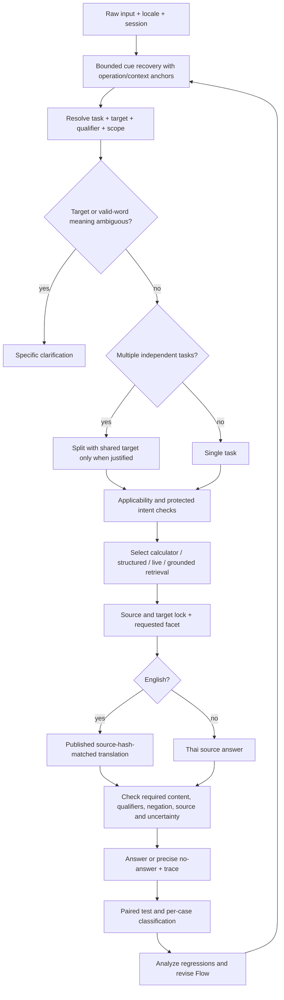

# Flow การแก้ความเข้าใจคำถามและภาษาอังกฤษ — r21

วันที่ 1 ตุลาคม 2026; ต่อจาก r20 โดยรักษา source, GT, log และแพ็กเกจเดิม

## 1. หลักฐานตั้งต้นและขอบเขต

ผู้ใช้อนุญาตให้แปลและตรวจภาษาอังกฤษโดยผู้ช่วยในแชทนี้ การตรวจคำแปลนี้ไม่ใช่การอนุมัติราคาหรือนโยบายโดยเจ้าของศูนย์ ไม่ใช่ผลประเมินจากคน และไม่ให้นำชื่อบุคคลไปแต่ง romanization

- r20: clean 1,790/2,000; noisy 1,655/2,000 ตาม frozen legacy contract
- noisy ตก 345: no_answer 148, localization_pending 92, clarification 58, answer 47
- replay 369 inputs ได้ mode/answer ตรง r20 ทั้งหมด หลักฐานใน `reports/r20_deep_failure_analysis_20261001/`
- 147 คู่เป็น clean ผ่าน/noisy ตก; 198 คู่ตกทั้ง clean/noisy จึงมีข้อผิดที่ไม่ได้เกิดจาก typo
- ทะเบียน runtime ภาษาอังกฤษเดิมว่าง 0 records; มี draft 615 fields แต่ draft บางข้อแปลผิดจริง เช่น กรรมการเป็น Chairman และชื่อมหาวิทยาลัยผิด
- บางผลไม่มี positive content gate จึงต้องใช้ source-supported pilot ตรวจงาน เป้าหมาย ตัวเลข และเงื่อนไขเพิ่มเติม เก็บ GT เดิมไว้

## 2. ลำดับแก้และเหตุผล

| ลำดับ | หมวด | รากเหตุ/ตัวอย่าง | สิ่งที่จะทำ | เกณฑ์ผ่าน |
|---|---|---|---|---|
| P0.1 | เป้าหมายและขอบเขตผิด | เลย→เพลย์; offer accommodation→catalog | exact zone ก่อน; fuzzy เฉพาะ token/บริบทบริการ; object gate | CS2→PC; คำสุภาพไม่สร้าง PS5; OOD ไม่ตอบ inventory |
| P0.2 | เลือกงานผิดก่อนจัดอันดับ | กี่บบาท→permission; เล่นได้ทที่ไหน→schedule | cue recovery มี anchor; price guard อ่าน facet ที่ extractor ยืนยันแล้ว | amount/unit/source ถูก; permission negatives ยังตอบสิทธิ์ |
| P1.1 | รายละเอียดหาย | sessioons, afteronon, คือเกมอะไน, รอบละกีน่าที | recover operation/qualifier ไม่เปลี่ยนชื่อ/ตัวเลข; ใช้ operation ที่ยืนยันได้ | session limit, afternoon, game detail, duration ครบ |
| P1.2 | แยกหลายงานผิด | memberss…president; equipment and devices | recovery ก่อน splitter; แยกเมื่อมีงานอิสระทั้งสองด้าน; noun phrase เป็นงานเดียว | ไม่รวม/ตัดงานโดย and อย่างเดียว |
| P1.3 | อังกฤษ source มีแต่เผยแพร่ไม่ได้ | 92 localization symptoms | แปล/review/source hash; แก้ draft ที่ผิด; release ใหม่พร้อม reviewer=assistant | ไม่มีเลข/ข้อห้าม/เงื่อนไขเปลี่ยน; ไม่ปลอม human review |
| P2.1 | คำจริงที่กำกวม/อ้างถึงลอย ๆ | pay/play, price/rice, อันนี้ | ถามตรงส่วนที่กำกวม; ไม่บังคับแก้คำจริง | ไม่เปลี่ยนความหมายเพื่อให้ GT ผ่าน |
| P2.2 | คำตอบตรวจไม่ครบ/trace ไม่ครบ | return ก่อน central rank; query ว่างใน validation | เพิ่ม applicability/evidence ใน path ที่แก้; audit source/operation/qualifier แยกจาก confidence | สามารถอธิบายว่าเลือกอะไรด้วยหลักฐานใด |
| P2.3 | CPU/latency | fuzzy ซ้ำหลังมี exact target | profile/เปรียบเทียบ affected case ก่อนเปลี่ยน; ไม่ลด threshold | content ไม่ถอย; latency อยู่ในงบเดิม |
| รอหลักฐาน | source/label/เจ้าของ | จอย PS5 รุ่นไม่ระบุ, policy sign-off, real booking oracle | แยก source gap/label review ออกจาก runtime defect | ไม่แต่งข้อมูล, ไม่อ้าง API สำเร็จ=สถานะถูก |

## 3. Flow รวม

Recovery มีงบไม่เกิน 3 spans/4 edits ต่อ call และไม่แตะ URL/ชื่อ/วันที่/ราคาเพื่อเดา ความมั่นใจ fixed ของ shortcut ไม่ใช่ probability ต้องรายงานเป็น branch confidence

## 4. วงรอบที่ทำจริง

1. **รอบ A — P0**: เก็บ baseline/hash; เปลี่ยน target/applicability/price; pilot ที่ตรวจ source และ negative controls; อ่านข้อถอยทุกข้อ
2. **รอบ B — operation/qualifier**: เพิ่ม contextual recovery; ทดสอบ clean/noisy และ compound/noun coordination; แก้เฉพาะสาเหตุที่ trace รองรับ
3. **รอบ C — English**: ตรวจ draft เทียบ Thai; แก้เลข ชื่อองค์กร บทบาท ข้อห้าม ข้อยกเว้น; audit local model เป็นหลักฐานช่วย ไม่เรียกว่า human semantic review; กักข้อกำกวมหรือ source ไม่รองรับ; publish immutable release ใหม่
4. **รอบ D — รวม**: รันชุดเดิม 1,000 TH +1,000 EN pairs, scorer เดิมและ v2 แยกตาราง; วิเคราะห์ improved/regressed/unresolved ราย case; focused regression/source integrity; ทบทวน Flow จากผลจริง

หยุดการแก้ในรอบนี้เมื่อได้การเปลี่ยนที่ทดสอบพอและสรุปงานคงเหลือชัดเจน ไม่อ้างว่าระบบเข้าใจข้อความทุกชนิดหรือทุก failure ถูกตรวจโดยคน เก็บ run ก่อนแก้ทุกครั้ง; ไม่ใช้ elapsed time เป็น permission

## 5. การตรวจแบบก่อนลงมือ 10 ครั้ง

| ครั้ง | ช่องที่ตรวจพบ | สิ่งที่ปรับใน Flow |
|---|---|---|
| 1 | 345 symptoms ไม่เท่ากับ 345 typo defects | แยก clean/noisy และ outcome |
| 2 | ความเสียหายจาก wrong target สูงกว่าข้อ no-answer | ให้ target/applicability เป็น P0 |
| 3 | guard คืนก่อน ranking | ใช้ shared facet; ไม่แก้ด้วยลดคะแนน |
| 4 | score ใช้ domain/frame ซ้ำจาก cue เดียว | ใช้ source-supported required content ไม่แปล confidence เป็น accuracy |
| 5 | draft hash ตรงยังแปลความหมายผิดได้ | semantic + number/condition review |
| 6 | แปลชื่อคนอาจสร้างชื่อที่ไม่เคยยืนยัน | เก็บชื่อ source เดิม; กัก romanization |
| 7 | and เชื่อมทั้ง noun และคำถาม | ต้องมี independent operations |
| 8 | แก้ pay เป็น play ทำลายคำถามจริง | specific clarification และ real-word negatives |
| 9 | GT เดิมมี label/source gap และ content gate ขาด | comparable frozen GT + additional source-supported gates |
| 10 | คำแปล/โค้ดใน source อาจไม่ตรงชุดที่คนเปิด | release manifest ใหม่; แจ้ง path ที่ใช้และตรวจไฟล์จริง |

การทบทวนแบบสิบครั้งไม่ใช่สิบรอบทดลอง ผลรันทดสอบและการทบทวนหลังทดลองจะบันทึกต่อท้ายพร้อมตัวเลขจริง

## 6. วงรอบทดลองและสิ่งที่พบจริง

| รอบ | สิ่งที่ทำ/ทดสอบ | ช่องที่พบ | การปรับจากหลักฐาน |
|---|---|---|---|
| A | target/applicability/price + pilot/unit | กู้คำ “คืออะไร” กว้างไป | ใช้ anchor และรักษา operation ที่สะอาด |
| B | operation/qualifier + semantic negatives | recovery รอบสองเปลี่ยน duration เป็น price และ session(s) ไม่คงเดิม | จำกัด context; valid-word/idempotence checks |
| C | review/publish English590; full TH/EN | clean1871/noisy1759; testเก่าคาด registryว่าง; Englishroleทำ identifierไทยหาย | ทดสอบ missing localization ด้วย mockNoneเฉพาะกรณี; เก็บชื่อ+บทบาทไทยกำกับ |
| D | contextual member/age/team; compound/ambiguity | clean1872/noisy1764; CS2 in-march ได้แต่หัวข้อ; ของยังไงยังถูกpreprocessแก้เป็นจอง | เพิ่ม specific phase clarification; guardอ่านraw |
| E | full Thai1000 (สองส่วนไม่ทับกัน), full English1000; HTTP preparation | fieldชื่อผิดสองส่วนทำคะแนนเดิมถอย; expanded source testพบ pause subtypeปะปน | คงชื่อที่ยังยืนยันไม่ได้; ไม่ใช้ directoryทั้งชุดทำคะแนน; ตรวจชนิดpause |
| F | EN1000ซ้ำหลัง subtype/untargeted-rule fixes; source tests+package HTTP | scoreV2คาดlocalization_pendingหลังpublish; ข้อ unknownยังมีหลายชั้น | แยก locale lifecycle mismatchจากcontentผิด; ไม่แก้GTเก่าเพื่อกลบ |

Final: clean **1872/2000**, noisy **1763/2000** (TH843 + EN920); noisyดีขึ้นสุทธิ108จากr20 แก้ได้109ข้อเดิมและมี1legacy regressionที่วิเคราะห์ไว้; frozenV2 noisy1647เทียบเดิม1608 ไม่มีexceptionหรือlatencyเกิน20sในชุดนี้ รายละเอียดทุกfailureเดิม345ข้อและผลใหม่อยู่ `analysis_final/per_case_analysis_345.md` ไม่อ้างว่าทุกข้อถูกตรวจความหมายโดยคน

ผลที่คะแนน D สูงกว่า finalหนึ่งข้อไม่ได้ใช้แทน final เพราะ D ตอบหัวข้อแทนขั้นตอนในคำถามกำกวม การถาม phaseในfinalมีหลักฐานดีกว่า แม้labelเดิมยังคาด answer

## 7. ทบทวน Flow หลังทดลองอีก 10 จุด

| ตรวจ | สิ่งที่หลักฐานใหม่บอก | ข้อกำหนดใน Flow ฉบับนี้ |
|---|---|---|
| 1 | source-hashตรงยังแปลกรรมการ/องค์กรผิดได้ | semantic review และtranslation unit gatesต้องมี |
| 2 | audit modelผ่าน213ไม่เท่ากับgold | review590ใหม่พร้อมprovenance; ไม่publishผลaudit213 |
| 3 | ชื่อไทย23ช่องไม่มีEnglishspellingทางการ | คงชื่อsource; holdromanization; แปลroleได้ |
| 4 | ชื่อบุคคลผิดทำdirectory25คนผ่านany-keyword | person binding+role relation; unknownไม่ตอบทุกคน |
| 5 | guardที่อ่านcleanqueryเห็นguessไปแล้ว | raw/candidateคู่กันจนถึงambiguitycheck |
| 6 | procedureheadingไม่ใช่ขั้นตอน | เมื่อphaseไม่ชัดถามเฉพาะphase; evidenceต้องมีproposition |
| 7 | pause_timeoutรวมtechnical/tactical/emergency | qualifier/subtypeต้องมีsourceheadingตรงก่อนrank |
| 8 | ภาษาอังกฤษพร้อมแล้วแต่frozenoverlayยังคาดpending | evalversionต้องผูกlocale release/hash; เก็บoldscore |
| 9 | ตารางและfree/bookedยังปะปนบางcase | calendar/liveต้องคนละevidence; API200ไม่ใช่truth |
| 10 | enginegateไม่เท่ากับหน้าเว็บ/ownerLLMprofile | package HTTP+guardผ่าน28; LLMprofile/realoracleแยกpending |

## 8. สถานะขั้นตอนใน diagram และงานรอบถัดไป

ขั้น recovery/applicability/ภาษาอังกฤษ/compound/subtype ใน path ที่รายงานถูกลงมือแล้ว **ขั้น N เป็นข้อกำหนดรวมที่ยังทำไม่ครบทุก return**: finalizerบางจุดยังใช้queryว่าง และpositivecontentcontractเดิมขาด1,107คู่ จึงย้ายการรวมtask+target+qualifierและsemantic final contractขึ้นเป็น **P0ของรอบถัดไป** ตาม `docs/121_r21_integrated_results_and_failure_priorities_20261001.md`

ทำต่อได้เอง: globaltask/evidencecontracts, versionedlocale/outcomeoverlay, sourcehierarchyprojection, negativecontrols, cue/object/roleframes, APIownerprofiletests งานที่ต้องมีเจ้าของ/ข้อมูลจริงเป็นsourcecontradictionรุ่นจอย/recordingpolicy/officialspelling/realbookingoracleที่ระบุคำถามไว้ในreport121

ไม่rebuild vectorindexในรอบนี้; runtimeEnglishstructuredใช้releaseใหม่และมีRAGprojectionเก็บไว้ การผ่านdeterministic/HTTPprofileที่ปิดLLMassistไม่รับรองRAG/LLMownerprofileทั้งหมด

แพ็กเกจใหม่: `owner_local_delivery_20261001_integrated_r21/PSU_Esports_Chatbot_Local`; รุ่น `2026.10.01-integrated-r21`; source/GT/fixture154ไฟล์เดิมไม่เปลี่ยน; 8localeเก่าคงhash; 20backupsคงhash; runtime/locales124ไฟล์ในpackageตรงproject เก็บผลล้มเหลวA–Fและlogเก่าทั้งหมดไว้ Testserver8096ปิดแล้ว และโปรเซสเดิม8095ไม่ถูกแตะ
