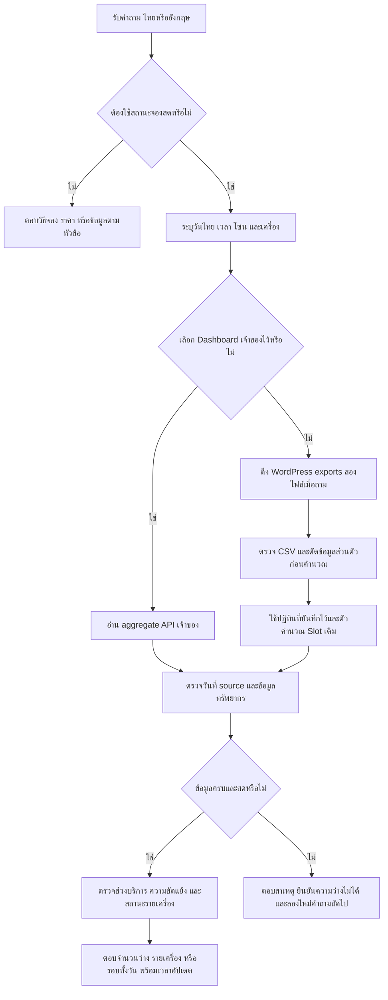

# r22: ดึง Booking เมื่อมีคำถาม

วันที่: 1 ตุลาคม 2026 (Asia/Bangkok)
เวอร์ชัน: `2026.10.01-on-demand-booking-r22`
เว็บที่เปิดให้ทดลอง: http://127.0.0.1:8090/

## สิ่งที่เปลี่ยน

- คำถามว่าง/ถูกจอง/จองได้ไหม/รอบที่จองได้ ดึง WordPress CSV ใหม่เมื่อมีคำถาม โดยใช้ตัวคำนวณ Slot เดิมของ Dashboard
- ชุด Chatbot อย่างเดียวไม่ต้องเปิด Dashboard แยก ไม่ต้องใช้ `start-dashboard.bat` และไม่เปิด process Dashboard เพิ่ม
- หากเปิด Dashboard เจ้าของที่ 8080 ก่อน Chatbot จะเลือก aggregate API ของตัวนั้น เพื่อใช้ปฏิทินเจ้าของที่แก้ไว้ ไม่สลับไปปฏิทินของแพ็กเกจเองเมื่อ Dashboard ล่ม
- Launcher ไม่ปิดความสามารถ Booking ถาวรเพราะแหล่งข้อมูลยังไม่พร้อมตอนเริ่ม ครั้งถัดไปที่ถามจะลองใหม่
- Cache ใน launcher เป็น 0: ทุกคำถามสถานะดึงใหม่ ไม่ใช้ snapshot จากคำถามก่อนหน้า
- วิธีจอง ราคา ระยะเวลาของรอบ และรายการอุปกรณ์ใช้เส้นทางข้อมูลที่เกี่ยวข้อง ไม่ถูกคำว่า booking ดึงไปตอบสถานะว่าง
- คำถามรอบจองทั้งวันแสดงหลายช่วงเวลา; คำถามตอนนี้หรือระบุเวลาตอบช่วงที่ถาม พร้อมรายเครื่องเมื่อถามทั้งโซน
- ความผิดพลาดแยก network permission, timeout, WordPress unavailable, non-live data, invalid export/payload และปฏิทินไม่พร้อม ทั้งไทยและอังกฤษ

## Flow

## การรักษาข้อมูล

ตัวเชื่อมต่ออ่าน export ในหน่วยความจำและตัดชื่อผู้จอง email โทรศัพท์ token และ appointment ID ก่อนส่งแถวให้ตัวคำนวณ ไม่บันทึก CSV ดิบ ปฏิทินต้องมีและอ่านได้ ไม่สร้างไฟล์เริ่มต้นเองหากหาย ตัวเชื่อมต่อส่งเข้าสู่ Pipeline เฉพาะสถานะรวม ไม่มีการเขียนจอง/ยกเลิก/hold/จ่ายเงิน

แก้แบบเจาะจงจากสถานะไฟล์จริง สำรอง 8 ไฟล์ก่อนเริ่มและเพิ่มสำรอง `protected_intents.py` ก่อนแก้ ไม่ reset Git ไม่ลบ log สร้างแพ็กเกจ r22 แยกจาก r21 แพ็กเกจเก่าและประวัติของผู้ใช้ยังอยู่ที่เดิม ผล hash ตรวจข้อมูลปฏิทิน/curated/locale/ตัวอย่างเดิม 30 ไฟล์ไม่มีการเปลี่ยน

## ผลทดสอบที่ยืนยันได้

- 48 test methods ด้าน adapter, fixture ที่รู้ผล, pipeline, typo และขอบปฏิทิน ผ่านทั้งหมด
- 38 test methods ด้าน routing/ราคา/นโยบายและการแก้ก่อนหน้า ผ่านทั้งหมด
- Fixture ยืนยัน booked, cancelled, no-show, VR 30 นาทีเต็มชั่วโมง, พัก 12:00-13:00, วันปิดเจ้าของ, ข้อมูลไม่ครบ, sample, วันที่ผิด, retry และความเป็นส่วนตัว
- API ของแพ็กเกจจริงผ่าน 6/6 ทั้งก่อนและหลังสลับเว็บ คำถามสด 4 ข้อมี trace `source=remote_csv_live`, `transport=wordpress`, `cached=false`
- หยุด Dashboard ที่ Agent เปิดไว้และทดสอบเว็บจริงอีกครั้งบน 8090: ยังตอบสดได้ โดยไม่ใช้ Dashboard process
- คำถามวิธีจองและราคาผ่านเส้นทาง static/structured และไม่มี live-booking trace
- ระยะเวลาคำถามสถานะสดในรอบสุดท้าย: 1.00–2.91 วินาทีบนเครื่องนี้ รวมเครือข่ายและ Pipeline เป็นการทดสอบแบบเรียงคำถาม ไม่ใช่ SLA/ผล load test
- โค้ด app ในแพ็กเกจตรงกับ source ทุกไฟล์ที่ตรวจ

## วิเคราะห์รอบที่แก้ระหว่างทดสอบ

1. รอบ A: พบ weekly-schedule guard รับคำถามช่วงจองวันนี้ก่อน adapter แก้ให้คำถามที่ระบุวันปัจจุบันและขอดู Slot ไปทางสด อีกหนึ่ง fail เป็นคำคาดหวังใน fixture test: renderer ตอบ `ไม่ว่างตลอดช่วง` ถูกความหมาย แต่ test เดิมคาด literal `ถูกจอง`; เก็บ log และแก้ test ใหม่ที่เพิ่งสร้าง ไม่แก้ Ground Truth เดิม
2. รอบ C: พบรูปแบบอังกฤษ `What PC slots...` ยังไม่ตรง helper และ `Which slots...now` ถูกแสดงทั้งวัน แก้การจับคำระบุโซนและรักษาคำถาม now เป็นช่วงปัจจุบัน รอบ D ผ่าน 48/48
3. HTTP candidate ครั้งแรก: คำตอบถูก แต่ตัวตรวจไม่ได้ส่ง debug และอ่าน query_debug ที่มีเฉพาะ preprocess จึงไม่มี live trace แก้ตัวตรวจให้ขอ debug และอ่าน trace จริง เก็บไฟล์เดิม แล้วรัน candidate_B และ final ใหม่ผ่าน 6/6
4. ตรวจคู่มือหลัง build พบประโยคเดิมว่าเรียกเฉพาะ Dashboard API แม้เพิ่มเส้นทางตรงแล้ว แก้คู่มือ source และแพ็กเกจ พร้อมเก็บฉบับก่อนแก้แยก

## สิ่งที่ยังไม่ยืนยัน

การเชื่อม WordPress สำเร็จและ fixture ถูกต้อง แยกจากการยืนยันสถานะทุกเครื่องของระบบเจ้าของจริง งาน independent owner oracle ยังถูกพักตามคำขอผู้ใช้ การดึงสดหมายถึง export ล่าสุดที่ WordPress เผยแพร่ ไม่ได้สร้าง direct database API หรือเปลี่ยนรอบ export ของ plugin ไม่รับรองการตอบพร้อมกันหลายผู้ใช้หรือความผิดพลาดภาษาอื่นทั้งหมดของ r21

## หลักฐาน

ผลรอบนี้: C:\Users\Chokhun\Downloads\Learn-LLM\18_PSU_Esports_Update_Route_Data\reports\r22_on_demand_booking_20261001_e667148c
- `booking_tests_A.log` ถึง `booking_tests_D.log`
- `routing_regressions_final.log`
- `http_candidate.json`, `http_candidate_B.json`, `http_final_dashboard_off.json`
- `integrity.json`, `completion.json`, `before/`, `owner_data_manifest.json`

แพ็กเกจ: C:\Users\Chokhun\Downloads\Learn-LLM\18_PSU_Esports_Update_Route_Data\owner_local_delivery_20261001_on_demand_booking_r22\PSU_Esports_Chatbot_Local
