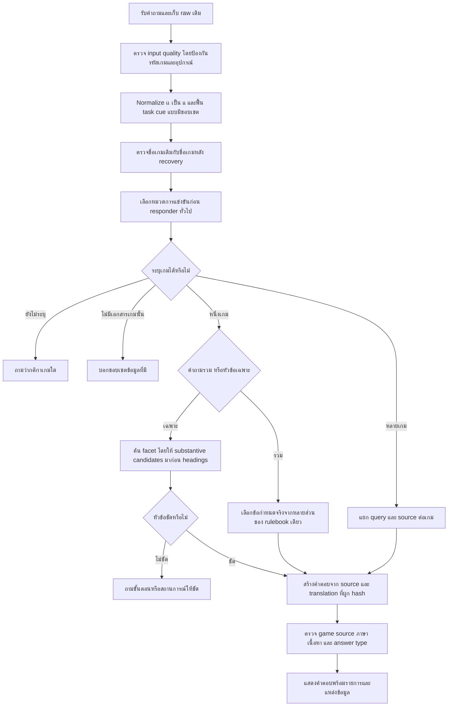

# กติกาการแข่งขัน r24: สาเหตุ แนวทางแก้ Ground Truth และผลทดสอบ

วันที่: 1 ตุลาคม 2026 (เวลาไทย)  
เวอร์ชันเว็บ: `2026.10.01-competition-r24`  
หน้าเว็บที่อัปเดต: http://127.0.0.1:8090/  
หลักฐานรอบนี้: `reports/r24_competition_20261001_164524_5ce728/`

## 1. สรุปสถานะ

แก้การตอบกติกาของ CS2, RoV, Tekken 8 และ VALORANT จากปัญหาที่พบจริงใน log และทดสอบหน้าเว็บจริงแล้ว คำถามรวมได้ข้อความกติกาจากเอกสารของเกมที่ระบุ พร้อมบอกว่าเป็นสรุปบางข้อ ส่วนคำถามเฉพาะหัวข้อใช้ส่วนของเอกสารที่เกี่ยวข้อง

เพิ่ม Ground Truth ผู้สมัครสำหรับตรวจอัตโนมัติ 2,000 เคส: ไทย 1,000 และอังกฤษ 1,000 มีทั้งภาษาพูด คำนำหน้าคำถาม คำสะกดผิด ตัวซ้ำ ตัวขาด คำถามไม่มีชื่อเกม เกมที่ไม่มีเอกสาร และการเปรียบเทียบหลายเกม

| การตรวจ | ผล | ความหมาย |
|---|---:|---|
| ชุดใหญ่ A ตาม rubric ตอนนั้น | 1,820/2,000 | เก็บคำตอบและ trace เดิมครบ |
| ตรวจคำตอบ A เดิมซ้ำด้วยเกณฑ์ข้อความสั้นของ B | 1,862/2,000 | เปลี่ยนเฉพาะ rubric; ไม่ได้รันระบบใหม่ |
| ชุดใหญ่ B หลังแก้ระบบ | 1,963/2,000 (98.15%) | ไทย 993/1,000; อังกฤษ 970/1,000 |
| ทดสอบซ้ำเฉพาะ 37 เคสที่ตกจาก B หลังแก้ | 37/37 | ไม่ใช่การรันชุดใหญ่สุดท้ายใหม่ทั้งหมด |
| Unit/regression ชุดสุดท้าย | 92/92 | ตรวจทั้งกติกา input recovery การจองและรายการอุปกรณ์ |
| API ของเว็บที่เปิดให้ผู้ใช้บน 8090 | 19/19 | เปิด LLM/RAG แบบหน้าเว็บ รวมคำถามเดิมทั้งสี่และการเปลี่ยนเกมในประวัติ |

**ผลผ่านหมายถึงผ่านเงื่อนไขอัตโนมัติที่กำหนด ไม่ใช่การยืนยันความถูกต้องของนโยบายโดยเจ้าของ และไม่ใช่การพิสูจน์ว่ารองรับทุกถ้อยคำแล้ว** ข้อจำกัดการให้คะแนนอยู่ในหัวข้อ 6

## 2. ทำไมคำถามของผู้ใช้จึงตอบผิด

### 2.1 `กฏตอนเเข่ง cs2 มีอะไรมั่ง`

ก่อนแก้: `input_guard_layout_retype` ขอให้ตรวจภาษาแป้นพิมพ์ ก่อนถึงการเลือกหมวดและค้นกติกา

หลักฐานจาก log:

- `layout_score = 0.393396` มากกว่า threshold `0.39` จึงถูกปฏิเสธ
- ทิศทางที่ตรวจพบคือ `thai_intended_english_active`
- เหตุผลระบุว่า English span แปลงเป็น Thai ได้ quality `0.363`, gain `0.000`, `seen=True`
- `cs2` ตัวเล็กไม่ได้รับการป้องกันเช่นรหัสอุปกรณ์/คำภาษาอังกฤษบางแบบ จึงถูกมองเป็นข้อความพิมพ์ผิดภาษา ทั้งที่เป็นรหัสเกมจริง

แก้: ป้องกัน ASCII ที่เป็นรหัสผสมตัวอักษรกับตัวเลข เช่น `cs2`, `ps5`, `pc1` ก่อนการแปลงแป้น ไม่ลด threshold ทั้งระบบ และเก็บตัวตรวจพิมพ์ผิดภาษาไว้

ควรตอบ: สรุปกติกา CS2 จาก `competition_rules_cs2_psu_phuket_2026` เช่น ทีมละ 5 คน รูปแบบ Single Elimination และ technical pause ทีมละ 2 ครั้ง **ครั้งละ**ไม่เกิน 10 นาที ไม่ควรขอให้ผู้ใช้พิมพ์ใหม่เพราะชื่อเกมนี้

### 2.2 `กฏตอนเเข่ง rov มีอะไรมั่ง`

ก่อนแก้: `pipeline:structured_games_catalog` ตอบรายการเกมทั้งหมด 42 เกม

เหตุที่ข้อมูลมีครบแต่ยังตอบผิด:

- `เเ` เป็นสระเอสองตัว ไม่ใช่ `แ` ตัวเดียว ตัวตรวจ cue ที่มองหา `แข่ง` จึงไม่เห็นการแข่งขัน
- `กฏ` ไม่อยู่ใน rule signals เดิม
- คำว่า `มีอะไรมั่ง` ถูกตีความเป็นการขอรายการ ตัวเลือกหมวดเกมให้ heuristic confidence ประมาณ `0.82` จากคำเกี่ยวกับเกมและคำขอรายการ
- เมื่อหมวด games รับคำถามไปแล้ว ตัวตอบ catalog ทำงาน จึงไม่ได้ค้นเอกสารกติกา RoV

แก้: เก็บ raw เดิมไว้ แต่ทำ `เเ → แ` ก่อนตรวจความหมาย รองรับ cue `กฏ` และภาษาพูดในคำถามรวม แล้วให้การแข่งขันมีโอกาสเลือกเส้นทางก่อนตัวตอบเกมทั่วไป

ควรตอบ: กติกา **RoV / Blueket Games 2025 ประเภททีมชาย** เช่น BO3 ทุกระยะตามเอกสาร อุปกรณ์ต้องเป็นโทรศัพท์มือถือ ไม่อนุญาต Tablet/iPad และกติกาเมื่อหลุดเกม พร้อมระบุรายการที่ข้อมูลอ้างอิง ไม่ถือว่ากฎของรายการนี้เป็นกฎ RoV ทุกงาน

### 2.3 `กฏตอนเเข่ง tekken 8 มีอะไรมั่ง`

ผู้ใช้รายงานว่าเคยได้กฎ VALORANT ขณะที่ log ที่พบและการยิงคำถามเดิมก่อนแก้ในรอบนี้ตอบ catalog 42 เกม จึงไม่อ้างว่าพิสูจน์เส้นทาง Tekken → VALORANT ของเหตุการณ์เดิมได้ครบ

อย่างไรก็ตาม ชุดใหญ่ A พบปัญหาเลือกหลักฐานเกมอื่นจริง 7 เคส รวมคำถาม:

`อยากทราบว่า สรุปกฎการแข่งขัน tekken 8 ทั้งหมด ครับ`

ใน preprocess การขยายชื่อเกมแบบ fuzzy ไปตีความถ้อยคำไทยและเติม VALORANT ทั้งที่ผู้ใช้ระบุ Tekken 8 ชัดเจนแล้ว ผลคือเข้าสู่การเปรียบเทียบและอ้างทั้ง `tekken8_format_ps5_1v1` กับ `valorant_team_size_players`

แก้: อ่านชื่อเกมเดิมก่อน recovery, ตรวจว่าชุดชื่อเกมไม่เปลี่ยนหลัง recovery และไม่ทำ fuzzy title expansion สำหรับคำถามการแข่งขันที่รู้หมวดแล้ว คำถามเปรียบเทียบแยก query ของแต่ละเกม ไม่ใช้ชื่อเกมอื่นปนใน query ที่ค้นกติกาของเกมเดียว

ควรตอบ: **Tekken 8 / PSU Esports ปะทะมันส์ สนั่นจอ** เช่น FT2 ชนะครบ 2 เกมก่อน, 3 รอบต่อเกม, 60 วินาทีต่อรอบ และข้อกำหนดตัวละคร/อุปกรณ์ตามเอกสาร ไม่ตอบกฎ VALORANT แทน

### 2.4 `กฏตอนแข่งวาโลมีอะไรมั่ง`

ก่อนแก้: `pipeline:competition_source_rag` เข้ากติกาถูกเกม แต่คำตอบมีเพียงชื่อเอกสาร ชื่อรายการ `Update`, `English below` และหัวข้ออุปกรณ์

เหตุ:

- คำถามรวมภาษาพูดไม่เข้าตัวสรุปกติกา
- การค้นด้วยคำทั่วไป เช่น กฎ/การแข่งขัน ให้คะแนนกับชื่อเอกสารและหัวข้อได้ดี
- validator เดิมยอมรับการมี source ของเกมที่ถูกต้อง แม้ตัวคำตอบยังไม่มีข้อกำหนดว่าทำอะไรได้/ไม่ได้ ต้องใช้กี่คน หรือได้กี่ครั้ง
- ค่าความมั่นใจในการจัดหมวดและคะแนนการค้น ไม่ใช่คะแนนพิสูจน์ว่าเนื้อหาตอบคำถามครบ

แก้: คำถามรวมต้องได้หลายส่วนของเอกสารที่มีข้อกำหนดจริง ส่วนคำถามเฉพาะให้ candidate ที่มีเนื้อหาจริงอยู่ก่อนหัวข้อ คำตอบต้องแสดงข้อความกติกา ไม่ถือ `Update` หรือชื่อหัวข้อเป็นกติกา

ควรตอบ: สรุปบางข้อจาก **PSU Phuket VALORANT 2026 Tournament** เช่นข้อกำหนดพื้นที่แข่งขัน อุปกรณ์ Tactical Timeout และ Technical Pause โดยแสดงชื่อประเภท pause ไว้เพื่อไม่เอาโควตาของประเภทหนึ่งไปอธิบายอีกประเภท

## 3. ปัญหาเพิ่มเติมที่ชุดใหญ่เปิดเผยและการแก้

| ลำดับ | หมวด | สาเหตุที่พบ | การแก้ที่ทำ |
|---|---|---|---|
| P0 | ชื่อเกมเปลี่ยน | Fuzzy expansion เติม VALORANT เข้าคำถาม CS2/RoV/Tekken; Arena of Valor บางคำถามปนหลักฐาน VALORANT | ยึด explicit target ก่อน recovery; งด title expansion ใน competition query; แยก query เปรียบเทียบ |
| P0 | ตอบนโยบายจองแทนกติกา | `rulebook` มีคำว่า `book`; คำว่าตาราง/รายงานตัวเข้าตัวตอบ booking/check-in ของศูนย์ก่อน | protected responder ตรวจการแข่งขันก่อน; ส่งต่อไปกติกาของรายการ |
| P0 | เลือกหมวดเกมทั่วไป | คำนำหน้า `สอบถามหน่อยครับ` ทำให้ generic game-meta clarification แย่งคำถามกติกาที่มีเกมและหัวข้อแล้ว | generic game-meta ทำงานเมื่อไม่มี competition signal |
| P0 | มี source แต่เนื้อหาไม่ตอบ | ค้นหัวข้อได้ดี แต่นำ headings มาตอบ โดยเฉพาะอังกฤษ | เนื้อหากติกาจริงมาก่อน headings; รายการ settings/ตัวเลขสั้นยังถือเป็นเนื้อหาได้ |
| P1 | สรุปกว้างแทนถามกลับ | ตัว broad ใหม่เคยรับ `... about in-march procedure` แล้วสรุปทั่วไป | กันคำถาม specific ที่ยังไม่รู้ facet ออกจาก broad; ให้ถามก่อน/ระหว่าง/หลังแมตช์ |
| P1 | ตัวเลขใน comparison ไม่ตรง source | fact card CS2 ใช้ถ้อยคำว่า pause รวม 10 นาที แต่ source ระบุครั้งละไม่เกิน 10 นาที | การเปรียบเทียบไทยใช้ curated source/contract ของเกมแทน summary card |
| P1 | ภาษาอังกฤษขาดหนึ่งแถว | Tekken `s01_c01:text` ไม่มี English localization ทำให้ identity variants 30 เคสตก | เพิ่ม translation หนึ่งรายการพร้อม source hash ใน release ใหม่ เก็บ 590 รายการเดิมครบ |
| P1 | คำผิดไม่มีเกม | `กติกกา timeout` ไม่มีชื่อเกม ทำให้ recovery ไม่ทำงาน | ฟื้น cue แบบจำกัดเมื่อมีบริบท timeout/การแข่งขัน แล้วถามว่ากติกาเกมอะไร |
| P1 | rubric ให้ตกผิด | ข้อความจริง เช่น `Rounds per game (Round): 3` สั้นกว่าเกณฑ์เนื้อหาเดิม | เพิ่มเงื่อนไขตรงกับ source เต็มบรรทัดสำหรับค่าตัวเลข/ข้อกำหนดสั้น และตรวจ A เดิมใหม่แยกไฟล์ |

ไม่เพิ่มคำถามทดสอบลง runtime และไม่ทำ alias รายประโยคเพื่อให้คะแนนดีขึ้น การแก้ cue ใช้ขอบเขต edit และบริบท โดยไม่เปลี่ยนตัวเลข วันเวลา และชื่อเกมไปตามการคาดเดา

## 4. Flow ที่ใช้หลังแก้

### เงื่อนไขสำคัญ

1. Raw query ต้องยังเรียกดูได้ใน log เพื่อดูว่าการแก้คำเปลี่ยนอะไร
2. ชื่อเกมที่ผู้ใช้ระบุชัดไม่เปลี่ยนเป็นชื่อเกมอื่นระหว่าง recovery
3. คำถามไม่มีชื่อเกมไม่ใช้การเดาว่าเป็น VALORANT
4. คำถามรวมต้องมีอย่างน้อย 3 source sections และข้อกำหนดจริงหลายข้อ; runtime เลือกไม่เกิน 8 sections เพื่อให้ข้อความอ่านได้
5. สรุปต้องบอกว่าเป็น **บางข้อ** ผู้ใช้ยังถามหัวข้อเฉพาะต่อได้
6. ข้อความหัวข้อและ metadata มีประโยชน์เมื่อถามชื่อเอกสารหรือรายการ แต่ไม่เพียงพอเมื่อถามเนื้อหากฎ
7. คำถาม specific ที่ยังตีความไม่ได้ต้องถามกลับ ไม่สรุปกติกาทั้งหมดแทน
8. ภาษาอังกฤษใช้ localization ที่ตรง source hash; ชื่อรายการภาษาไทยที่แปลใหม่ระบุว่าเป็นการแปล ไม่อ้างว่าเป็นชื่ออังกฤษทางการ
9. กฎของรายการในไฟล์ไม่ได้หมายความว่าจะใช้กับทุกการแข่งขันของเกมนั้น

## 5. Ground Truth ที่เพิ่ม

ไฟล์หลัก: `data/eval/competition_user_r24_2000_20261001.jsonl`  
Manifest: `data/eval/competition_user_r24_2000_20261001.manifest.json`  
เครื่องมือรัน: `tools/competition_user_ground_truth_r24.py`

| ลักษณะข้อมูล | จำนวน |
|---|---:|
| ไทย | 1,000 |
| อังกฤษ | 1,000 |
| คำถามต้นแบบไม่ซ้ำ | 580 |
| คำถามต้นแบบที่คงข้อความไว้ | 580 |
| เปลี่ยนคำนำหน้า/คำลงท้ายแบบธรรมชาติ | 1,039 |
| ตัวขาด ตัวซ้ำ สลับตัว และคำสะกดผิดใน task words | 381 |
| แต่ละเกมในแต่ละภาษา | 240 |
| Control/ไม่ระบุเกม/เกมไม่มีข้อมูล/หลายเกมในแต่ละภาษา | 40 |

มีหัวข้อรูปแบบการแข่งขัน ทีม/ตัวสำรอง แผนที่ การตั้งค่า อุปกรณ์ คุณสมบัติ/สมัคร รายงานตัว ขั้นตอนระหว่างแมตช์ disconnect pause/timeout พฤติกรรม การลงโทษ ข้อพิพาท ตาราง และขอบเขตเอกสาร ตามที่ source เดิมรองรับ

ตัวอย่าง:

- `กฏตอนเเข่ง cs2 มีอะไรมั่ง` → สรุปกติกาจากเอกสาร CS2 หลายข้อ
- `อยากทราบว่า กติกกา rov มีอะไรบ้าง ครับ` → สรุป RoV ไม่เพิ่ม VALORANT
- `สอบถามหน่อยครับ ตาม rulebook เทคเค่น 8 การตั้งค่าในเกม ต้องทำยังไง ครับ` → ค่ารอบและเวลาใน Tekken
- `What are the RoV tournament ruls?` → กติกา RoV ภาษาอังกฤษ
- `VALORANT ruules overview please.` → สรุป VALORANT ภาษาอังกฤษ
- `อยากทราบว่า กติกกา timeout เป็นยังไง ครับ` → ถามให้ระบุเกม
- `What do the CS2 tornament rules say about in-march procedure` → ถามว่าขั้นตอนก่อน/ระหว่าง/หลังแมตช์ใด
- `Does this studio have Free Fire anti-cheat tournament rulse?` → ไม่สร้างกฎ Free Fire ที่ยังไม่มี source

คำผิดในชุดนี้เน้น task words ไม่ได้พิสูจน์ทุกกรณีชื่อเกมเสียหลายตัวหรือผิดทั้งประโยคอย่างรุนแรง คำถาม 2,000 เคสประกอบด้วย variants ของต้นแบบ ไม่ใช่ 2,000 ความหมายอิสระ

แต่ละเคสระบุ locale, เกม, facet, outcome, source ที่ยอมรับ, parent Gold และชนิด mutation ข้อมูลเดิมยังอยู่ครบและไฟล์ทดสอบใหม่ไม่ถูกบรรจุในแพ็กเกจ runtime

## 6. เงื่อนไขตรวจเนื้อหาและข้อจำกัดการให้คะแนน

คำถามว่า “มีกติกาอะไรบ้าง” ไม่ควรผ่านด้วยคำตอบเพียง “กฎการแข่งขัน VALORANT / อุปกรณ์” เพราะยังไม่มีข้อกำหนดที่ผู้อ่านใช้ได้จริง

ชุดนี้จึงตรวจเพิ่ม:

- หมวดและ outcome ตรงกับที่คาด
- มี source ของเกมที่ถาม และไม่มีหลักฐานเกมอื่นปนโดยไม่ได้ขอเปรียบเทียบ
- คำถามเฉพาะมี evidence ของ facet ที่คาด ไม่ใช่อ้างเกมถูกแต่หัวข้อผิด
- คำถามรวมมีข้อความกติกาจริงหลายส่วน
- คำตอบเฉพาะมีข้อความที่ตรงกับ source ไม่ผ่านด้วยชื่อเอกสาร/citation อย่างเดียว
- ค่าจริงที่สั้น เช่น `3` รอบ/`60` วินาที ต้องปรากฏเป็นข้อกำหนดเต็มบรรทัดที่ตรง source ไม่บังคับให้ยืดคำตอบเพื่อถึงจำนวนคำ
- validator และเวลาไม่เกินขอบเขตผ่าน

**ยังไม่ใช่ semantic grading เต็มรูปแบบ**: literal overlap หนึ่งข้อไม่พิสูจน์ว่าทุกข้อในย่อหน้าถูกต้องหรือไม่มีประเด็นสำคัญตกหล่น และ evidence ถูกส่วนไม่เท่ากับตีความข้อยกเว้นถูก การทดสอบ semantic ที่ยืนยันเพิ่มเติมใน unit ได้แก่ CS2 ทีมละ 5 คน, Tekken FT2/3 รอบ/60 วินาที, RoV ห้าม Tablet/iPad และ VALORANT Technical Pause ห้ามสื่อสารเว้นแต่ได้รับอนุญาต

Source เดิมหลายรายการมีสถานะ `pending_owner_review` Ground Truth ใหม่จึงเป็น **synthetic assistant-reviewed candidates** ไม่เปลี่ยนสถานะเป็น owner-approved Gold

## 7. รอบปรับแก้และหลักฐาน

### A → B

รอบ A ใช้เวลา 618.42 วินาที และตก 180 เคสตามเกณฑ์เดิม พบทั้ง routing/target ผิด, headings, comparison, cue typo และ short-fact rubric

ปรับภาษาอังกฤษให้เนื้อหาจริงมาก่อนหัวข้อ, protected policy ไม่แย่ง competition, ป้องกัน target เปลี่ยน และเลือก source ของ comparison แทน fact card ที่ถ้อยคำตัวเลขไม่ตรง

Rubric ข้อความสั้นทำให้ A เดิม 42 เคสกลับมาผ่าน โดยไม่รันคำตอบใหม่ คะแนน A ที่เทียบเกณฑ์ short-fact เดียวกันจึงเป็น 1,862/2,000 ห้ามนำ 1,820 → 1,963 มาอธิบายว่าทั้งหมดเกิดจากระบบตอบดีขึ้นอย่างเดียว

### B → C

รอบ B ใช้เวลา 459.06 วินาที ผ่าน 1,963 และตก 37 เคส:

- 6 ไทย: generic game-meta clarification แย่งคำถาม RoV disconnect และ Tekken match settings ที่ขึ้นต้น `สอบถามหน่อยครับ`
- 1 ไทย: typo `กติกกา timeout` ไม่มีชื่อเกม
- 30 อังกฤษ: identity question variants ของ Tekken ขาด translation แถวเดียว

แก้ทั้งสามกลุ่มแล้วรันเฉพาะรายการที่ตก ผ่าน 37/37 ใน 8.38 วินาที ผลรวมจากการรัน B และการทดสอบซ้ำครอบคลุมทุก case ID แต่ไม่ได้อ้างว่าได้รัน final code ครบ 2,000 ใหม่อีกครั้ง

### Regression ที่เคยตกและแก้

`regressions_B.log` เก็บผล 85 tests ที่เคยตก 1 subcase: ambiguous English procedure ถูก broad responder ตอบสรุปทั่วไป จากนั้นแก้เงื่อนไข broad ให้ถามกลับ โดยไม่เปลี่ยน expected answer ของ regression เดิม ผลสุดท้าย `regressions_final.log` ผ่าน 92 tests

### หน้าเว็บจริง

`http_ready_8090.json` เก็บคำตอบและ latency 19 เคสจาก API ที่หน้าเว็บใช้ โดยเปิด LLM/RAG:

- คำถามผู้ใช้เดิม 4 เคสผ่าน ใช้เวลา 0.6685, 0.1399, 0.1056 และ 0.1864 วินาทีตามลำดับในการทดสอบครั้งนี้
- ประวัติ VALORANT แล้วเปลี่ยนเป็น Tekken อ้าง source Tekken ถูกต้อง
- broad ภาษาอังกฤษทั้ง 4 เกมผ่าน
- English Tekken identity ใช้ translation ใหม่ได้จริง
- focused Thai Tekken/RoV ผ่าน ใช้เวลา 3.35 และ 3.9184 วินาทีในการทดสอบครั้งนี้
- รายการเกมทั่วไปยังตอบ catalog 42 เกมเมื่อถาม `มีเกมอะไรบ้าง`
- booking control `พรุ่งนี้ตอนบ่าย3มีอุปกรณ์อะไรว่างให้เล่นบ้าง` ได้ `live_booking_status_fast_path` และวัน 2026-10-02 ศูนย์ไม่เปิดตามข้อมูลที่ดึงครั้งนั้น ใช้เวลา 2.1688 วินาที

การตรวจ booking นี้ยืนยันเส้นทางและคำตอบวันปิดของข้อมูลที่ระบบดึงมา ไม่ใช่ fixture อิสระที่ยืนยันเครื่องว่าง/ถูกจองทุกรายการ รอบ candidate ก่อนหน้านี้เคยได้ Dashboard timeout และตอบ unavailable; เก็บไว้ใน `http_candidate_final.json` ไม่ซ่อนผลนั้น

## 8. ข้อมูลที่เจ้าของ/ผู้จัดยังไม่ได้ยืนยัน

### Tekken: ขอบเขตข้อยกเว้นการหยุดเกม

`competition_rules_tekken8_psu_esports_s03_c01` ระบุเมื่อเริ่มเกมแล้วห้ามหยุดด้วยเหตุผลใด ๆ และถ้าหยุดโดยเจตนาปรับแพ้ 1 รอบ

`competition_rules_tekken8_psu_esports_s07_c01` ระบุ Pause ทำได้เมื่อผู้เล่นทุกคนยินยอมและมีเหตุเหมาะสม เช่นอุปกรณ์ขัดข้อง/เหตุฉุกเฉิน; หยุดโดยไม่จำเป็นมีโทษเช่นเดียวกับออกจากเกมก่อนจบ

คำถามที่ควรส่งให้ผู้จัดอย่างเจาะจง:

1. ข้อ s07 เป็นข้อยกเว้นของการห้ามหยุดใน s03 หรือไม่?
2. ก่อนกด Pause ต้องขออนุญาตกรรมการด้วยหรือเพียงความยินยอมของผู้เล่นทุกคน?
3. ถ้าผิดเงื่อนไข ใช้โทษแพ้ 1 รอบหรือแพ้ทั้งเกม/แมตช์ และแต่ละกรณีแยกอย่างไร?

รอบนี้คงข้อความต้นฉบับไว้ ไม่แก้กฎให้ข้อหนึ่งชนะอีกข้อจากการเดา ผลสอบผ่านไม่ใช้เป็นหลักฐานตัดสินขอบเขตนโยบายนี้

### การแปลอังกฤษ

เพิ่ม `competition_rules_tekken8_psu_esports_s01_c01:text` หนึ่งรายการตามการอนุญาตให้จัดการอังกฤษในแชทเดิม ระบุชื่อรายการ `Thrilling Showdown on Screen` ว่าเป็นการแปลจากชื่อไทย ไม่ใช่ชื่ออังกฤษทางการที่ผู้จัดยืนยัน

Release ใหม่: `en-20261001T173559+0700` มี 591 records โดย 590 records เดิมเหมือนเดิม ใช้ source hash `5728fa3f1ad0dbaedaf16410b179159c4185d512680bd72c82f5e9876f5918dc`

คำว่า approved ในกระบวนการ localization หมายถึงผ่านกระบวนการอนุมัติของระบบภายใต้คำสั่งผู้ใช้ครั้งนี้ Reviewer ระบุชัดว่าเป็น assistant translation ไม่ใช่ human owner review ชื่ออังกฤษและความลื่นไหลยังไม่ได้รับการตรวจจากผู้จัด

### ขอบเขตข้อมูล

- แหล่ง RoV เป็น Blueket Games 2025 ประเภททีมชาย ไม่ได้ยืนยันงานใหม่หรือประเภทอื่น
- ยังไม่มี source ที่รองรับ Free Fire/Dota 2 ตาม control cases จึงไม่ยืมกฎจากเกมอื่นมาตอบ
- ยังไม่มีผลยืนยันจากคนเกี่ยวกับคำถามใหม่ทั้งหมด 2,000 เคส
- ต้องเพิ่มคำถามจริงที่ผู้ใช้พบใหม่และแยกชุด holdout หากจะวัดความสามารถนอก variants ที่ใช้ปรับแก้รอบนี้

## 9. การรักษาไฟล์เดิมและแพ็กเกจ

- เก็บ source code ก่อนแก้ไว้ใน `reports/.../before/app/` รวมไฟล์ที่ยังไม่ commit อยู่เดิม; แก้เฉพาะจุดและไม่ reset/checkout ทับงานเดิม
- เก็บ snapshot แพ็กเกจ r24 ก่อน sync เพิ่มใน `package_final_before_sync/`
- แพ็กเกจ r23 และ candidate ก่อนหน้าคงอยู่ ไม่ลบ code หรือ log
- log ใหม่ append ในแพ็กเกจ r24 แยกจาก log เดิม การเปิดเวอร์ชันใหม่หยุดเฉพาะ launcher ที่ตรวจ command/path ว่าเป็นเว็บแชทที่เรารันไว้
- Dashboard ต้นฉบับของเจ้าของ port 8080 ไม่ถูกหยุด
- `data/locales/en/CURRENT` เปลี่ยนเพื่อเลือก release ใหม่โดยเก็บ pointer ก่อนหน้าไว้ และคง release เก่าครบ
- source Gold เดิม SHA-256: `51e94305ddc0e30190480698a217d09b16e00d0f9fe2612b4206e1e868cc36c1`
- source chunks SHA-256: `36fa00666d129cb8e65d8828b841ced198ec10d4f87b0c7aa1cb1057443bd9b0`
- ตรวจ hash ข้างต้นตรงกับก่อนเริ่ม และตรวจ source app กับแพ็กเกจที่รันตรงกันใน `final_preservation_check.json`

### ไฟล์ที่เพิ่มหรือแก้

| งาน | ไฟล์ |
|---|---|
| ป้องกันรหัสเกมถูกมองเป็น wrong layout | `app/core/keyboard_input_anomaly.py` |
| ฟื้น cue คำผิดแบบจำกัด | `app/core/intent_cue_recovery.py` |
| เก็บ raw, visual vowel, target invariance | `app/pipeline/preprocess.py` |
| ชื่อเกมและ competition signals | `app/pipeline/competition_targets.py` |
| equipment facet | `app/pipeline/competition_taxonomy.py` |
| priority กติกาก่อน policy | `app/pipeline/protected_intents.py` |
| แยกคำถามรวมกับเฉพาะ | `app/pipeline/retrieval.py` |
| สรุป source clauses ใหม่ | `app/pipeline/competition_overview.py` |
| จัดลำดับ route และ source comparison | `app/pipeline/engine.py` |
| English substantive clauses | `app/pipeline/bilingual_english.py` |
| เคสทดสอบและ evaluator | `tests/test_competition_user_questions_r24_20261001.py`, `tools/competition_user_ground_truth_r24.py` |

## 10. จุดเริ่มอ่านหลักฐานต่อ

1. `baseline_http.json` และ `original_log_matches.json`: คำตอบเดิมและเหตุผลจาก log
2. `failure_analysis_r24.md`: 37 เคสที่ตก B พร้อมก่อน/หลังแก้ และตาราง 180 เคสจาก A
3. `full_A_details.jsonl`, `full_B_details.jsonl`, `failed_C_details.jsonl`: คำถาม คำตอบ mode source IDs input guard และ trace
4. `full_A_offline_regraded_summary.json`, `full_A_short_content_regrading.json`: แยกผลแก้ rubric ออกจากการแก้ระบบ
5. `regressions_final.log`: 92 tests ผ่าน
6. `http_ready_8090.json`: ผลจากเว็บที่เปิดให้ลองจริง
7. `identity_translation_publish.json`: การแปลหนึ่งแถวและการเก็บรายการเก่า
8. `package_final_sync.json`, `web_launch_ready.json`, `final_preservation_check.json`: แพ็กเกจที่ใช้ PID และการตรวจรักษาไฟล์

สามารถเปิดหน้าเว็บเดิมและ refresh เพื่อทดลองคำถามเดิมได้แล้ว ตัวเลขความเร็วเป็นผลบนเครื่องนี้ในครั้งที่บันทึก ไม่ใช่เวลารับประกันทุกคำถาม
