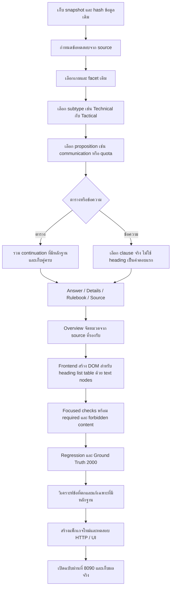

# Flow r25: เลือกข้อกฎและจัดคำตอบการแข่งขันให้ตรงคำถาม

สถานะ: ลงมือและทดสอบฉบับ r25 แล้ว วันที่ 1 ตุลาคม 2026; ผลตรวจเดิมอยู่ใน `competition_format_audit_20261001_181424_3bc493` ของโฟลเดอร์งาน Codex

## เป้าหมายและขอบเขต

ใช้ข้อความกติกาที่มีอยู่ให้ตอบตรงคำถามก่อน แล้วแสดงรายละเอียด/ข้อยกเว้นและอ้างอิงท้ายสุดด้วยรูปแบบเดียวกันไทย/อังกฤษ จัดตารางเป็นคู่ข้อมูลครบ และแสดงหัวข้อ/list/table บนเว็บได้จริง

คงไฟล์ source, owner review queue, inactive canonical releases, localization releases และ Ground Truth เดิม เก็บสำเนาโค้ดก่อนแก้และผลแต่ละรอบแยกกัน งานนี้ปรับการเลือกข้อความและการนำเสนอจากหลักฐานเดิม ไม่อนุมัตินโยบายแทนผู้จัด

## ข้อเท็จจริงก่อนเริ่ม

- 4 เอกสาร / 104 chunks และ curated ตรงกับผล parser ของไฟล์ต้นทางปัจจุบัน
- Review schema ผ่าน แต่ V2 ยังรอตรวจ 104 records; runtime ใช้ curated/translation เดิม
- Thai Technical Pause communication มี Tactical quota และ Major Bug ปน
- English focused answer ขึ้นต้นชื่อเอกสาร และบาง clause ซ้ำ
- CS2 penalty table แถวสุดท้ายอยู่คนละ source section: s54 จบที่การหมิ่นศาสนา และ s55 มี `แบนถาวร`; approved English คือ `Offensive religious remarks` กับ `Permanent ban`
- ข้อ s54 สั้นกว่า 700 ตัวอักษรอังกฤษในไฟล์นี้ ความขาดของคู่สุดท้ายจึงเกิดจาก import boundary ด้วย ไม่สรุปว่าเกิดจาก excerpt limit อย่างเดียวตาม audit เบื้องต้น
- Frontend ใช้ textContent จึงแสดง Markdown stars เป็นตัวอักษร

## Flow การพัฒนา

## ลำดับและเกณฑ์สำเร็จ

1. **Scope ของข้อกฎ**: Technical communication ต้องมีข้อห้ามและข้อยกเว้น และไม่มี Tactical allowance/Major Bug ปน ทั้งสองภาษา
2. **ตาราง**: CS2 มีครบ 9 คู่จาก source ตารางกับ continuation; แถวการหมิ่นศาสนาคู่กับแบนถาวร พร้อม source IDs s54/s55 ห้ามใช้ dedup ที่ลบโทษซ้ำจนเลื่อนคู่
3. **Focused answer**: ไทยขึ้นต้น `คำตอบ:` อังกฤษ `Answer:` พร้อม clause ที่ตอบคำถาม ไม่เปิดด้วย generic heading
4. **รายละเอียด**: clause ที่เป็น evidence เดียวกันไม่แสดงซ้ำ; ไม่ตัดกลางเงื่อนไข/ข้อยกเว้น/คู่ตาราง
5. **Settings**: target-bound wording `การตั้งค่าเกม` เข้าเส้นทางเดียวกับ in-game settings ที่มีอยู่ และระบุว่าเป็นค่าตามกติกาของรายการในไฟล์
6. **Overview**: หัวข้อมีชื่อหมวดคงที่และข้อความกฎจริง; เป็นสรุปบางข้อ ไม่อ้างครบทุกกฎหรือเติมหมวดที่ไม่มี source
7. **UI**: assistant headings/list/table เป็น DOM จริง user text ยังเป็น text; ข้อความไม่ถูกนำไปใส่เป็น raw HTML
8. **Preservation**: hash source/owner queue/releases/Gold/localization pointer/schedule ต้องตรงก่อนแก้; package เดิมและ log เดิมอยู่ครบ

## การทดสอบ

- เพิ่ม tests ที่ดูบรรทัดแรก, ไม่มีรายละเอียดผิด subtype, ค่าและหน่วยจริง, คู่ตารางทั้งหมด/แถวสุดท้าย, source refs และ ordinary games/booking regression
- รันชุด r24 2000 เดิมเพื่อวัดผลเทียบ corpus เดิม เกณฑ์ overlap เดิมยังมีข้อจำกัด จึงต้องอ่านร่วมกับ focused semantic checks ใหม่
- แพ็กเกจทดสอบเปิด LLM/RAG แบบเว็บจริง; ตรวจคำตอบไทย/อังกฤษ และ DOM จริงของหัวข้อ/list/table
- เก็บผลที่ตกทุกครั้ง; เปลี่ยน expected answer ได้เฉพาะมี source ยืนยัน โดยบันทึกเหตุผล ไม่เปลี่ยนเพื่อให้ implementation ผ่าน

## ประเด็นที่ผู้จัดยังต้องตัดสินใจ

Tekken pause มีข้อความข้อ s03/s07 ที่ขอบเขตข้อยกเว้นและโทษไม่ชัด คงข้อความต้นฉบับและสถานะ review เดิม ไม่มีการเลือกกฎหนึ่งแทนอีกกฎจากการเดา

คำถามที่ต้องถามผู้จัดโดยตรง:

1. ข้อ s07 ที่ยอมให้หยุดเมื่อผู้เล่นทุกคนยินยอมและมีเหตุเหมาะสม เช่น อุปกรณ์ขัดข้อง/เหตุฉุกเฉิน เป็นข้อยกเว้นของ s03 ที่ห้ามหยุดเกมหลังเริ่มหรือไม่ และต้องให้กรรมการอนุญาตก่อนด้วยไหม?
2. เมื่อกดหยุดโดยเจตนา/ไม่จำเป็น ให้เสีย **1 Round**, เสีย **1 Game** หรือแพ้ **Match แบบ FT2**? ข้อ s03 ระบุปรับแพ้ 1 รอบ แต่ s07 อ้างโทษเดียวกับออกจากเกมและใช้คำว่า “ปรับแพ้ทันที” ต้องยืนยันระดับโทษแต่ละกรณี

Runtime overview แสดงข้อความทั้งข้อห้ามและข้อยกเว้น พร้อมแจ้งว่าต้องให้ผู้จัดยืนยัน ไม่มีการเปิดใช้ canonical/V2 ที่ยังไม่อนุมัติ

## บันทึกผลหลังลงมือ

Report: `reports/r25_competition_format_20261001_182903_580ca7`

### การตรวจและปรับแก้ 3 รอบ

| รอบ | สิ่งที่พบจากผลจริง | การแก้ | หลักฐาน |
| --- | --- | --- | --- |
| A | Technical communication ไทยปน Tactical/Major Bug; ตาราง CS2 มี continuation; อังกฤษเปิดด้วยหัวเอกสาร | เลือก subtype/proposition, รวม s54+s55 เป็น 9 คู่, ขึ้นต้นด้วย clause จริง, จัด DOM หัวข้อ/list/table | `first_probe.json`, `round_A_unit.json` (102/102), `http_candidate_A.json` (29/29 ตามเกณฑ์แรก) |
| B | ข้อภาษาอังกฤษเรื่อง iPad ยังเลือกย่อหน้ารวม; overview ใช้หัวข้อหมวดกว้าง; คำถามระยะเวลา Technical ที่ source ไม่ระบุถอยไปตอบข้อความทั่วไป | แยก bullet/เลขข้อใน translation ที่แบนเป็นบรรทัดเดียว, ตรวจ facet ภายใน clause, ย้าย pause ให้ถูกหมวด, กันตารางใช้เป็น prose, ตอบช่องว่างหลักฐานตรง ๆ | `second_probe.json`, `third_probe.json`, `round_B_unit.json` (102/102); ตรวจเว็บพบข้อที่เกณฑ์ A ยังจับไม่ครบ |
| C | ประเภทโทษ VALORANT ถูกกรอง Warning/Round Rollback และใช้ชื่อหมวดเป็น detail; มี Map Forfeit ซ้ำ | เก็บทั้ง 5 ประเภทและเงื่อนไขครบจาก source section เดียว, ไม่เติมหัวข้อเปล่า/รายการซ้ำ, เพิ่มเงื่อนไขต้องปรากฏ/ห้ามปรากฏ | `round_C_unit.json` (103/103), `http_candidate_B.json` (30/30) |

การทดสอบ A ที่ผ่านไม่ได้แปลว่าปัญหาทั้งหมดหาย: ตัวตรวจแรกยังไม่บังคับให้คำถามระยะเวลาที่ไม่มีหลักฐานต้องตอบช่องว่างโดยตรง และไม่ตรวจหมวด overview ทุก clause จึงเพิ่มเงื่อนไข B/C ตามสิ่งที่พบจริง

### รูปแบบคำตอบที่ใช้งานแล้ว

- **คำถามเฉพาะเรื่อง:** `คำตอบ:` / `Answer:` ตามด้วยข้อกฎที่ตอบคำถามก่อน ตามด้วยรายละเอียดที่เกี่ยวข้องและข้อยกเว้น แล้วจบด้วย rulebook/source
- **คำถามกว้าง:** แสดงหัวข้อหมวดคงที่ และเลือกเฉพาะข้อย่อยที่รองรับหมวดนั้น ตัวอย่าง VALORANT แยก Tactical, Technical และ Player Emergency ชัดเจน พร้อมระบุว่าเป็นสรุปบางข้อ
- **ตาราง:** ตาราง 2 คอลัมน์ CS2 ครบ 9 คู่ ทั้งภาษาไทย/อังกฤษ; source IDs มี s54 และ s55 ไม่ใช้การลบค่าที่ซ้ำซึ่งทำให้คู่เลื่อน
- **ไม่มีข้อกฎรองรับรายละเอียดที่ถาม:** ระบุว่าไม่พบรายละเอียดนั้นใน section ที่ตรง subtype โดยไม่ใช้เวลา/โควตาของ pause คนละประเภท
- **หน้าเว็บ:** หัวข้อใช้ `h3/strong`, ข้อกฎใช้ `ul/li`, คู่ข้อมูลใช้ `table/thead/tbody`; ใช้ text nodes ในเนื้อหา ไม่ใส่ข้อความเป็น HTML ดิบ ข้อความผู้ใช้ `<b>...</b>` ยังเป็นข้อความธรรมดา

### ชุดใหญ่เดิม 2,000 ข้อ

| ฉบับ | ตัวตรวจ r24 เดิม | ข้อที่ตก | ผลตรวจข้อความต้นฉบับย้อนหลัง |
| --- | --- | --- | --- |
| A | 1,956/2,000 | 44 ข้อ เฉพาะ source-content matcher | ทั้ง 44 ข้อมี complete clause จาก source ที่เลือกอยู่ในคำตอบ |
| B ฉบับสุดท้าย | 1,953/2,000 | 47 ข้อ เฉพาะ source-content matcher | ทั้ง 47 ข้อมี complete clause จาก source ที่เลือกอยู่ในคำตอบ; จึงผ่านเกณฑ์ **มีข้อความ source รองรับ** 2,000/2,000 หลัง review |

ผลดิบและ Ground Truth เดิมคงอยู่ ไม่มีการเพิ่มข้อความส่วนเกินในคำตอบเพื่อให้ตัวตรวจผ่าน ไม่มีการเปลี่ยน expected ของ Gold เดิม

สาเหตุ false negatives ของ B แบ่งเป็น:

1. **30 ข้อ Tekken equipment:** `PlayStation 5 console used` เป็นข้อสั้น 5 tokens ภายใน English bullet list ที่ถูกรวมเป็นบรรทัดเดียว ตัวตรวจเดิมใช้ fragment 7 tokens จากบรรทัดยาวและไม่ได้แยก bullet จึงไม่เห็น exact short clause นี้
2. **17 ข้อ VALORANT penalties:** source มี Warning, Round Rollback, Round Loss, Map Forfeit, Match Forfeit ตรงกับคำตอบ แต่ตัวตรวจเดิมเลือกเฉพาะบรรทัดที่มีตัวเลขหรือชุดคำ modal บางคำ จึงกรองกฎโทษเหล่านี้ออกก่อนเทียบ

รายละเอียดคำถาม คำตอบ เหตุผล และ exact source clause แต่ละข้ออยู่ใน `full_r25_B_failure_groups.json` และ `full_r25_B_source_presence_review.json` ทดสอบ final ด้วย LLM/semantic retrieval ปิดเพื่อเทียบ corpus เดิม; ทดสอบ HTTP แยกโดยเปิดแบบเว็บใช้งานจริง

### การยืนยันของระบบกับการยืนยันของคน

| ตรวจแล้ว | ยังไม่ได้รับการยืนยันจากผู้จัด/คน |
| --- | --- |
| Unit/regression 103/103; HTTP candidate ฉบับสุดท้าย 30/30 | ความถูกต้อง/ความมีผลของนโยบายการแข่งขันจากผู้จัด |
| Source-content presence จากชุด 2,000; focused checks ตรวจเนื้อหา/ข้อยกเว้น/สิ่งที่ห้ามปน | การตรวจความหมายครบทุก proposition ทั้ง 2,000 ข้อโดยผู้ตรวจอิสระ |
| Browser DOM: หัวข้อ/list จริง, ตาราง 9 แถว 2 คอลัมน์ทั้งสองภาษา, ไม่มี Markdown stars ดิบ, user HTML เป็น text | การยอมรับรูปแบบคำตอบและ usability โดยผู้ใช้จริง |
| แพ็กเกจตรง code snapshot 8 runtime files; protected data hashes ตรงเดิม 6 files | V2 owner review queue 104 records ยังรอตรวจ, canonical activation ยังไม่อนุมัติ |

คำว่า approved localization ในโค้ดคือ release ที่ระบบเลือกและตรวจ source hash ไม่ใช่หลักฐานว่าผู้จัดได้อนุมัติภาษาอังกฤษทุกข้อแล้ว คะแนน confidence ของ route ก็ไม่ได้เป็นการรับรองความถูกต้องของนโยบาย

### การส่งมอบและการเก็บข้อมูลเดิม

- แพ็กเกจใหม่: `owner_local_delivery_20261001_competition_format_r25_final/PSU_Esports_Chatbot_Local`
- Runtime: `2026.10.01-competition-format-r25`; ใช้งานที่ `http://127.0.0.1:8090/`
- `before/`, `after/`, manifest, ผลดิบแต่ละรอบและ log อยู่คนละไฟล์; package r24 และ r25 candidate แรกยังอยู่ ไม่มี commit/reset/clean ที่ลบงานค้าง
- หยุดเฉพาะ launcher เว็บที่ Codex เปิดและตรวจ command line แล้วก่อนสลับพอร์ต; Dashboard ของเจ้าของและ Ollama ไม่ใช่เป้าหมายของการหยุด
- candidate HTTP 30 ข้อใช้เวลาประมาณ 0.085–10.823 วินาทีบนเครื่องนี้; คำถามมีคำเกริ่นบางแบบยังเข้าขั้น LLM routing และเป็นงานปรับความเร็วต่อได้ ไม่อ้างว่าทุกคำถามต่ำกว่า 1 วินาที

### ขอบเขตการพัฒนาถัดไป

1. ให้ผู้จัดตอบ 2 คำถาม Tekken ด้านบน แล้วจึงจัดการข้อขัดแย้งใน claim/review workflow
2. เพิ่ม proposition completeness checks เป็นชุดมาตรฐานแยกจาก legacy source matcher เพื่อครอบคลุมคำถามทุก facet ไม่ใช้เพียง game/source/overlap
3. ลดการใช้ LLM routing ของคำถามที่ target/facet มีหลักฐานชัด เพื่อปรับเวลาของคำถามพร้อมคำเกริ่น
4. ตรวจและอนุมัติ V2 claims/English โดยคนก่อนเปิด canonical releases; การจัด format ใน r25 ไม่ถือเป็นการอนุมัติข้อมูลแทนขั้นตอนนั้น
