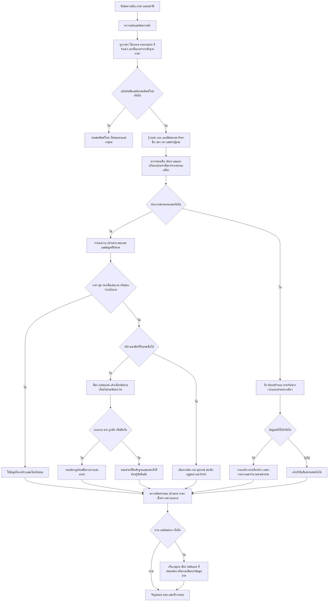

# Flow r30 ฉบับทบทวน 4 ฉบับสมบูรณ์ของรอบนี้ — งานที่ทำแล้ว การตรวจจริง และงานที่ยังเหลือ

วันที่ 2 ตุลาคม 2026 ใช้กับรุ่น `2026.10.02-full-improvement-r30-G6` เอกสารนี้แยกสิ่งที่ลงมือทำและทดสอบแล้วออกจากสิ่งที่ยังเป็นงานถัดไป ไม่รับรองว่าทุกคำถามถูก ไม่เปลี่ยนนโยบาย/ราคา/ข้อมูลเจ้าของ และไม่เขียนทับ Gold หรือ log เก่า

## 1. สิ่งที่แก้ในรอบนี้ เรียงตามผลกระทบ

| ลำดับ | สาเหตุที่ยืนยันจากโค้ด/trace | สิ่งที่ทำแล้ว | เกณฑ์พิสูจน์ |
|---|---|---|---|
| P1 | ตัวเลือก 1 หรือ 2 ชั่วโมงถูกอ่านเป็นระยะเดียว | อ่าน duration alternatives ที่มีหน่วย รวมสามตัวเลือกและหน่วยร่วม คิดแต่ละตัวเลือกด้วย SERVICE_FEES เดิม | ยอดและจำนวนรอบทุกตัวเลือก; เวลา/วันที่/รหัสเครื่อง/ช่วง 1–2 ชั่วโมงไม่เป็นตัวเลือก |
| P1 | คำปฏิเสธกลุ่มนักศึกษาถูกใช้ให้สิทธิ์ฟรี | ตัด affiliation ที่ผู้ถามปฏิเสธ; ถ้ากลุ่มจริงยังไม่ชัดให้ถาม | ไม่อ้างสิทธิ์ฟรีให้ผู้ที่ปฏิเสธกลุ่ม; แหล่ง PC ยังบังคับเมื่อมีข้ออ้างราคา |
| P1 | “ค่าเล่นแต่ละเครื่อง” หลุดไปข้อมูล PC เก่า | ใช้รายการแพ็กเกจทุกบริการจากตารางเดียว พร้อมแหล่ง PC วันที่ 2026-07-27 | ต้องครบทุกรายการ/กลุ่มที่เก็บไว้; ไม่สร้างราคาใหม่ |
| P1 | ชื่อปุ่มชนกับคำในชื่อเกม/คำอธิบาย | เลือกชื่อปุ่มก่อน exact / ชื่อย่อยใน source / unique OSA one edit สำหรับชื่อไม่มีเลขและยาวอย่างน้อยสี่ตัว | รหัส R9/Q9/Z9 ที่ไม่มีไม่แทนด้วย R1/R2 และไม่แสดงปุ่มอื่นทั้งหมด |
| P1 | “จองอะไรเพื่อเล่นเกม” เข้า booking steps โดยยังไม่ได้เลือกบริการ | ผูก exact game กับบริการจาก catalog แล้วให้ขั้นตอน; เกม/ภาคไม่ชัดถามต่อ | catalog ไม่ใช้ยืนยัน slot หรือสร้างการจอง |
| P1 | ผู้เล่นหลัก/เปลี่ยนตัว/เลือดและศพไม่ถูกจับเป็นประเด็นกฎ | เพิ่มโครงสร้างข้อความไทย/อังกฤษแบบผูกเกม และดึงข้อกฎ literal จาก rulebook เดียว | ทีม CS2 5 คน; ห้ามเปลี่ยนสมาชิก; VALORANT ปิดเลือด/ศพ; ไม่เอา “หน้างาน” ไปตอบเรื่องเอกสาร |
| P1 | arrival ถูกเหมารวมเป็นเวลาเริ่มแมตช์ | RoV แสดงข้อ 4.1.4 ครบ และแจ้งว่าข้อนี้กล่าวถึงการเริ่มแข่งช้าเกิน 15 นาที | ไม่สร้างเส้นตายการมาถึงอีกข้อจากการตีความ |
| P1 | หน้าเว็บนำ layout direction คะแนนต่ำไปเลือกภาษา แม้ detector ให้ผ่าน | ให้เฉพาะ flag keyboard_layout_mismatch ที่จำแนกแล้วมีผลต่อภาษา | คำไทย/typo ไทยไม่ถูกเปลี่ยนเป็น EN เพราะ mapping candidate; แป้นผิดจริงยังขอพิมพ์ใหม่ |
| P1 | ชื่อเกมมี The/of/It จนคำถามไทยถูกนับเป็น EN | แยกชื่อหลายคำ/ชื่อย่อยของเกมใน catalog ออกจากหลักฐานภาษาเฉพาะ mixed input โดยไม่แก้ข้อความ | คำถามไทยใช้ TH; ประโยค EN จริงและ toggle ยังใช้ EN; detected ยังคง mixed |
| P1 | คำถามเวอร์ชัน/แก้ client/เพิ่มรายชื่อ/สกิน/จำนวนรอบไม่เข้า detail หรือชนคำนาม | ผูก proposition กับเกมและข้อ literal; roster action แยกจากหัวข้อ roster; protest-language รองรับลำดับคำสองทิศ | ไม่ตอบ catalog/เสียงดัง/ปุ่มแทนกฎ; คำถามรวมต้องครบ eligibility, count, registration |
| P1 | PC1 และ available ทำให้ policy กับ occupancy ปนกัน | ตรวจเลขเครื่องและสถานะ; available for booking days/time periods ที่ไม่ระบุเครื่องหรือเวลาจริงเป็น weekly policy | PC1/status ใช้สด; weekly policy ไม่อ้างเครื่องว่าง; วันปิดพิเศษยังมีผลก่อน |
| P2 | EN fallback เหมารวมไม่มีต้นฉบับเป็นไม่มีคำแปล | แยก missing policy source / missing translation ไม่แนบหน้าแรกเป็นหลักฐานของกฎที่ไม่มี | คำถามถ่ายภาพ/วิดีโอไม่แต่งสิทธิ์/ความยินยอม/พื้นที่ |

## 2. Flow ตอนใช้งานจริง

ข้อจำกัด: ประโยค implicit ที่ไม่ได้อยู่ใน concept vocabulary ยังอาจหลุดไป fallback; ไม่รับรองว่าจับทุกประโยคได้ การจับ roster/action และ protest-language ที่พบในรอบนี้แก้และมี regression tests แล้ว validator เส้นทางทั่วไปยังไม่ได้พิสูจน์ทุก proposition; รายละเอียดงานต่อในข้อ 5

### ราคาและกลุ่ม

1. แยกบริการเดียว/ทุกบริการ/เปรียบเทียบหลายบริการ ระยะเวลาต้องมีหน่วย
2. แยกตัวเลือกจากช่วงเวลา 1–2 ชั่วโมง; ไม่อ่าน PC1 หรือ 09:00 หรือวันที่เป็นระยะเวลา
3. คำปฏิเสธกลุ่ม/ระยะเวลาไม่ถือเป็นข้อยืนยันใหม่ ถ้าต้องใช้ข้อมูลเพิ่มให้ถาม
4. Nintendo ไม่ทราบจำนวนคนแสดงแพ็กเกจที่มี ไม่สมมุติจำนวนคน; VR ราคาต่อรอบกับการกิน slot เป็นคนละการตรวจ
5. ราคา PC ที่เป็นข้อเท็จจริงต้องมี local update; clarification ที่ยังไม่มีราคาไม่ต้องใช้แหล่งราคาเป็นหลักฐาน

### ปุ่มและแพลตฟอร์ม

ใช้ label จากแหล่งจริงก่อนคำอธิบาย typo ที่แก้ได้ต้องมีตัวเลือกเดียวและไม่มีเลข ยังคงหมายเหตุแหล่งรอง ต้องทดสอบด้วยเครื่อง/เกมจริงก่อนรับรอง mapping ของศูนย์ การถามแพลตฟอร์มเมื่อมีหลาย mapping เป็นงานเพิ่มที่ยังไม่ได้ครอบคลุมทุก fallback

### กฎและอังกฤษ

หนึ่งเกมต้องอ้าง rulebook เกมนั้น ทุก proposition ต้องมีข้อกฎรองรับ การมี hit ID หรือ confidence .97 ไม่พิสูจน์ว่าคำตอบครบ .97/.98 ของเส้นทาง literal เป็นค่าความมั่นใจการจับเงื่อนไขตามโค้ด ไม่ใช่คะแนนรับรองผู้จัด อังกฤษใช้คำแปลที่ผูก hash กับ source ไม่แปลเติมข้อมูลที่ไม่มี นโยบายไม่มีต้นฉบับต้องแยกจากต้นฉบับมีแต่คำแปลขาด

### จองและเวลา

ถามว่าง/ไม่ว่างใช้ข้อมูล WordPress สดผ่าน chatbot โดยไม่ต้องเปิด Dashboard แยก ในแพ็กเกจนี้ `dashboard_required=false`, `cache_seconds=0`, `read_only=true` สถานะเชื่อมต่อได้เป็นหลักฐาน transport; fixture ที่รู้คำตอบเป็นหลักฐานคำนวณ occupancy; สถานะจริงต้องเทียบ oracle จริงอีกขั้น การทดสอบ oracle จริงยังพักตามคำขอผู้ใช้ นโยบาย Maintenance/ช่วงเปิดทั่วไปไม่เท่ากับเครื่องว่างในวันนั้น

## 3. Flow ทดสอบที่ทำจริง

1. เก็บ Git status, snapshot app/tests เดิม 248 ไฟล์ และ hash ข้อมูล/booking 584 ไฟล์ก่อนแก้; snapshot เพิ่มก่อน D/E/F/G/G2/G3/G4/G4b/G4c/G5/G5b/G6
2. Inventory `data/eval`, routing, ground_truth และ human_review ทั้ง JSON/JSONL; alias และ subset บันทึกแต่ไม่เอามาบวกเป็นตัวอย่างอิสระ
3. baseline 69 ข้อ: 15 → A 40 → B/C 69; เพิ่มขอบเป็น 79: D 75 → E 78 → F 79; ขอบเพิ่ม 43: baseline F 17 → G 37 (รวม assertion body/bodies ผิด 3 ข้อ) → G2/G3/G4 43 ตาม fixture v2; source contracts ใหม่ G3 15/27 → G4 27/27 และ G5 เพิ่ม regression/guard controls เป็น 39 ข้อ การนับเป็นรอบที่รันจริง ไม่แต่งจำนวน loop
4. unittest ทุกโมดูล 425 ข้อ และ smoke 85 ไฟล์; เกณฑ์ล้าสมัยต้องเทียบ r29/แหล่งเดิมก่อนเรียก regression
5. ทุก input หลัก 20,327 requests / 55,583 grades แยกตาม corpus; ชุดเก่าอีก 970 requests / 981 grades; session 12 เคส/24 turn; guard 500 ทั้ง native detector และ runtime profile
6. sweep ใหญ่ปิด LLM/semantic และใช้ booking unavailable แบบควบคุม; รุ่น G2/G3/G4/G5 ใช้ locale binding แบบ server เพื่อไม่สรุป direct Auto ผิดเป็นเว็บผิด
7. ตรวจเว็บจริงแบบเปิด LLM/semantic: 79 + 43 + 8 + 45 + 280 + 320 + 128 = 903 เคส (8 ข้อตรวจภาษา; ส่วน live-required ตรวจ path ไม่ใช่ occupancy) ตรวจ source/เนื้อหาตาม oracle ของแต่ละชุด; live/guard ตรวจแยกอีก 44 เคส
8. แยกข้อผิดจริง / source ขาดหรือขัดกัน / Gold/heading/mode เก่า / grader bug / proper names/ภาษา / dependency offline / latency / ambiguity
9. เก็บผลเดิมครบ ถ้า grader ผิดให้สร้างผล rescore อีกไฟล์พร้อมเหตุผล ไม่แก้คำถามหรือ expected เดิม
10. Build แพ็กเกจใหม่ ตรวจ hash/source preservation/API ก่อนเปลี่ยน 8090 เฉพาะ process ที่ยืนยันเป็นของงานนี้ แล้วตรวจ API ซ้ำหลังเปลี่ยน

ผลสุดท้ายและจำนวนที่ผ่านดู `FINAL_RESULTS_TH.md` ในรายงาน r30; ต้องไม่เรียก observation หรือ route-only ว่า answer accuracy

## 4. ทบทวน Flow 10 ประเด็น

| จุดตรวจ | ผลและสิ่งที่ปรับ |
|---|---|
| 1 รักษาไฟล์ | ใช้ snapshot/hash และรายงานใหม่ ไม่ reset Git ไม่แทน Gold |
| 2 เลข/เวลา | duration parser ต้องมีหน่วย มี negative controls รหัสเครื่อง/วันที่/ช่วง |
| 3 คำปฏิเสธ | ตรวจกลุ่ม/ระยะเวลา ไม่ให้สิทธิ์จากข้อความที่ถูกปฏิเสธ |
| 4 แหล่งข้อมูล | ข้ออ้างราคา PC มี local source; no source policy ไม่แนบ homepage เพื่อทำเหมือนยืนยัน |
| 5 ชื่อปุ่ม | exact label และ ambiguity; ไม่แก้รหัสเลข |
| 6 ขอบเขตเกม | exact service choice และชื่อ rulebook; ภาคไม่ชัดถามเพิ่ม |
| 7 ภาษา | เปรียบ ingress/direct พบ candidate คะแนนต่ำมีผลผิด จึงเพิ่ม classified direction gate และแยก source game titles จากหลักฐานภาษา |
| 8 ประโยคหลายเรื่อง | พบ action/count, scope และลำดับ protest-language ชนกัน แก้ข้อที่ยืนยันและเพิ่มการตรวจคำถามรวม; ความครบทุก proposition ทั่วไปยังเป็นงานต่อ |
| 9 หลักฐานทดสอบ | แยก source/content/route/guard/transport/occupancy และ oracle ของคน |
| 10 การเปิดใช้งาน | แพ็กเกจใหม่ทดสอบแยกพอร์ต เก็บรุ่นก่อนและ log ไม่หยุด process อื่น |

ตารางนี้เป็นการตรวจ 10 ประเด็นของเอกสาร ไม่อ้างว่ารันชุดใหญ่ครบ 10 รอบ

## 5. งานต่อ เรียงความสำคัญ และ Flow ที่ต้องใช้

### P1-A: การจับประเด็น/เป้าหมาย — สิ่งที่แก้และงานที่ยังเหลือ

ข้อผิดสี่ตัวอย่างที่ revision 3 เก็บไว้ตรวจข้อกฎต้นฉบับและแก้ใน G4 แล้ว:

| คำถาม | สาเหตุเดิม | คำตอบที่ต้องมีตาม source | การแก้และขอบ |
|---|---|---|---|
| CS2 ใช้แพลตฟอร์มอะไรและห้ามดัดแปลงตัวเกมไหม | ส่วนที่สองไม่เข้ากฎและแตกไปกฎเสียงดัง | Steam/latest CS2 และห้ามดัดแปลงที่ไม่ได้รับอนุญาต | version/client proposition ผูกเกมเดียว; ไม่ตีความเป็นห้ามทุก modification |
| CS2 ปิดรับสมัครแล้วเพิ่มเพื่อนเข้า roster ได้ปะ | roster noun เลือก count แทน action หลังปิดรับ | ไม่อนุญาตลงทะเบียนผู้เล่นหลังปิดรับสมัคร | ขยาย closed-registration ลำดับคำ; count ต้องมี size/composition หรือหัวข้อ roster ที่แยกจริง |
| RoV ใช้สกินพิเศษได้หรือเปล่า | implicit permission ไม่เข้า detail | 4.2.5 ใช้ Default เท่านั้น | target-bound skin permission; คำถาม catalog สกินยังไม่เหมารวมเป็นกฎ |
| เทคเคนแต่ละเกมแข่งกี่รอบ | ชื่อ franchise/round-count หลุดไปหัวข้อกว้าง | จำนวนรอบต่อเกม 3 ของเอกสาร Tekken 8 | infer เฉพาะ franchise ที่มี registered edition เดียวและไม่มีรุ่นอื่นระบุ พร้อม qualifier ว่าเอกสาร Tekken 8 ที่มี |

G4 full tests ทำให้พบ regression จริงสองข้อ จึงแก้ G5:

- `eligibility, roster, and registration` ต้องมีทั้งสามประเด็น: รักษา roster ที่เป็นหัวข้อคั่นด้วย comma และ count ขณะที่ after-closed action ไม่ถูกเพิ่ม count แทนคำตอบ
- `Which days and time periods are available for PC booking?` เป็น weekly policy; available ในวลีนี้ไม่ใช่ยืนยันเครื่องว่าง แต่ `Which PC1 booking slots are available...` ต้องดึงสด

ชุด legacy เพิ่มทำให้พบอีกสองข้อและแก้ G5:

- `รายการ CS2 ใช้เวอร์ชันเกมแบบไหน`: context gate เดิมไม่เห็น tournament; preprocess เพิ่ม Call of Duty: Warzone แล้ว target lock คะแนน 1.0 ทั้งที่ชื่อไม่ได้อยู่ใน raw คำถาม เพิ่ม event/version context ที่ผูก CS2 ให้กฎมีผลก่อน catalog lock ยังต้องตรวจการขยายชื่อในเส้นทางอื่นต่อ
- `CS2 ถ้าจะประท้วงใช้ภาษาอังกฤษได้ไหม หรือบังคับไทย`: route จับกฎได้ แต่ language concept จับเฉพาะ “ภาษา...ประท้วง”; เมื่อไม่พบ detail ไปชน “บังคับ” ของเกม เพิ่ม concept ตามลำดับคำสองทิศและผูก source ภาษาทางการ ไม่สร้างกฎภาษาใหม่

G6: ตรวจเว็บจริงเพิ่มพบ `CS2 แข่งกี่วันและแข่งที่ไหน` ยังไม่มี duration/venue concept ทั้งที่ `competition_rules_cs2_psu_phuket_2026_s08_c01` ระบุทั้งสองเรื่องในข้อเดียว เพิ่ม proposition ที่ผูก CS2 พร้อม literal clause ทั้งไทย/อังกฤษและ qualifier ว่าตามเอกสารกติกาที่มี ไม่ใช้เป็นกำหนดการรายการใหม่ ขอบ `last round`, ตำแหน่งปุ่ม และเวลา pause ไม่เป็นระยะเวลารายการ เพิ่ม 6 ประโยคก่อน/หลังและหนึ่ง unit method

Flow ต่อสำหรับประโยคที่ยังไม่ครอบคลุม: raw + trace → รักษา target/date/เลข/ปฏิเสธ → แยก requested propositions → clause ledger ที่มี source hash + scope + condition/result → ถ้าขาดประเด็นให้ partial/clarification → ตรวจ target, first line, missing clauses และ forbidden claims → clean/noisy same oracle → full regression ที่เกี่ยวข้อง ไม่มี whole-question alias เป็นทางหลัก

### P1-B: Oracle เนื้อหาและความต่าง Gold เก่า

บางข้อบังคับคำว่า `Verified game catalog`, mode เก่า หรือ source ID ที่ต่างจาก clause ที่ตอบจริง บาง Gold คาด answer ทั้งที่ source ไม่มี ต้องไม่ลบ fail ทั้งหมวด Flow: เก็บคะแนนเดิม → เทียบ source ทีละข้อ → overlay ใหม่มี must-clause/forbidden/scope → ระบุ reviewer/evidence hash → ตรวจ clean/noisy ด้วย oracle เดียวกัน → เผยทั้งคะแนนเดิมและคะแนน oracle ใหม่

### P1-C: Schedule policy กับ live status — แก้ขอบที่ยืนยันแล้ว

G4 แก้คำถาม Maintenance ทั่วไปให้ใช้ตารางเดิมแม้ dependency unavailable และตรวจ numbered resources; G5 แก้ available for generic booking days/time periods ที่ถูกกันผิด การถามเครื่องว่างหรือวัน/เวลาจริงยังเป็น live path สถานะเชื่อมได้และคำตอบ booked/free ต้องรายงานแยกกัน

Flow ต่อ: classify policy / resource-status / date override → generic policy ให้ regular slots + special-closure disclaimer → actual slot fetch WordPress read-only → source freshness/วัน/เครื่อง/ช่วง → overlap ตาม fixture (VR 30 นาทีครองชั่วโมง) → response ตอบเฉพาะสถานะที่ข้อมูลรองรับ → API transport มีหลักฐาน fetch แต่ occupancy ต้องมี oracle อีกขั้น ไม่เปลี่ยนตารางหรือข้อมูลเจ้าของ

### P2: ความทนต่อ typo และขอบราคา/ปุ่ม/อังกฤษ

1. คู่ clean/noisy ยังมี regression ภายใต้เกณฑ์เนื้อหาที่เข้มขึ้น ต้องดู span recovery และ target margin ไม่เพิ่ม whole-question alias เป็นหลัก
2. ตรวจ negation สองกลุ่มในประโยคเดียว/กลุ่มผู้ใหญ่ที่ถูกปฏิเสธก่อนคำนวณราคา และชื่อปุ่มเดียวที่มีหลายแพลตฟอร์ม
3. เกม family ไม่ระบุภาค เช่น Call of Duty/Overcooked ให้เสนอภาคจาก catalog เพื่อให้ถามยืนยันได้ง่าย โดยไม่ยืนยันบริการของภาคที่เดา
4. Proper name ภาษาไทยไม่เหมารวมเป็น English prose leakage; ขอชื่ออังกฤษทางการเฉพาะที่ยังไม่มี ไม่แปลชื่อบุคคลเอง
5. แยกประโยคทั่วไปที่ต้องใช้ LLM ออกจาก correctness ของ static sweep; เพิ่ม production model benchmark ที่มีคำตอบจาก source และ timeout gate หลังคอร์ปัสผ่านการทบทวน
6. คิวเมื่อมีคำถาม WordPress ช้า: วัดแยกตอนว่าง/มีโหลด ปรับข้อความรอและ SLA ก่อนเพิ่ม worker/RAM; ผล concurrent 10 ข้อจากการทดสอบชนกันไม่ใช้สรุปเป็น regression

## 6. คำถามที่ต้องเจ้าของ/ผู้จัดตัดสินใจ

- Tekken pause: ข้อห้ามหยุดและข้อที่ผู้เล่นทุกคนยินยอมใช้ร่วมกันอย่างไร เงื่อนไขข้อยกเว้น โทษ และหน่วย round/game/match ใด
- RoV 6.1.5.1: ขอประโยคเต็มหลังคำว่า “ออกจาก”
- Rulebook ทั้งสี่: ชื่อรายการ ปี รุ่น วันที่มีผล และขอบเขตที่ใช้จริง
- ถ่ายภาพ/วิดีโอ: อนุญาตหรือไม่ ขอความยินยอมใคร จำกัดพื้นที่ใด
- อุปกรณ์: รุ่น/จำนวน controller ที่ใช้งานจริง; บุคลากร: ชื่ออังกฤษทางการ
- ค่าสมัคร/อายุ: ข้อกำหนดแต่ละรายการ ไม่ใช้ราคาค่าเครื่องแทน
- Booking จริง: oracle booked/free ยังพักตามผู้ใช้ ทดสอบการเชื่อมต่อ/fixture ต่อได้ แต่ไม่รับรองข้อมูลจริงว่าเทียบตรงแล้ว

ใช้แบบฟอร์มข้อมูลเจ้าของเดิมที่ทำไว้แล้ว ไม่กรอกแทนและไม่เปลี่ยน source จนได้คำยืนยัน

## 7. Flow วิเคราะห์ข้อไม่ผ่านทุกชุดและการใช้คะแนน

1. เก็บ original result/grade ก่อนเสมอ ทุก unique input เชื่อมกลับ raw line, source IDs, route, candidate scores, validation และ trace ได้
2. เทียบ expected กับ source ปัจจุบัน: keyword รูปแบบเก่า เช่น `3 รอบ` เทียบ literal `จำนวนรอบต่อเกม (Round): 3` ไม่ใช่หลักฐานว่าเลขผิด; ห้ามลบ fail รวมทั้งหมวด
3. จำแนก: confirmed wrong target/action/content; incomplete propositions; source missing/conflict; old mode/heading/keyword; grader implementation; locale/proper names; controlled dependency; loaded latency; observation without oracle
4. route .97, resolver 1.0, capability .999 เป็นคะแนนเลือกตามเงื่อนไขและข้อความที่ขั้นก่อนส่งมา ไม่ใช่ความน่าจะเป็นว่าคำตอบจริงถูก ตัวอย่าง false appended title แสดงว่าคะแนนสูงยังเลือกผิดได้
5. “ต้องมีเนื้อหา” หมายถึงคำถามสามเรื่องต้องมีข้ออ้างที่รองรับครบสามเรื่อง เช่น eligibility + 5 players + no late registration การมี source CS2 หรือคำว่า registration เพียงอย่างเดียวไม่ทำให้คำตอบครบ
6. จัดปัญหาที่พิสูจน์จาก trace/source ก่อน → เพิ่ม content/negative contract → แก้ operation/target/qualifier ตามสาเหตุ → focused → full corpus → actual API → วัด loaded/idle แยก → source preservation → release → replay
7. ถ้า test เก่าล้ม ให้เก็บคะแนนเก่าและเพิ่ม diagnostic/source overlay แยก พร้อม scope; human_review/English reference ที่ยังไม่มี oracle เป็น observations และ pending approval

## 8. หลักฐานและความเสี่ยงที่ยังเหลือ

- Complete root sweeps F/G2/G3/G4/G5/G6 เก็บแยก; A/B ที่หยุดกลางคันไม่นับครบ; 20,327 unique requests กับ 55,583 grades มี historical/split/alias จึงไม่บวกเป็น answer accuracy เดียว
- Extra corpus 970 unique requests, 981 grades; by-game subsets ตรวจ alias; 120 human-review observations ไม่มีคำเฉลยคนและไม่นับ correct answers
- G6 เปลี่ยน production จาก G5b เฉพาะ competition_detail.py ตัวเลือกตรวจซ้ำแบบอนุรักษ์จาก trace เลือกทั้ง 20,327 requests เพราะ candidate metadata ทุกแถวมีการแข่งขันอยู่ด้วย จึงได้ตรวจซ้ำใหม่ครบทุก input จริง ไม่ได้ใช้แถวคำตอบ G5 แทนแถว G6 พิสูจน์ด้วย execution_provenance/keys ใน final_G6_verified_coverage.json; scope string เก่าใน wrapper เป็น template และอธิบายแก้ใน coverage audit แยก
- Strong competition composition/content/new-question 728 cases ตรวจ clause/source/first line ครบตาม oracle ที่เขียน ไม่ใช่ผู้จัดรับรองทุกกฎปัจจุบัน
- Guard runtime G2/G3 ได้ 498/500 policy actions; สองเคส mixed wrong layout ควรขอพิมพ์ใหม่ตาม oracle G5 เพิ่มการตรวจร่วม: accidental repeat ที่มีหลักฐาน candidate_seen/gain จาก corpus และอยู่นอก source game title exact → ประเมิน layout ใน residual หลังนำชื่อออกจากหลักฐาน → คะแนนอย่างน้อย max(.65, configured threshold) จึงขอพิมพ์ใหม่ ไม่ส่งข้อความที่แก้ไปตอบ ไม่เปลี่ยน global thresholds ตรวจ runtime 500 ซ้ำและมี negative controls ประโยคอังกฤษ/ไทย/ชื่อเกมเลขโรมัน ผลล่าสุดอยู่ final_G5_runtime_guard500_summary.json ไม่ใช่ answer accuracy หรือ independent holdout
- Runtime flags ตรงทั้งสองประเภท 471/500: layout TP240/FN0/FP0; repeat TP173/FN27/FP2 โดย action ยังตรง 500/500 เพราะ repeat เป็น warn/continue และบาง repeat miss มี layout block อยู่แล้ว อ่าน final_G5_runtime_guard500_interpretation.json แยกจากคำตอบ การจับซ้ำต่ำกว่า .55 และภาษาไทยหลายคำติดกันเป็นงานต่อ ไม่ลด threshold รวมเพื่อไล่คะแนน
- คู่ clean/noisy 2,000 ใช้ V2 content overlay และเก็บ Gold เดิม มี noisy regression ที่ต้องแยก target/recovery/abstention/contract ตาม trace ไม่ปรับ threshold จาก pass rate อย่างเดียว
- Worker หนึ่งตัว queue wait 3 วินาทีอาจได้ 503 ใน loaded concurrency; ต้องเปิดผล idle แยกพร้อม error body ไม่กล่าวว่าทุก 503 เกิดจาก WordPress หรือภาษา
- ไม่มี source ใหม่ที่ผู้จัดรับรอง ไม่มี real booked/free oracle ตามคำขอพักเก็บข้อมูล ไม่กรอกนโยบายแทนเจ้าของ

Static sweep 20,327 ใช้ binding ภาษาแบบ server แต่เรียก pipeline โดยตรง การ short-circuit ของ runtime guard ตรวจใน runtime500/กรณี guard และ API จริงแยก ไม่เรียก static sweep ว่าการทดสอบ HTTP ครบ 20,327 คำถาม

ผลจำนวนสุดท้ายดู `FINAL_RESULTS_TH.md`, `FINAL_G6_DETAILED_CAUSE_ANALYSIS_TH.md`, `FINAL_G6_FULL_ANALYSIS_SUMMARY.json` และ `release_preflight_G6.json` ใน reports/r30_full_improvement_20261002_020311_6374c0

G6 ตรวจซ้ำกลุ่มที่อาจได้รับผล 20327 requests แล้วเก็บผลรวมการครอบคลุมเดิม 20,327 requests พร้อม execution_provenance ต่อแถว จำนวนนี้ได้รันใหม่ทั้งหมดใน G6

## 9. ข้อผิดจริงที่ตรวจพบหลัง G6 — ยังต้องแก้รอบถัดไป

สองข้อในชุดเสริมมี source ครบและ trace ยืนยันว่า matcher ยังจับคำถามไม่ครบ:

| คำถาม | สาเหตุที่พิสูจน์ | คำตอบที่ควรได้ตามเอกสารเดิม |
|---|---|---|
| สถานที่จัด PSU Phuket CS2 2026 คือที่ไหน | ไม่รู้จักวลี สถานที่จัด ที่อยู่ก่อนชื่อรายการ จึงไม่มี detail concept และปฏิเสธอย่างปลอดภัย | สถานที่ PSU Esports Studio - Phuket ม.อ. ภูเก็ต พร้อม qualifier ว่าเอกสารที่มี |
| CS2 timeout ตอน freeze time ได้กี่วิกี่ครั้ง | bare timeout ไม่เข้า tactical_timeout แต่ freeze time เข้า round_time จึงตอบเวลาต่อรอบแทน | ขอเวลานอกทีมละ 4 ครั้ง ครั้งละ 30 วินาที ใช้ใน Freeze time |

Flow รอบถัดไป: content contracts ไทย/อังกฤษ clean/noisy → เลือก timeout ก่อนคำบอกบริบท freeze time และตรวจ quantity/duration/condition ครบ → negative controls เวลา freeze time ปกติ/VALORANT timeout/technical pause/ตำแหน่งปุ่ม/รายการใหม่ → source-bound matcher → focused/unit/competition corpus/API → preservation audit → release การเพิ่ม G6 duration/venue ไม่ได้แก้ทุกสำนวนสถานที่แล้ว

หลักฐานทั้งหมด: CONFIRMED_REMAINING_G6_CASES.json และ REMAINING_G6_PRIORITY_AND_FLOW_TH.md ในรายงาน r30 ข้อเหล่านี้ยังเปิดอยู่ ต่างจาก mode/keyword เก่าที่ต้องทบทวน oracle ก่อน
