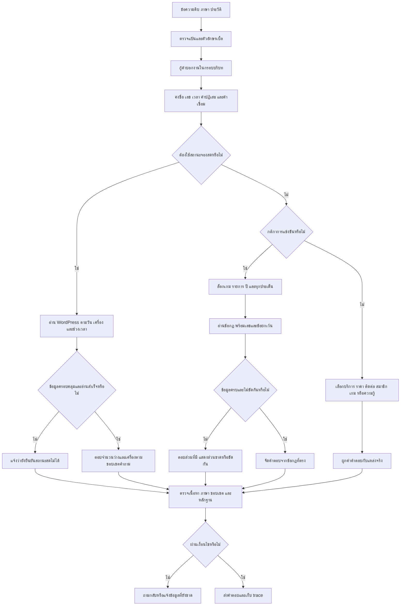

# Flow ตรวจและแก้จากการใช้งานจริง — PSU Esports Chatbot r33

วันที่ 2 ตุลาคม 2026 เวลาไทย • แพ็กเกจ finalI • runtime `2026.10.02-usable-task-frames-r33`

## 1. ผลที่ส่งมอบ

เว็บทดสอบใช้งานอยู่ที่ http://127.0.0.1:8090/ แพ็กเกจใหม่อยู่ใน `owner_local_delivery_20261002_usable_task_frames_r33_finalI/PSU_Esports_Chatbot_Local`

ใช้ launcher ของแพ็กเกจนี้เมื่อต้องเปิดใหม่ กระบวนการเว็บต้องทำงานอยู่เพื่อรับคำถาม สถานะจองถูกดึงจาก WordPress เมื่อคำถามต้องใช้ข้อมูลสดตาม flow เดิม; การอ่านสถานะไม่สร้างรายการจอง งานเก็บ occupancy จริงยังพักตามคำสั่งผู้ใช้

## 2. Flow จาก input ถึง output

## 3. การกู้คำผิด

1. เก็บ input เดิมและแต่ละข้อความระหว่างแก้ใน trace เสมอ
2. ใช้ OSA/edit distance กับศัพท์งานที่ระบบรองรับ เช่น ราคา การจอง กฎ การติดต่อ มี syntax/topic ที่ยังอ่านได้เป็นหลักฐาน
3. อังกฤษ: จำกัดตำแหน่งคำ เช่น modifier ก่อน hardware noun; ไม่แก้ house เป็น mouse เพียงเพราะประโยคมีคำว่า gaming
4. ไทยไม่มีช่องว่าง: เทียบ span ของคำบอกงานกับบริบทอุปกรณ์/เกม/รูปคำถามและขอบหลังคำ เช่น ก่อน/ภายใน
5. หลายคำผิด: เลือกการแก้ทีละ span หากต่างตำแหน่งกัน; ถ้าคำตอบหลายคำแข่งขันใน span เดียวกันและคะแนนเท่ากัน ให้คงคำเดิม
6. ใช้ budget เดิม 3 spans / 4 edits รวมในการกู้คำบอกงาน ไม่ขยายการแก้ให้ไม่มีขอบเขต
7. คำจริงที่กำกวม เช่น pay, rice, embers, march ต้องรักษาความหมายหรือถามเพิ่ม ชื่อหลัง Mr./Ms./Dr./called/named ไม่เป็นคำบอกงานให้สะกดแก้เอง
8. ข้อจำกัดของตัวกู้ใหม่: ประโยคยาวเกิน 180 อักษร/URL/@ ข้ามตัวกู้กรอบงานนี้ แต่ยังผ่านส่วนอื่นของ pipeline ตามเดิม ไม่ได้แก้การพิมพ์ผิดทุกคำทั่วไป

## 4. คำตอบที่ผูกกับข้อมูล

- ราคาเปรียบเทียบ: อ่าน SERVICE_FEES ของทุกบริการที่ระบุ แสดงระยะเวลา ความจุ และราคาแต่ละกลุ่ม ไม่เลือกถูกกว่าโดยสมมุติกลุ่ม/จำนวนผู้เล่น
- เกมไปบริการจอง: ต้องมีเกมและภาคตรงรายการ จึงแสดงบริการที่มีเกมนั้น พร้อมขั้นตอนจอง; catalog ไม่ใช่การยืนยัน Slot สด
- รายการสมาชิก: ถามคนใดต้องพบชื่อที่ยืนยันได้ ไม่ตอบ directory ทั้งหมดแทนคนที่ไม่รู้จัก; จำนวนหมวดคำนวณจากรายการจริง
- อีเมลพร้อมโทรศัพท์: อ่านกฎเดิมทั้งสองช่อง ผูก source ID กับ canonical content_id แล้วเก็บ projected evidence ID เดิม ตรวจข้อความตรงแหล่งก่อนตอบ
- คำว่า transfer booking: ใช้กฎไม่ให้โอนสิทธิ์จอง; bank/money/payment transfer ใช้กฎวิธีชำระ
- วันภาษาอังกฤษ: พหูพจน์ใช้เฉพาะชื่อวันเต็ม Sundays/Saturdays; ไม่เติม s หลัง thu แล้วทำให้ thus กลายเป็นวันพฤหัส
- เกมที่ไม่ปรากฏในรายการ: ตรวจ catalog ปัจจุบันก่อนตอบว่า “ยังไม่พบในรายการที่ยืนยันได้” ไม่กล่าวว่าไม่มีเกมแน่นอน และไม่เปลี่ยนคำถามแนวเกมเป็นสถานะสตูดิโอ
- อุปกรณ์ส่วนตัว/ส่งเครื่องถึงบ้าน: ไม่ยืมกฎเฉพาะการแข่งขันมาอนุญาตการใช้บริการทั่วไป ถ้าไม่พบหลักฐานต้องแจ้งช่องว่าง

## 5. ตรวจ flow และลงมือหลายรอบ

| รอบ | พบอะไร | แก้และหลักฐาน |
|---|---|---|
| A | คำบอกงานหาย/หลายคำผิด; การกู้ไทยไปกินคำกี่นาที | เพิ่มกรอบงาน; unit พบข้อผิดพลาด 7 และ dependency error 1 เก็บผลเดิม |
| B | กู้คำจนเปลี่ยนระยะเวลา/ความหมาย | ล็อกคำจริงและคำปฏิเสธ แยก Thai competition recovery; focus 88/107 |
| C | ชื่ออังกฤษถูกตัดตรงจุดหลัง Mr.; ข้อความ overnight ไม่ครบเกณฑ์ | แก้ขอบเขตชื่อและแจ้งขาดข้อมูล; focus 93/107 |
| D | เกมก่อนคำถามมี/ไหมและบริบทบริการยังตก | แก้กรอบงาน; unit 464/464; full 20,327 requests |
| E | 5/24 ประโยคใหม่ผิด: ก่อน/ภายใน, reservatoin, contact สองช่อง, house→mouse | จำกัดตำแหน่ง noun และเพิ่มขอบหลังคำ; ใหม่ 24/24 ผ่านเว็บเมื่อพร้อม |
| F | contact source ใช้ registry ผิดประเภท; Minecraft ผ่าน retrieval ช้า | อ่าน curated sources และเพิ่ม catalog absence path แต่ยังพบ id ของแถวไม่ครบ |
| G | thus→Thursday; transfer booking→บัญชีธนาคาร; หลาย span ผิดทำให้ abstain ทั้งประโยค | จำกัด weekday plurals แยกความหมาย transfer และยอมแก้คนละ span; replay 7,177 |
| H | แถว metadata ไม่มี id ทำให้ worker เริ่มใหม่ | ข้ามแถวไม่ใช่ record; crash หาย แต่ helper ยังไม่ผูก canonical content_id |
| I | canonical projection ID ต่างจาก source ID | ผูก content_id และตรวจ source text; unit 472/472, contact HTTP ตรง 2 ช่อง |

แต่ละรอบใช้ผลก่อนหน้าเป็นหลักฐาน ไม่เปลี่ยน owner data หรือ Gold เดิม ผล failed/transport/startup/interrupted ถูกเก็บไว้ด้วย

## 6. เกณฑ์ทดสอบและขอบเขตหลักฐาน

1. unit ตรวจข้อผิดพลาดการทำงานและขอบเขต; ไม่รับรองข้อเท็จจริงทุกคำถาม
2. source/content oracle ตรวจคำตอบจริงและแหล่งที่ตรง; route/status ผ่านอย่างเดียวไม่พอ
3. ชุดพิมพ์ผิดใช้ scorer v2 เดียวกับ r32: 2,000 คู่ มี positive content contract 894 คู่เท่านั้น
4. full D สด 20,327 inputs / 55,583 grades จากนั้น G replay 7,177; ผลรวมเป็น composite ที่เก็บ generation รายข้อ ไม่เรียกว่า finalI fresh full sweep
5. I เปลี่ยนเฉพาะ compound contact source mapping; corpus เก่าไม่มีคำถาม email+phone ที่เข้า guard นี้ จึงใช้ 8 regression tests และ HTTP คำถามใหม่เพิ่ม
6. HTTP ใช้ runtime ที่เปิดจริงพร้อม LLM/semantic profile ของแพ็กเกจ; full offline ใช้ LLM OFF/semantic OFF และ controlled live-unavailable fixture จึงเป็นคนละสภาพทดสอบ
7. ชุด 24 ประโยคใหม่เริ่ม D ได้ 19/24 หลังนำ failure มาแก้ จึงเป็น regression set ไม่ถือเป็น holdout ใหม่หลังแก้
8. เชื่อม API สำเร็จ ≠ สถานะว่าง/จองถูกต้อง: synthetic booking 31/31 เป็นข้อมูลรู้ผลจำลอง; occupancy จริงยังไม่ยืนยัน

## 7. ผลที่ตรวจแล้ว

- finalI unit 472/472; usage source assertions ไทย/อังกฤษ 56/56; literal preservation 24/24 input ไม่ซ้ำ
- finalI HTTP กฎตรวจเนื้อหา 30/30; partial 8/8; ฉบับปี 24/24
- G actual HTTP regression 935/937: 2 เคสอายุ/คุณสมบัติคาด no_answer ทั้งคำถาม แต่ระบบตอบส่วนที่มีและบอกอายุที่ขาด ชุด partial ตรวจแยกผ่าน
- finalI browser helper พร้อมกัน 10/10 ทั้ง test port และ 8090; เป็น catalog/simple requests ไม่ใช่ SLA ของ LLM/WordPress
- production smoke literal 9/10; อีกเคส oracle ใช้คำว่า ราคา แต่คำตอบมาตรฐานใช้ ค่าบริการ และตอบเหมือน clean ทุกตัวอักษร มี adjudication แยก ไม่เขียนทับผล 9/10
- frozen corpus composite ผ่านเกณฑ์เก่า 52,015/55,583; 1,807 unique inputs มี failed grade อย่างน้อยหนึ่ง เกณฑ์เหล่านี้ยังมี expected status/route/ชื่อแหล่งเก่าและ source gaps ไม่เท่ากับ 1,807 คำตอบผิดจริง
- typo v2 clean 1,760/2,000, noisy 1,760/2,000; clean-pass/noisy-fail 9 คู่ เทียบ r32 107 คู่ noisy เดิม 1,676 ไม่แปลว่าถูกเนื้อหา 88% ทุกคำถาม

## 8. งานที่เหลือ เรียงลำดับ

### P1: 4 กรณีพิมพ์ผิดที่มีประเด็นต้องแก้ต่อ

1. คำขึ้นต้น “จอสอบถาม…” ทำให้ validator มอง equipment แม้แก้ “พงกว่า” เป็น “แพงกว่า” และสร้างราคา PC+VR ที่ถูกจาก source แล้ว: แก้การจัดน้ำหนัก question frame/ส่วนคำนำ โดยคงการตรวจแหล่ง ไม่ปิด validator
2. “จ่ายเงินยังไงตอนของ” เสียคำ จอง; task grammar จึงไม่จับ reservation: ใช้กรอบวิธีชำระที่มีหลักฐานอิสระและคำตอบธนาคารเดิม พร้อม negative controls โอนสิทธิ์/โอนเงิน/ยอดราคา
3. “คำพูไดม่เหมาะสม” ทำให้คำบอกงานและ negation เสียพร้อมกัน: ต้องแก้กู้ span ที่รักษาปฏิเสธ ห้ามลด threshold จนคำพูดเหมาะสมถูกเปลี่ยนเป็นไม่เหมาะสม
4. “อ้างอิงติกา … จำนวยผู้เล่นต่อทีม”: เสียทั้งคำกติกาและจำนวน; ต้องกู้ operation ก่อน target/source ranking แล้วตรวจ exact edition/ครบข้อกฎ

การลงมือรอบต่อไป: oracle เนื้อหาจาก source → เก็บ clean/noisy/คำปฏิเสธ/คำจริงควบคุม → แก้ทีละประเภท → source/negative/replay → hash/package/HTTP ไม่เพิ่ม alias ของทั้งคำถามเพื่อให้เคสผ่าน

### P2: 5 คู่ที่ไม่ควรบังคับแก้เป็นเจตนาเดียว

- Wherw can you pay VALORANT: กู้ where แล้วถามว่าจะเล่นหรือจ่ายเงิน
- rice: เป็นคำจริง อย่าบังคับ price
- in-march procedure: march เป็นคำจริง อย่าบังคับ in-match
- Who are the embers: embers เป็นคำจริง ยังขาดกรอบว่าเป็น members ของศูนย์
- นาย้ปนไค อ: ข้อความหายหลายส่วนและ candidate ต่ำ จึงถามกลับก่อน

### P2: ตรวจเกณฑ์ชุดใหญ่กับ source ทีละกลุ่ม

ดู ALL_REMAINING_FAILURE_TRIAGE.jsonl และ counts; การจัดกลุ่มเป็น automatic triage ไม่ใช่ owner factual review ควรเริ่ม positive content failures แล้วจึง source identity/route-only failures ห้ามแก้ Gold เงียบ ๆ เพื่อเพิ่มคะแนน

### ข้อมูลและการใช้งานที่ยังต้องยืนยัน

- นโยบายอุปกรณ์ส่วนตัวและถ่ายภาพ; เพิ่มข้อมูลจริงแล้วต้องปรับ missing-policy guards ไม่ให้บังนโยบายใหม่
- Tekken pause ขัดกัน; RoV 6.1.5.1 จบไม่ครบ; ค่าสมัคร อายุ roster รวมสำรอง ฉบับปี และการตรวจคำแปล
- ชื่อสมาชิกภาษาอังกฤษที่ไม่มี mapping ยืนยัน: ใช้ชื่อไทยใน directory หรือต้องให้เจ้าของยืนยันการเชื่อมชื่อ
- control mappings ที่มาจาก secondary source ต้องตรวจเกม/จอยที่ติดตั้งจริงตามคำเตือนเดิม
- occupancy และ workload มากกว่า burst ที่ตรวจยังไม่รับรอง; งาน occupancy พักตามผู้ใช้

## 9. การรักษาไฟล์และ provenance

ไม่ reset/stash/commit/ลบแพ็กเกจหรือ log เก่า owner/Gold hashes 584 ตรงเดิม ไฟล์ tests ที่มีใน snapshot ตรงเดิมทั้งหมด เพิ่มเฉพาะ regression file ใหม่ แพ็กเกจ finalI กับ project app/UI ตรงกัน 129 files

full D freeze มี note เก่าที่ไม่ตรงคำอธิบาย generation อยู่ใน artifact แรก ให้ใช้ FINAL_EXECUTION_SCOPE.json และ generation ของแต่ละ raw record เป็นหลัก ไม่แก้ทับ artifact ประวัติ

API run E ก่อน server พร้อมเป็น connection refused; E/G compound contact เคยเกิด worker restart; H HTTP regression ถูกขัดจังหวะตอนเปลี่ยน packageและมี mixed transport จึงไม่นับเป็นคะแนน finalI ใช้ G complete regression กับ I final checks แยกกัน

ดู FINAL_RESULTS_TH.md, REMAINING_9_SOURCE_REVIEW.jsonl, ALL_REMAINING_FAILURE_TRIAGE.jsonl, OWNER_QUESTIONS_FINAL_TH.md และ FINAL_EXECUTION_SCOPE.json ใน report r33 สำหรับรายละเอียด
