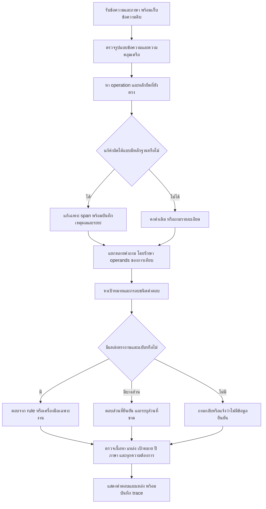

# Flow ฉบับตรวจแล้ว — PSU Esports Chatbot r34 finalI

วันที่เริ่ม 2 ตุลาคม 2026; ตรวจและเปิดใช้ฉบับสุดท้าย 3 ตุลาคม 2026 เวลาไทย

## 1. วัตถุประสงค์และขอบเขต

แก้ 4 กลุ่มที่ยืนยันจาก r33: ราคา PC+VR ถูก validator เปลี่ยนเป็นอุปกรณ์, วิธีจ่ายเงินที่คำจองผิดเป็นของ, คำพูด/ปฏิเสธผิดพร้อมกัน, และกติกา+facet ผิดพร้อมกัน เพิ่มการตอบหลายความต้องการในอังกฤษจากผลตรวจจริง

ใช้ข้อมูลและข้อความ rule เดิม ไม่แก้เจ้าของ/Gold ไม่เปลี่ยนนโยบายหรืออัตราราคา ไม่มีการเก็บสถานะจองจริงหรือสร้างการจองในรอบนี้ แยกคำตอบถูก แหล่งถูก การรับส่งสำเร็จ และการรับรองโดยเจ้าของ

## 2. Flow จากข้อความเข้าไปถึงคำตอบ

### 2.1 เก็บ input และผูกภาษา

- เก็บ raw และ recovered แยกกัน ใช้ locale binding แบบเดียวกับเว็บ
- ข้อความเกิน 180 ตัวอักษร, URL และชื่อ/ข้อมูลระบุตัวตน ไม่ผ่านตัวแก้คำงานชุดนี้โดยอัตโนมัติ
- หลาย span แก้ได้ไม่เกิน 3 ขั้น รวมงบ edit 4 ตัว ตัวใหม่ในรอบนี้ส่วนใหญ่ระยะ 1 ตัว
- ไม่เปลี่ยนเลขเครื่อง เวลา วันที่ ปี กลุ่มผู้ใช้ และคำจริงที่เป็นไปได้ เช่น pay/rice/march/embers

### 2.2 แก้ operation ก่อนเดาข้อเท็จจริง

| กลุ่ม | หลักยึด | สิ่งที่แก้ | สิ่งที่ต้องรักษา |
|---|---|---|---|
| เทียบราคา | บริการจากทะเบียนตรงอย่างน้อย 2 รายการ + กรอบแพงกว่า/ถูกกว่า/compare fees | operation ราคาและ task word ตาม syntax | ไม่เลือกบริการแรกทิ้งอีกบริการ ไม่เดากลุ่ม/ระยะ/จำนวนคน |
| วิธีจ่าย | กรอบจ่าย/ชำระเงิน + วิธี/ยังไง/อย่างไร/payment method | operation วิธีชำระและคำงาน 1 ตัว | `ของ` ไม่ต้องเปลี่ยนเป็นจอง ไม่สับสนโอนเงินกับโอนสิทธิ์ |
| คำพูด | คำเหมาะสมยังตรง + ชิ้นคำพูดไม่ระยะ 1 | transposition ที่มีหลักฐาน | ไม่เติมไม่ให้คำพูดเหมาะสม ไม่กินคำลงท้าย/ชื่อคน |
| กติกา | game จากทะเบียน rulebook ตรง + คำอ้างอิง | กติกา ก่อน facet จากทะเบียนในขั้นต่อไป | ไม่ยืมคนละเกม/ปี ไม่ตีความ 5v5 เป็น roster รวมสำรอง |

กรอบทั่วไปและกติกาแยกกัน กฎแข่งขันต้องมีลำดับก่อนกฎชำระเงิน/กฎในศูนย์ หากคำใกล้หลายความหมายให้ถามกลับ ตัวแก้ไม่ได้เป็น spellchecker สำหรับทุกคำในภาษา

### 2.3 แยกคำถามอย่างรักษาความหมาย

- `PC และ VR อันไหนถูกกว่า` เป็น 1 operation มี 2 operands ต้องได้ราคาทั้งสอง
- `PC กับ VR อันไหนแพงกว่า แล้วจองยังไง` มี 2 operations ต้องตอบทั้งราคาและขั้นตอน
- English payment method กับ payment deadline เป็นคนละ operation แม้อยู่ในหมวด reservation เหมือนกัน
- อย่าใช้การตรวจว่า domain เหมือนกันเป็นเหตุให้ทิ้งคำถามที่สอง
- เรื่องการแข่งขันให้ระบบ facet/composition ของ rulebook จัดการตามเดิม ไม่ใช้ splitter ทั่วไปแยกข้อกฎจนขาดเงื่อนไข

### 2.4 ดึงคำตอบจากแหล่งเดิม

- ราคาใช้ SERVICE_FEES และ source ids ที่ระบุ: PC update แยกจากภาพราคา ไม่คำนวณ VR 60 นาทีจาก 190×2 เพราะตารางระบุ General Student 375
- วิธีจ่ายอ่าน `rule_payment_bank` จาก rules ที่โหลดจริง; ไม่มี rule ไม่สร้างบัญชี/ธนาคารเอง
- คำพูดใช้ `rule_noise_language`; ไม่แต่งบทลงโทษเพิ่มเติม
- AoV/RoV ใช้ `competition_rules_rov_blueket_2025_men` และหัวข้อที่ตรง ปีอื่นไม่มีต้นฉบับต้องแจ้งฉบับที่มี
- ตารางเก่า/คำแปลอัตโนมัติ/source hash ไม่ใช่การรับรองข้อมูลปัจจุบันโดยเจ้าของ

### 2.5 ตรวจคำตอบก่อนจบ

1. **ความต้องการ:** ตอบทุก operation/facet ที่ถาม ไม่ตอบแค่ส่วนแรก
2. **เนื้อหา:** ตัวเลข ข้อจำกัด ข้อยกเว้น และคำปฏิเสธต้องครบ
3. **เป้าหมาย:** เครื่อง/บริการ/เกม/ฉบับ/ปีต้องตรง
4. **แหล่ง:** source id และ source domain ตรงกับคำตอบ; id ตรงอย่างเดียวไม่พอ
5. **ภาษา:** effective locale ตรง แต่การผ่านอัตโนมัติไม่เท่ากับเจ้าของรับรองคำแปล
6. **input ที่แก้:** คงคำลงท้าย ชื่อคน คำจริง เวลา และปฏิเสธ; ต้องตรวจแยกจากเนื้อหาคำตอบ
7. **ผลการจอง:** API/HTTP สำเร็จเป็น transport เท่านั้น ต้องมี fixture/สถานะที่รู้จริงจึงยืนยัน occupancy; รอบนี้ไม่เก็บของจริง

ห้ามข้าม validator เพื่อให้คะแนนผ่าน ถ้ากรอบผิดให้แก้กรอบ ถ้า source ขาดให้บอกส่วนที่ขาด ถ้า oracle ผิดให้เก็บผลดิบและทำ sidecar จากแหล่ง ห้ามแก้ Gold เดิมให้ตามคำตอบ

## 3. Loop ที่รันจริงและการแก้ตามผล

| รอบ | การตรวจ/สิ่งที่แก้ | ผลและข้อค้นพบ |
|---|---|---|
| Baseline | 64 เคสก่อนแก้ | literal 29/64; source-reviewed sidecar 43/64 เพราะ oracle ใหม่ผิดราคา375/380และ source ทางเลือก ไม่แก้ผลดิบ |
| A | price frame/คำเทียบไทย–อังกฤษ | 49/64; ราคาผ่าน16/16 |
| B | วิธีจ่ายไม่ต้องมีจอง และกู้คำงานตาม syntax | 58/64; payment16/16 |
| C | ชิ้นคำพูด/ปฏิเสธและ English topic | 63/64; speech16/16 |
| D | reference+game bootstrap rule cue ก่อน facet | 64/64 |
| E | holdout คำใหม่61เคส | 53/61 พบ8กรณีใหม่; หลังนำมาแก้ชุดนี้กลายเป็น regression ไม่เรียก unseen อีก |
| F | operands คำเทียบ, คำชำระ, รูปคำอังกฤษ, players facet | 60/61 |
| G | อย่า กับ อย่างไร | 61/61 และหลัก64/64; API125/125 แต่ unit ใหม่พบกิน ค ของครับ |
| H | boundary คำลงท้ายและชื่อคน | unit487/487; fresh4330คำถาม/13057เกณฑ์; API125/125; broad HTTP935/937 |
| I | holdout ผสม6เคสพบอังกฤษ2เคสตอบส่วนแรก → แยก operation method/deadline และ comparison/booking | 6/6 หลังแก้; unit489/489; replay1155คำถามผสมจาก corpusเดิม; final API131/131 |
| Release | ตรวจ package hash, API8090, UI assets และ concurrency แล้วเปิดใช้ | source-content131/131; concurrent10/10; owner/Gold584hashไม่เปลี่ยน |

ตัวอย่างเนื้อหาถูกแต่ unit ไม่ผ่านคือคำลงท้าย จึงเพิ่ม gate ใหม่แล้วทำต่อจริง ไม่หยุดเมื่อเห็นคะแนน source-content เต็ม รายละเอียดคะแนนเลือกเครื่องมืออยู่ใน CAUSE_ANALYSIS_TH.md และ trace ก่อน/หลัง

## 4. ตรวจ flow ด้วย 10 มิติ

1. หลักฐานราคา: แก้ oracle375 แยกจาก code/data
2. หน้าที่ชั้นต่าง ๆ: answer กับ validator ใช้สัญญาณงานร่วมกัน
3. ชื่อ/ตัวเลข/ปี: กันการเปลี่ยนเป้าหมายและฉบับ
4. คำปฏิเสธ: กู้เฉพาะ transposition ยืนยันได้ ไม่เติม/ลบความหมาย
5. ขอบเขตคำไทย: แยกอย่า/อย่าง และรักษาครับ/ค่ะ
6. ความหมายคำจริง: real-word ambiguity ขอรายละเอียด ไม่ forceGold
7. หลายความต้องการ: แยก operation แม้ domain เดียวกัน และไม่แยก operands
8. Oracle: ตรวจ content/source/input แยกกัน มี holdout และเก็บ literal failures
9. Provenance: ระบุ runtimeแต่ละรอบ/ส่วนที่ replay และไม่เรียก composite ว่า fresh full sweep
10. ใช้งานจริง: ทดสอบแพ็กเกจ HTTP/locale/UI/คิวก่อนเปลี่ยน8090 รักษา dirty files/logs และหยุดเฉพาะ process ที่ตรวจเจ้าของแล้ว

## 5. ผลใหญ่และข้อจำกัดที่ยังอยู่

- fresh H: 4,330 requests; I affected replay: 1,155 requests; unionหลังoverride **5,176 requests / 15,296เกณฑ์** ผ่าน14,225; ไม่ผ่าน1,071เกณฑ์ใน429คำถาม ไม่พบ grade ที่ก่อนผ่านแล้วตกใหม่ เทียบ r33 แต่ไม่ใช่ fresh finalI ทั้ง20,327คำถาม
- 2,000คู่ไทย/อังกฤษ: clean **1760/2000**, noisy **1764/2000**; cleanผ่าน/noisyตกเหลือ **5** จาก9ในr33 Positive content contractsมี894คู่ อีก1106คู่ยังไม่ได้รับการตรวจเนื้อหาครบเท่าชุดนั้น จึงห้ามเรียก overall factual accuracy
- อีก5คู่เป็น pay/play, rice/price, march/match, embers/members และตัวตนไทยที่ขาดมาก คงการถามกลับ
- Legacy failures429คำถามมี inherited automatic triage: route/intent227, clarification75, literal/missing-answer71, live/offline-or-legacy34, general policy source gap22 หมวดนี้เป็นการคัดแยกอัตโนมัติจากผลเดิม ยังต้องตรวจ semantics/sourceทีละกรณี ไม่อ้างว่าทั้ง429คำตอบผิดจริง
- HTTP broad H **935/937**: 2เกณฑ์เก่าคาด no_answerทั้งคำถาม ทั้งที่ตอบ eligibilityจากsourceพร้อมแจ้งไม่มีage; แยก sidecar ไม่แก้Gold Actual I affectedHTTP24/24; ไม่อ้างว่ารัน937ใหม่ทั้งชุดบนI
- Sourceการแข่งขัน30/30, partial8/8, edition24/24 ตรวจHTTPบนH; H→I ต่างเฉพาะ English splitter ซึ่ง competition guardข้ามอยู่แล้ว มีunitIและaffectedHTTPตรวจผลกระทบ
- WordPress transport และ occupancyจริงยังไม่ตรวจในรอบนี้ Known booking/calendar fixturesอยู่ในunitชุดเต็ม เป็นsynthetic ไม่ใช่สถานะลูกค้าจริง

## 6. สิ่งที่ยังต้องยืนยัน/ทำต่อ

1. ขอเจ้าของยืนยัน source/policy/ฉบับและความขัดแย้งที่ระบุใน OWNER_QUESTIONS_TH.md เช่น general personal gear, photo/video, Tekken pause, RoVข้อไม่ครบ, age/entryfee/roster+subs และตารางราคาปัจจุบัน
2. ขอผู้ตรวจไทย/อังกฤษรับรองคำแปลข้อกฎ/ตัวตนจากต้นฉบับ ไม่เท่ากับการผ่านmachine tests
3. ตรวจ429 legacy failed requestsตามsourceจริงก่อนจัดเป็น bug/เกณฑ์เก่า/คำถามขาดข้อมูล เลือกทำ content positive contractsก่อน route-only
4. เมื่อผู้ใช้เปิดให้เก็บสถานะจริง จึงทำ transport+known occupancy oracleตามวันเวลาไทย ไม่มีการสร้าง/แก้การจองโดยอัตโนมัติ
5. ถ้าพบคำถามผู้ใช้ใหม่ ให้เก็บ raw+locale+คำตอบ+trace+source+expectedที่รับรองก่อน วน baseline→fix→regression→holdout→packageAPI ตามflowนี้ ไม่เพิ่ม full-question aliasเป็นทางหลัก

## 7. เปิดใช้และหลักฐาน

- เว็บ: http://127.0.0.1:8090/ (refreshแท็บเดิม)
- Runtime: `2026.10.03-source-task-boundaries-r34`
- Package: `C:\Users\Chokhun\Downloads\Learn-LLM\18_PSU_Esports_Update_Route_Data\owner_local_delivery_20261003_source_task_boundaries_r34_finalI\PSU_Esports_Chatbot_Local`
- Production launcher PID9172; record `C:\Users\Chokhun\Documents\Codex\2026-09-25\psu-esports-studio-phuket-chatbot-c-2\web_chat_runs\r34_ready_8090_399d01136d.json`
- Report: `C:\Users\Chokhun\Downloads\Learn-LLM\18_PSU_Esports_Update_Route_Data\reports\r34_four_typo_groups_20261002_234656_bb3f77`
- app/UI130ไฟล์ตรงกับแพ็กเกจ; owner/Gold584ไม่เปลี่ยน; testsเดิม146ไฟล์ไม่เปลี่ยน เพิ่ม17testmethodsในไฟล์ใหม่; log/packageรุ่นเก่ายังคงอยู่

เอกสารหลักฐาน: CAUSE_ANALYSIS_TH.md, ORIGINAL_FOUR_BASELINE_TRACE_EXTRACTS.json, BASELINE_SOURCE_REVIEW_SIDECAR.json, FINAL_COMPOSITE_SCOPE.json, FINAL_COMPOSITE_SUMMARY.json, REMAINING_FIVE_DETAILS.json, REMAINING_FAILURE_TRIAGE.jsonl, OLD_PARTIAL_STATUS_ADJUDICATION.json, FINAL_RELEASE_AUDIT.json
