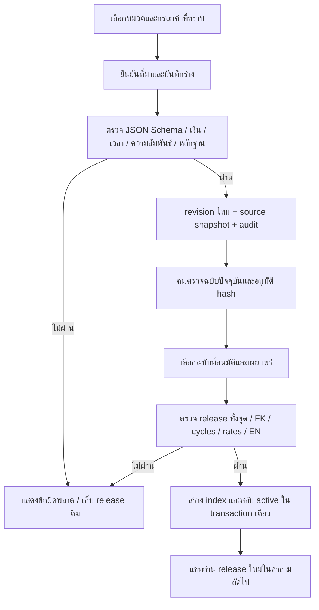

# Flow ข้อมูลกลางที่ลงมือทำแล้ว — studio-content-3.0

## 1. ขอบเขตและหลักการ

ตอบเฉพาะข้อมูลบริการศูนย์ เกม อุปกรณ์ ราคา การจอง นโยบาย การแข่งขัน และหมวดที่เกี่ยวข้อง เจ้าของเพิ่มรายการในชนิดข้อมูลเดิมได้โดยกรอกฟอร์ม ไม่ต้องเพิ่มชื่อเกมในโค้ด การเพิ่มชนิดข้อมูลหรือ operation ใหม่ เช่น สูตรคำนวณเฉพาะ ต้องเพิ่ม schema และ adapter แล้วทดสอบ

ใช้ 24 kinds / 155 fields จาก registry เดียว สำหรับฟอร์ม validator renderer และรายการ fields ที่ LLM เลือก ความหมายของช่องเป็นสัญญาที่เครื่องอ่านได้ ไม่ใช้การถามชื่อเกมทุกตัวอย่างเป็นกลไกหลัก

## 2. เจ้าของ → ข้อมูลที่เผยแพร่

save ใช้ expected_version เพื่อกันทับร่างคนละฉบับ approve ผูกกับ revision/hash; publish ผูก expected_active และ request_key การกดซ้ำคำขอเดิมได้ release เดิม แต่ reuse key กับอีก selection ถูกปฏิเสธ ร่างที่ไม่เกี่ยวข้องไม่ขัดขวาง release ที่ใช้ฉบับเผยแพร่เดิม

## 3. คำถาม → คำตอบ

1. scope/translation/creation guards เดิมทำงานก่อน
2. อ่าน snapshot ของ active release เฉพาะข้อมูลที่เผยแพร่ ไม่ค้น draft
3. resolve entity จากชื่อ/aliases ในข้อมูลเอง → bounded fuzzy เมื่อคะแนน ≥0.88 และห่างตัวเลือกถัดไป ≥0.06 ป้องกันเลขภาค/รุ่น ไม่ยุบชื่อเกมต่างรุ่น
4. ถ้าเป็นคำถามต่อ อ่าน user history ทั้ง text และ content พร้อม protocol acknowledge ของเว็บเดิม
5. เลือก fields จากคำถาม/คำอธิบาย registry; ถ้ายังตีความไม่ได้ LLM เลือก fields ภายใต้ schema เฉพาะ kinds ที่เกี่ยวข้อง จำกัด 4 วินาทีและไม่อนุญาตให้เขียน facts/SQL/ID ใหม่
6. plan ที่ผิดรูปแบบ field ต่างหมวด หรือแพลตฟอร์มที่ไม่ได้เผยแพร่ถูกปฏิเสธ ถ้าไม่เข้าใจให้ถามเพิ่ม ไม่ใช้เรื่องย่อเกมเป็นคำตอบแทน
7. join ด้วย stable IDs: game→game_service→service/resources, game→control_set/game_mode, service/audience→rate, zone→rental, competition→rules/dependencies
8. วันที่มีผลใช้ aware datetime และช่วง [เริ่ม,สิ้นสุด) รวมตรวจ parent references ก่อนแสดงข้อมูลลูก แพลตฟอร์มผิดไม่ดึงปุ่ม PC ไปตอบ
9. ทุก field ตอบตามสถานะ known/unknown/not_applicable/conflicted พร้อม obligations และ evidence locator; ราคาแสดง amount_minor เป็น THB โดยไม่ใช้ float คิดเงิน
10. “ทั้งหมด” ของรายการที่เลือกใช้ทุก field และ relations ที่รองรับ ไม่ top-k รายการทั้งหมดใน common catalog ใช้ ID count เต็ม แต่รายการเดิมที่ยังไม่ย้ายไม่รวมใน common list และระบุขอบเขตไว้
11. finalizer ตรวจ active/epoch อีกครั้งก่อนคืนคำตอบ ถ้าข้อมูลเปลี่ยนระหว่างตอบให้ retry
12. คำถาม occupancy สดส่งต่อ WordPress adapter เดิม; common live_binding เป็น configuration ไม่ใช่สถานะจองสด

## 4. วงรอบที่ทำจริงและเหตุผล

| รอบ | สิ่งที่พบ | การแก้ / หลักฐาน |
|---|---|---|
| 1 | temp directory/sandbox socket เข้าถึงไม่ได้ | แยก test temp ใน candidate และขอสิทธิ์ loopback ผ่านระบบ เก็บผลผิดพลาดเดิม |
| 2 | note=null แต่ schema เป็น string; SQL INSERT releases จำนวน placeholders ผิด | normalize note และแก้ INSERT ก่อนผ่านชุด 17 เคส |
| 3 | native confirm ทำ UI ค้างใน browser; form เพิ่มเกมใหม่ต้องพิสูจน์ | เปลี่ยนเป็น dialog ภายในหน้า กรอก→อนุมัติ→เผยแพร่→preview ผ่านจริง มีภาพ |
| 4 | เว็บถามต่อหลุด เพราะ history ใช้ text; negative oracle ไป match คำว่าอนุญาตในไม่อนุญาต | รองรับ text/content; แก้ oracle ตามความหมาย คงผลรอบแรกไว้ เว็บ 22/22 ผ่าน |
| 5 | withdrawn name หายหลัง release ใหม่; platform ไม่รองรับ; EN nested; timezone overlap | cc_names ถาวร, platform guard, recursive EN validation, compare actual instants ผ่าน 22 เคส |
| 6 | selector หมวดกว้างไปตอบคนละเลขภาค; parent หมดอายุยังตอบ child; uncertain phrasing | จำกัด category fallback, recursive effective checks, clarification+bounded planner ผ่าน final 26 เคส |
| 7 | first request เสียเวลา import validator | preload ใน worker ก่อน ready; ผล timing รอบเว็บสุดท้ายอยู่ในรายงาน ไม่อ้าง concurrency จาก sequential tests |

## 5. หลักฐานวิจัยที่นำมาใช้และข้อจำกัด

[SGD](https://arxiv.org/abs/1909.05855), [D3ST](https://arxiv.org/abs/2201.08904), [SGD-X](https://ojs.aaai.org/index.php/AAAI/article/view/21341) สนับสนุนการแยก descriptions/slots ออกจากชื่อรายการ แต่เป็นคนละ model/dataset จึงไม่รับรองว่าบอทไทยตัวนี้ zero-error ใช้ holdout title, paraphrase, history และ near-negative ตรวจจริง

[JSON Schema 2020-12](https://json-schema.org/draft/2020-12/json-schema-validation), [PROV-O](https://www.w3.org/TR/prov-o/), [Ollama structured outputs](https://docs.ollama.com/capabilities/structured-outputs) เป็นเอกสารทางการสำหรับ typed contract, provenance และ constrained plan การได้ JSON ถูก schema ไม่ได้หมายถึงตีความคำถามถูก หรือเจ้าของยืนยันข้อเท็จจริงแล้ว รายละเอียดการค้น/ระดับการอ่านอยู่ในรายงานวิจัยก่อนหน้า
