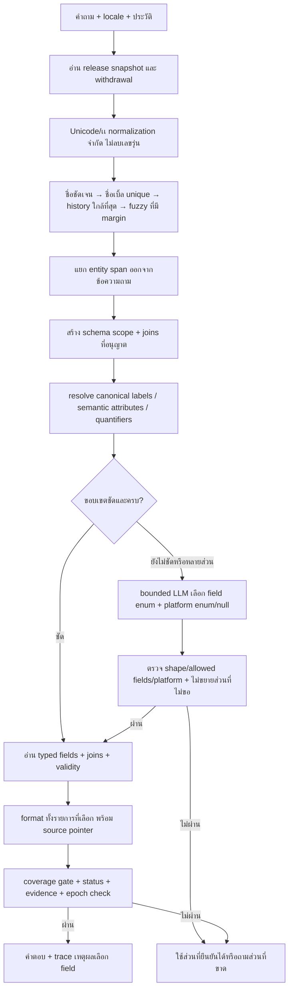

# Flow r59: อ่านคำถามตาม schema และตอบครบตามขอบเขต

วันที่ 2026-10-12 — เอกสารทำงานก่อนลงมือและจะเพิ่มผลตรวจหลังแก้

## 1. เป้าหมายและหลักฐานตั้งต้น

ระบบต้องตอบข้อมูลของศูนย์/ร้านเกมที่มีหลักฐานในทะเบียนกลาง ทั้งไทยและอังกฤษ รับชื่อรายการใหม่โดยไม่เพิ่ม alias ของคำถามทุกครั้ง และรับคำถามต่อเนื่องที่ระบุเพียงส่วนที่ต้องการได้

หลักฐานจาก r58: 5,056 คำถาม ผ่าน 2,653 ผิด 2,403; 2,272 เคสผิดเลือกรายการถูกแล้ว แต่เลือก field ไม่ครบ/ผิด/ว่าง; 131 เคสไม่เลือกรายการ; ชุดนี้เป็น DEMO สมมุติ ไม่ใช่การตรวจข้อเท็จจริง PSU จริง ผลที่เคยผ่าน 814 เคสมีธงตรวจคุณภาพซึ่งไม่เท่ากับผิดทุกเคส

## 2. รายการงานตามความเร่งด่วน

| ลำดับ | ปัญหา | การแก้ในรอบนี้ | เงื่อนไขผ่าน |
|---|---|---|---|
| P0 | ชื่อ/alias มีคำว่า price, rules, about แล้วปนกับ intent | แยกช่วงชื่อออกก่อนเลือก field | ชื่อเหมือนคำ intent ไม่ทำให้ถามผิดส่วน |
| P0 | global TERMS ส่ง field ที่หมวดนั้นไม่มี | resolver ตาม schema ของรายการ + relation ที่อนุญาต | ไม่มี unsupported field ถูกแสดงเป็นข้อมูลหาย |
| P0 | กี่คน/กี่นาที/สูงสุด/ขั้นต่ำแตกต่างตามหมวด | ใช้ชนิด attribute และ quantifier ของ schema | ที่นั่งห้อง/คนเล่น/เวลาเล่น/เวลากันช่องไม่สลับ |
| P0 | And/แล้ว + คำถามใหม่ไม่รู้รายการเดิม | history ใกล้ที่สุดและ explicit entity ชนะ history | ต่อเนื่องถูกและเปลี่ยนรายการได้ |
| P0 | LLM ส่ง record ID ใน platform, partial fields ไม่ถูกตรวจ | enum จาก scope, null ชัดเจน, dynamic descriptors, audit เหตุผล reject | แยก transport / schema / semantic / final-answer |
| P1 | ครบ/ทั้งหมด/all เป็น substring ทั่วไป | broad เฉพาะความต้องการข้อมูลทั้งรายการ; negation และ count guard | football/install/small/ข้อมูลครบไหมไม่ดึงทุก field |
| P1 | free to play เข้าทาง live | live เฉพาะความว่างเชิงเวลาหรือ slot; ค่าใช้จ่ายคนละ intent | ราคา 0 ไม่ถูกตีเป็นสถานะจอง |
| P1 | พิมพ์เบิ้ลชื่อคะแนนเกือบเท่ากัน | exact ก่อน, ลบเบิ้ลหนึ่งตัวในช่วงชื่อและรับเฉพาะ candidate เดียว | ชื่อ/เลขรุ่นใกล้กันไม่เดา |
| P1 | ชื่อ contact/ขั้นตอนกลายเป็น technical ID | render label จาก schema/ช่อง contact.value และ nested refs | ไม่แสดง ID แทนช่องทางที่มีค่าจริง |
| P1 | ValidationResult(True) ทุกครั้ง | coverage gate สำหรับ field ที่เลือก และ source pointer; confidence ระบุไม่ calibrated | กรณี missing coverage ไม่รายงาน validated answer |
| P2 | คำถามใหม่ยังไม่มีความหมายชัด | bounded LLM fallback หรือถามเฉพาะส่วนที่ขาด | ไม่เสริมข้อเท็จจริง/นโยบายเอง |

## 3. Flow การตอบ

## 4. รายละเอียดการออกแบบ

### 4.1 Schema scope

สร้าง fields ที่อนุญาตจาก CATALOG ทุกครั้ง ไม่ใช้ชื่อเกม/ศูนย์/fixture เป็นกฎ ข้อมูลใหม่ในหมวดเดิมใช้ resolver ชุดเดียวกัน ส่วน field ใหม่ที่ไม่มี concept ใช้ชื่อ canonical/คำอธิบาย schema และ bounded planner ห้ามอ้างว่าทุก paraphrase ของ field ใหม่จะถูกทันที

resolver แบบ deterministic เป็น fast path ของ attribute ที่มีความหมายชัด เช่น capacity/duration/contact และ quantifier เป็นกฎภาษา ไม่ได้เก็บคำถามทดสอบทั้งประโยค ห้ามอ่าน expected_fields เข้า resolver หรือ prompt

### 4.2 State และ pending

ชื่อชัดเจนในคำถามปัจจุบันชนะชื่อในประวัติทุกครั้ง คำถามสั้นต่อเนื่องใช้รายการจาก user turn ล่าสุดที่ระบุชื่อ หาก user ตอบเพียงชื่อหลังคำถามขาดรายการ ให้สืบทอด fields จาก user turn ที่ตั้งคำถาม การตัดสินใจต้องมี method trace และไม่สร้าง state ข้าม session

### 4.3 Planner

ส่ง schema description ไทย/อังกฤษตาม field key, selected kind, allowed platform และคำถามหลังตัดชื่อ (ชื่อไม่เป็น cue) output เป็น requested_fields, all_fields, platform เท่านั้น grammar สร้างจาก allowed keys ไม่ใช้ free text ห้าม LLM เขียนราคา/คำตอบ/SQL ต้องรองรับ abstention ผ่าน [] และทวน validator การ retry ต้องอยู่ใน deadline และไม่เพิ่มคิวโดยไม่จำเป็น

### 4.4 ความครบและความจริง

coverage runtime ตรวจได้ว่าคำตอบมี field ที่ plan เลือกจริงพร้อม locator แต่ **ตรวจเองไม่ได้ว่า plan ตรงความต้องการมนุษย์ 100%** จึงวัด independent expected fields ใน test แยกอีกชั้น การมี citation ไม่รับประกันเลือกคำตอบถูก การไม่มี field ใน schema เป็น unsupported scope ไม่ใช่ owner ยังไม่มีข้อมูล

### 4.5 คำตอบที่ควรแนบบริบท

ราคาแนบ currency/unit/duration/audience/validity; policy แนบ decision/เงื่อนไข/ข้อยกเว้น; competition rule รักษาข้อความทั้งข้อและ dependencies แต่ไม่ดึง rulebook ทุกข้อเมื่อถามเพียง release/date; game player counts ผ่าน game_mode ไม่เอาที่นั่งห้องแทน; ปุ่มทุกปุ่มใน preset ไม่เท่ากับทุก field ของเกม

## 5. ลูปตรวจทานและทดสอบ

1. สำรอง source ทั้งสามชุดและบันทึก Git status/DB logical hash
2. ตรวจ Flow รอบแรก: alias contamination/quantifiers/negation/unknown semantics
3. แก้ resolver และ planner ใน candidate พร้อม focused assertions ที่อิสระจาก renderer
4. วัดชุด 5,056 เดิมเพื่อเทียบก่อน/หลัง **ชุดนี้เป็น regression ที่เห็นแล้ว ไม่ใช่ holdout**; เก็บ log ใหม่
5. วิเคราะห์ fail และ pass→fail แยกตาม kind/style/language; ห้ามเพิ่มกฎชื่อ fixture หรือ expected answer
6. ปรับเฉพาะ concrete bug และทวน focused holdout ที่แต่งต่างจากชุดเดิม เช่น floor vs location, all seats, not all, steps + proof, prompt injection, platform ID
7. ทวน HTTP preview, pipeline, owner edit/publication guards และ actual LLM focus ใน scope ที่เปลี่ยน
8. เปิดผลเทียบ เก็บ unresolved cases/ข้อจำกัด เขียน Flow ฉบับหลังปรับและ propagation receipt
9. sync เฉพาะไฟล์ logic ที่ยืนยัน version เดิมตรงกัน ไป project/package ห้าม publish/แก้ owner DB โดยเดา

## 6. งานวิจัยที่ใช้และข้อจำกัด

รายละเอียดอยู่ใน Research.md งาน SGD/D3ST/SDT สนับสนุน schema descriptions + context/examples; PICARD/JSONSchemaBench สนับสนุนข้อจำกัด output ที่แยก syntax จาก semantics; CheckList สนับสนุน behavior tests หลายความสามารถ; noisy-channel เป็นหลักการ candidate correction ไม่ใช่หลักฐานว่าแก้ภาษาไทยทั้งหมดได้ในระบบนี้

## 7. ข้อมูลจริงที่ยังไม่ควรเหมารวมกับผลอัตโนมัติ

- สถานะสดผู้ใช้แจ้งว่าตรวจถูกแล้ว ถือเป็น user confirmation เดิม ไม่ใช่ผล DEMO นี้
- ภาษาอังกฤษผู้ใช้เคยแจ้งผ่าน แต่ข้อมูล DEMO ใหม่ยัง agent_translated ไม่ใช่ owner-reviewed
- production common DB มี 41 draft และไม่มี active cc_release; การแก้ engine ไม่เท่ากับ publish owner content หรือว่าหน้าเว็บเก่าถูกทุกหมวด
- การเพิ่มนโยบาย ราคา หรือเวลาเปิดจริงยังต้อง evidence/approval ที่ store กำหนด
- การตอบหลายคนพร้อมกันไม่ใช่ขอบเขต benchmark รอบนี้ ห้ามใช้ cache ของ test เป็นตัวเลข latency production

## 8. ผลจริงหลังลงมือ

ผลอยู่ใน RESULTS_TH.md และ REVIEW_LOOPS.md: core regression 5,056/5,056, HTTP 224/224, actual pipeline 224/224, 160 บทสนทนา/480 turns ผ่านครบ และ focused 50/50 ไม่มี pass→fail ใน core รอบสุดท้าย รายละเอียด raw LLM กับ guard/replay แยกชั้น ไม่เรียก raw LLM ว่าถูก 100%

## 9. Flow ที่ปรับจากผลจริง

### ก่อน resolve

1. Exact name ก่อน typo และก่อน history; alias คำอังกฤษต้องมีขอบเขต; numeric span ห้ามตัด 88 ไปเทียบ 8
2. Single repeat ต้อง unique หลัง suppress ชื่อสั้นซ้อนชื่อยาว; ไม่ลด threshold/margin ของ fallback fuzzy ทั้งฐาน
3. Strip ชื่อที่พบจริง/ชื่อเบิ้ลก่อน cues; เเ→แ และ Unicode NFC เป็น common normalization; full legacy preprocess ยังเป็นงาน integration ต่อ

### เลือก field

1. Primary kind เป็นขอบเขตหลัก; game มี game_mode/game_service/control_set children และ competition มี rule children
2. Related price expose amount_minor ให้ planner เท่านั้น ไม่เอา rate/rental ทุก column มาปน audience/service
3. Resolve minimum/maximum/count ตาม attribute type และ locale; session_minutes ต่างจาก occupancy_minutes และ duration_minutes ของราคา
4. Compound ใช้ union ของ needs; unsupported คือตีความ scope ไม่ได้ ไม่ใช่ fact.status=unknown
5. all games + platform คือทุก record + field platform ไม่ใช่ทุก field ของทุกเกม; full rule text คือข้อความทั้งข้อ ไม่ใช่ metadata ทั้ง record
6. opening status คือ state; opening hours/periods คือ open_periods

### รับแผน LLM

1. Enum จาก allowed schema และ selected scope; platform=null ถ้าไม่ได้ระบุ; [] เป็น abstention ที่ตรวจได้
2. ทุก gate และ timeout ต้องมี reason; HTTP 200/decoded JSON/schema accepted/semantic accepted เป็นคนละผล
3. เมื่อ deterministic clauses ครบ ให้ guard ลบ fields เกินและปฏิเสธ all_fields ที่ไม่ได้ขอ ถ้า model ตก known need ให้ไม่รับ plan
4. Unknown clauses ที่ model ตีความยังเป็น schema-only/unverified intent ต้องเก็บ log และวัด independent holdout; runtime citation/coverage ไม่พิสูจน์เรื่องนี้เอง
5. แผนที่ผ่านยังไม่ใช่ข้อเท็จจริง ให้ typed reader อ่าน source-backed values เท่านั้น

### อ่านและส่งคำตอบ

1. Preserve time validity/withdrawal/dependency/approved release guards
2. Game player count ใช้ mode; controls เลือก platform/preset ไม่ยืม PS5 จาก PC; competition release/date ไม่ดึง rule text ทั้งชุดโดยไม่จำเป็น
3. Resolve FK เป็นชื่อ/ค่า contact รวม nested steps; ถ้าไม่มี display field ใช้ alias ก่อน technical ID
4. สร้าง obligations + evidence locator และตรวจทุก selected need; missing coverage → partial_answer/validation=false ไม่ใช่ validated answer
5. แสดง uncalibrated confidence และ validation scope จริง แนบ planner audits ไปใน pipeline artifact
6. ระหว่างเล่น ไม่ใช่คำถามว่าง; ระหว่าง 15–16 เครื่องว่างไหม ยังเข้าทาง booking สด

## 10. เกณฑ์หยุดลูปรอบนี้และงานถัดไป

หยุดเมื่อ concrete failures ของชุดที่เกี่ยวข้องถูกแก้, core ไม่มี regression, published-store guards ผ่าน และมีคำอธิบายผล/ข้อจำกัดครบ ไม่ทำ full suite 20,000+ ไม่วนเพิ่ม test เพื่อให้ตัวเลขดูดี

งานต่อที่ทำเองได้และลำดับอยู่ใน RESULTS_TH.md โดยเริ่ม blind holdout/natural noise และ dynamic schema semantics, ต่อด้วย common/legacy state integration, rendering precision และ confidence calibration การยืนยัน facts เจ้าของเป็นอีก gate หนึ่ง ไม่ผูกกับการรัน fixtures ผ่าน
