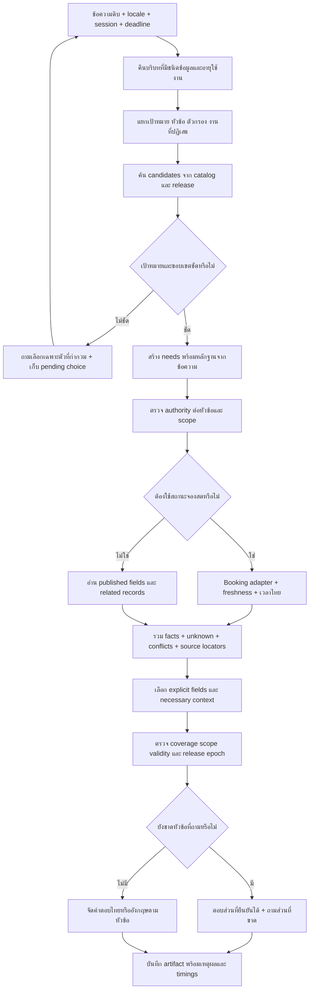

# Flow r61 ระหว่าง implementation

**ลงมือแล้วบางส่วน;แผน16ข้อด้านล่างยังเป็นtargetdesign ไม่ใช่ทั้งหมดถูกติดตั้งแล้ว**

อ่าน RESULTS_TH.md เพื่อดูสถานะทีละS01–S16และผลที่วัดจริง แผนฉบับต้นไม่ถูกแก้ทับในโฟลเดอร์r61_solution_plan

# แผนแก้ปัญหาที่เหลือทั้งหมดหลัง r60

วันที่วิเคราะห์: 2026-10-13 เวลาไทย

**สถานะ: แผนพัฒนาที่ตรวจทานกับ source แล้ว ยังไม่ได้ลงมือแก้หรือรันชุดทดสอบที่เสนอในเอกสารนี้**

ฐานอ้างอิง: โปรเจกต์จริง `C:/Users/Chokhun/Downloads/Learn-LLM/18_PSU_Esports_Update_Route_Data` และ source ที่ hash ตรงกันใน `r58_common_content_20261010/system/PSU_Esports_Chatbot_Local` ซึ่งอัปเดตถึง r60 แล้ว ผล r60 ใน `r60_generalization_20261012/FINAL_VERIFICATION.json` และ `ANALYSIS_TH.md`

## 1. เป้าหมายและเกณฑ์ความสำเร็จ

ให้เจ้าของเพิ่ม/แก้ข้อเท็จจริงตามฟอร์มเดิม แล้วแชทตอบตาม **รายการ + หัวข้อที่ถาม + เงื่อนไข + บริบทบทสนทนา + เวลาที่มีผล** โดยไม่ต้องเขียนเงื่อนไขชื่อเกมหรือ alias ของคำถามใหม่ทุกครั้ง

LLM เปิดสำหรับใช้งานปกติอยู่แล้ว ใช้ตีความคำถามและเลือกงาน ส่วนตัวอ่านข้อมูล/คำนวณ/ตรวจหลักฐานใช้โค้ดและข้อมูลที่อนุมัติ โมเดลไม่สร้างราคา นโยบาย สถานะสด หรือเลขเวอร์ชันเอง

เกณฑ์หลักแยกกัน:

1. เลือกเป้าหมายถูก: เครื่อง/เกม/บริการ/กลุ่มผู้ใช้/แพลตฟอร์ม/edition ถูก ไม่สลับตัวเลข
2. ตอบทุกหัวข้อที่ขอ: ไม่ตกส่วนที่สอง ไม่ใช้การมีคำตอบหนึ่งส่วนแทนความครบ
3. ให้เฉพาะเนื้อหาที่ต้องใช้: explicit content + necessary context; optional detail แสดงเมื่อขอ
4. ข้อเท็จจริงตรง release และเวลา มี source locator ทุกส่วนสำคัญ
5. unknown/conflicted/withdrawn/not_current ไม่ถูกเปลี่ยนเป็น Yes/No/ราคาเก่า
6. ถ้าต้องถามกลับ ให้ถามเฉพาะสิ่งที่ขาด และรับชื่อ/ตัวเลือกสั้นใน turn ต่อไปได้
7. สำนวนไทย/อังกฤษ/พิมพ์ผิดที่ meaning เดิมต้องได้ factual scope เดิม
8. คำถามนอกเรื่องศูนย์/บริการ/เกมที่มีข้อมูลยังตอบขอบเขต ไม่เพิ่มความรู้ทั่วไปตามใจโมเดล
9. เวลา/คิว/ความผิดพลาดของโมเดลต้องวัดกับ endpoint จริง และแยกจาก quality ของคำตอบ
10. งานที่มี owner facts ใช้ review/approve/publish เดิม ไม่อนุมัติข้อเท็จจริงแทนเจ้าของ

**ไม่มีเป้าหมายรับรองว่าทุกประโยคที่เป็นไปได้ต้องถูก 100%** ให้มีเกณฑ์วัดชัด ข้อผิดพลาดที่รู้ต้องไม่กลับมา และไม่ปล่อยคำตอบที่รู้ว่า scope ผิดเพื่อให้มี output

### คำศัพท์ที่ใช้ในแผน

| คำ | หมายถึงอะไรในระบบนี้ |
|---|---|
| entity / target | รายการที่ผู้ใช้ถาม เช่น PC1, เกมหนึ่งเกม, บริการหนึ่งชนิด |
| field | ช่องข้อมูล เช่น ราคา เวลาเล่น วิธีเล่น หลักฐานที่ต้องนำมา |
| need | หัวข้อที่ผู้ใช้ต้องการคำตอบ อาจต้องใช้หลายช่องข้อมูลร่วมกัน |
| scope / qualifier | เงื่อนไขของคำถาม เช่น กลุ่มผู้ใช้ แพลตฟอร์ม วันเวลา รุ่นเกม |
| projection | เลือกว่าจะนำช่องข้อมูลใดมาแสดงในคำตอบ |
| authority | แหล่งใดมีสิทธิ์ยืนยันข้อมูลหัวข้อนั้นในขอบเขตนั้น |
| legacy | เส้นทางอ่านข้อมูลเดิม ก่อนข้อมูลกลางรูปแบบใหม่ |
| release / epoch | ชุดข้อมูลที่เผยแพร่แล้ว และเลขสถานะที่เปลี่ยนเมื่อข้อมูลเปลี่ยน |
| fixture / gold | ข้อมูลตัวอย่างที่รู้ผล และสิ่งที่กำหนดไว้ล่วงหน้าว่าคำตอบควรมี |
| holdout | ชุดที่เก็บไว้ตรวจหลังพัฒนา โดยยังไม่เปิดดูผลระหว่างแก้ |
| calibration | ตรวจว่าความมั่นใจของระบบสัมพันธ์กับอัตราตอบถูกที่วัดจริงหรือไม่ |

### ตัวอย่างพฤติกรรมที่ต้องได้

ตัวอย่างต่อไปนี้เป็นเกณฑ์ออกแบบ ไม่ใช่ผลทดสอบหรือการยืนยันราคา/กฎใหม่:

1. “ราคาบุคคลภายนอกเท่าไหร่” → แสดงราคาบริการที่เกี่ยวข้องเป็นรายการ หากผู้ใช้ต้องการทั้งหมด ไม่บังคับถามชื่อบริการซ้ำเมื่อแสดงทุกตัวเลือกได้
2. ระบบถาม “PC หรือ PS5?” แล้วผู้ใช้ตอบ “PC” → ใช้หัวข้อราคาและกลุ่มบุคคลภายนอกเดิม พร้อมเลือก PC ไม่ถามใหม่ว่าต้องการเรื่องเกมหรือราคา
3. “ทั้งหมด” → อ่านตัวเลือกและหัวข้อจากคำถามก่อนหน้า ไม่แปลงเป็นคำถามความรู้ทั่วไป
4. “เกมไหนเล่นสี่คนได้” → ตรวจจำนวนผู้เล่นในโหมดที่ศูนย์รองรับ ไม่ใช้จำนวนที่นั่งห้องแทนจำนวนผู้เล่น
5. “ตอนบ่ายสามมีอะไรให้เล่นที่ว่าง” → ตรวจสถานะจองสดและแสดงเฉพาะอุปกรณ์ว่าง ไม่ตอบรายชื่อเกมที่ติดตั้งอย่างเดียว
6. “เอาเมาส์ส่วนตัวมาได้ไหม” → ตอบจากกฎที่ผู้ใช้ยืนยันไว้แล้ว ไม่เพิ่มข้อยกเว้นหรือค่าปรับที่ไม่มีข้อมูล
7. “ไม่เอาราคา ขอเวลาเล่นกับเวลาที่ล็อกเครื่อง” → ตอบเวลาสองแบบ ไม่แถมราคา
8. “ลงเกมเองได้ไหม แล้วต้องใช้ Steam ของตัวเองไหม” → ตรวจนโยบายสองหัวข้อแยกกัน ถ้าข้อใดยัง unknown ให้ระบุ ไม่ยืมคำตอบอีกหัวข้อมาสรุปแทน
9. หลังเจ้าของเปลี่ยนราคาหรือถอนข้อมูล → ตอบชุดที่เผยแพร่และยังมีผล ไม่ย้อนข้อมูลเก่ามายืนยันเพราะหาใหม่ไม่เจอ
10. พิมพ์ชื่อคล้ายสองเกม → ถามเลือกชื่อเกมสั้น ๆ แล้วใช้คำตอบต่อในบริบทเดิม ไม่เลือกเกมใดเองเพียงเพราะชื่อใกล้ที่สุด

## 2. หลักฐานที่ทำให้ต้องแก้หลายชั้น

### 2.1 ข้อมูลเกินบางส่วนมาจากตัวอ่านเอง

`app/knowledge/common/answer.py` บังคับ:

- policy เติม decision/conditions_all/exceptions/details/consequence แม้ถามหัวข้อเดียว
- rate และ rental_package ใช้ `keys=list(r['fields'])` เสมอ
- game child records ใช้ `add(child,list(child['fields']))` และเพิ่มข้อมูลบริการหลายช่อง
- competition children/dependencies แสดงทุก field

ดังนั้นการแก้ prompt หรือบอก LLM ว่า “ตอบสั้น” อย่างเดียวไม่แก้สาเหตุทั้งหมด และตัดคำตอบด้วยจำนวนคำอาจลบเงื่อนไขสำคัญ

28/100 เคส r60 มี extras: บางส่วนเป็นบริบทจำเป็น ไม่ใช่ 28 คำตอบผิดทั้งหมด ต้องแยกแต่ละ extra ว่า required context, optional, หรือ irrelevant ก่อนวัด precision

### 2.2 Semantic guard ยังตรวจความหมายไม่ได้ทุกสำนวน

`planner.py` บังคับ enum/shape ได้ แต่ `semantic_guard` ใช้ known cues ถ้าคำถามใหม่ไม่รู้ความหมายจะยังเป็น `schema_only_unverified_intent`. การเลือก valid field ผิดยังผ่าน schema ได้

### 2.3 ข้อมูลกลางมี entry point ก่อน legacy

`engine.py` เรียก common แล้ว return ถ้ามีคำตอบ; ถ้า common คืน None จะเข้าระบบเดิมต่อ เช่น game competition ที่ยังไม่ migrate. ต้องมี authority ต่อ entity/field/scope ก่อนตัดสิน fallback ไม่ปิดระบบเดิมทั้งก้อน เพราะข้อมูลจริง common ยังไม่เผยแพร่

### 2.4 ข้อจำกัดคิวมีหลายระดับ

`local_models.py` มี `MODEL_WORK=BoundedSemaphore(1)`, planner acquire แบบ non-blocking; `llm_health.py` มี admission อีกระดับ; worker supervisor มีคิวและ budget; Ollama เป็นอีก process. เปลี่ยน worker count อย่างเดียวไม่ได้ยืนยันว่าจะตอบพร้อมกันเร็วขึ้น

### 2.5 Rendering scope และ build version มีหลักฐานชัด

catalog schedule/closure ระบุ `zone_ids=[]` ที่ status=known คือทุกโซน แต่ renderer FK list join ได้ข้อความว่าง; ต้องแก้ความหมายนี้เฉพาะ kind/field ห้ามแปลง [] ทุก field เป็นทุกอย่าง

package_manifest ของ SYSTEM ยังระบุ runtime_version `2026.10.10-common-r58.2` แม้ source เป็น r60; launcher อ่านค่านี้ จึงต้องให้ runtime รายงาน code/content fingerprint ที่ตรงจริง ไม่ใช้วันที่อย่างเดียวบอกว่า process ใหม่แล้ว

## 3. แผนผังการตอบที่เสนอ



แผนผังไม่บังคับให้ LLM ทำทุกกล่อง: fast path ของ known semantics ใช้ได้; unknown paraphrase ให้ local planner ช่วย ภายใต้เวลาและจำนวน call ที่กำหนด

## 4. โครงสร้างกลางสำหรับคำขอภายใน runtime

เพิ่ม read-plan ภายใน ไม่บังคับเจ้าของย้ายฟอร์มหรือเปลี่ยนรหัสรายการทั้งหมด เพื่อให้ code แต่ละชั้นใช้คำขอชุดเดียวกัน

ตัวอย่างโครงสร้างเป้าหมาย — **เป็นข้อเสนอ ไม่ใช่ contract ที่ติดตั้งแล้ว**:

```json
{
  "schema_version": "common_read_plan_v1",
  "intent": "detail",
  "targets": [{"record_id": "resolved_id", "kind": "service"}],
  "needs": [
    {
      "id": "n1",
      "source_span": "เวลาเล่นจริงกับเวลาที่ล็อกเครื่อง",
      "field_ref": {"kind": "service", "key": "session_minutes"},
      "scope": {"platform": null, "audience_id": null},
      "resolution": "model_proposed"
    },
    {
      "id": "n2",
      "source_span": "เวลาเล่นจริงกับเวลาที่ล็อกเครื่อง",
      "field_ref": {"kind": "service", "key": "occupancy_minutes"},
      "scope": {"platform": null, "audience_id": null},
      "resolution": "model_proposed"
    }
  ],
  "unresolved_spans": [],
  "rejected_needs": [],
  "filters": [],
  "detail_level": "requested",
  "context_basis": [],
  "source_question_preserved": true
}
```

ข้อกำหนด:

- field_ref เป็น kind+key ไม่ใช้ key ลอย เพื่อแยก installed version/control version
- ID ต้อง resolve จาก candidate registry ที่ server สร้าง ไม่มี record ID อิสระจากโมเดล
- source_span ต้องอยู่ในข้อความต้นฉบับหรืออ้าง turn ที่ชัดเจน; **มี span ไม่ได้แปลว่าตีความถูก**
- needs ที่ model เสนอไม่ถูกตั้งว่า verified เพียงเพราะ JSON ถูก; แยก typed_supported/model_proposed/unresolved
- rejected task ไม่ตอบกลับ; negative fact เช่น “ไม่ใช่นักศึกษา” เก็บเป็น qualifier ไม่ทิ้ง
- filters เป็น enum field/operator ที่ whitelist ตาม type ห้าม SQL หรือ arbitraryexpression
- ค่าเวลาสดต้องส่ง adapter ไม่อ่าน availability เก่าจาก common
- need หนึ่งอาจต้องหลาย field เช่นราคา+หน่วย+เงื่อนไข; field หนึ่งอาจตอบหลาย need; เก็บ mapping แบบ many-to-many
- อ่านข้อมูลทั้งหมดเมื่อ user ขอทั้งหมดได้ ไม่ใช้เพดานความยาวตัดเนื้อหาที่เขาขอ; ถ้ามากแบ่งส่วน/หน้าโดยแจ้งจำนวนและให้ต่อได้

## 5. วิธีแก้ครบทั้ง 16 รายการ

### S01 — คำตอบมีเนื้อหาเกินที่ถาม

**สถานะ:** พบจริง; r60 extras28/100; ไม่ใช่ทุก extra ผิด

**วิธีแก้:** แยก response projection ออกจาก field selection

1. เพิ่ม metadata นักพัฒนา `answer_profiles` ต่อ kind:
   - explicit: field ที่ user ขอ
   - identity: ชื่อรายการ/หัวข้อ สำหรับไม่สับสน โดยเป็น heading ได้ ไม่ซ้ำเป็น bullet
   - necessary context: เงื่อนไขที่ถ้าไม่แสดงทำให้คำตอบผิดความหมาย
   - optional: detail ที่แสดงเมื่อขอ
2. price จำเป็นมี amount/currency/unit และ scope ของบริการ/กลุ่ม/ช่วงเวลา; ไม่แสดงทุก column ของ rate เพียงเพราะเป็นราคา
3. rental ถามราคา: ชื่อแพ็กเกจ+กลุ่ม+ราคา+หน่วย/เงื่อนไขที่ใช้จริง; ถามอุปกรณ์: equipment_included และ scope ไม่ยัดทุก term ที่ไม่เกี่ยวข้อง
4. policy “เอาเมาส์มาได้ไหม”: decision+applicableconditions+exceptions ที่มีผล; consequence แสดงเมื่อถามหรือเป็นข้อจำกัดที่จำเป็นจริง ไม่เติมโทษจาก unknown
5. childrecords ส่ง requestedprojection ไม่ใช้ list(allfields)เสมอ; ruledependencies แสดงข้อความเงื่อนไขที่จำเป็นพร้อมแหล่งอ้างอิง ไม่ยัด metadata ทุกตัว
6. all_fields/detail_level=full ยังตอบครบตามหมวด ไม่บังคับตอบสั้นเพื่อคะแนน

**ไฟล์:** answer.py + metadata ใหม่ `answer_profiles.json` + formatter/projection module; ไม่แก้ ownerdata

**ทดสอบ:** replay28cases, เพิ่มไทย/อังกฤษเจาะหัวข้อเดียว/ทั้งหมด/ข้อยกเว้น/ราคาเปรียบเทียบ/linkedchild. Gold แยก must_include/must_exclude/allowed_context

**ผ่านเมื่อ:** requiredcoverage ยังครบ; ไม่มี irrelevantextras ในชุด knownfailures; necessarycontext ไม่หาย; “ทั้งหมด”ไม่มี field ที่มีสิทธิ์แสดงถูกตัด

**ทำเองได้:** ทั้ง logic+syntheticgold; ถ้าไม่รู้ businesscondition ใหม่เก็บ unknown ไม่กำหนดว่า mandatory เอง

### S02 — ดึงข้อมูลเชื่อมโยงยังไม่ครบ

**วิธีแก้:** เพิ่ม relation contracts ที่อิง FK จริงของ catalog

1. กำหนด path ที่อนุญาต เช่น game→game_service→account_policy; resource→service→rate; competition→rule→depends_on
2. ทุก edge ตรวจ referencekind, effectivevalidity,withdrawal,platform/audience/service scope
3. traversal มี visitedset/depth/workbudget เพื่อหยุด cycle ไม่ส่ง allrecords ไปให้โมเดล join เอง
4. queryneed กำหนด projection ของปลายทาง เช่นถามบัญชีต้องอ่าน policy decision/details ที่เกี่ยวข้อง ไม่จบเพียงชื่อ policy
5. ถ้ามีหลายราคาที่คนละกลุ่ม ให้แสดงแยกหรือถามกลุ่มตามคำถาม ไม่เลือกตัวแรก
6. missinglink/unknownfield ต้องแยกจาก“ไม่มีบริการ”; sourcepointer ของปลายทางคงอยู่

**ไฟล์:** typedrelationresolver ใหม่ + answer.py + catalogreader; ใช้ reference_kind เดิมเป็นฐาน

**ทดสอบ:** 0/1/หลาย children; missingref;cycle;old/newversion;wrongplatform;audience ต่างกัน;ถอน child ระหว่างตอบ;ถาม nameonlyvsdetail

**ผ่านเมื่อ:** แต่ละ facts มี record_id+field+source ของตัวที่ถูก scope; ไม่รั่ว facts ข้ามกลุ่ม/แพลตฟอร์ม/เวลามีผล

**ทำเองได้:** contracts/test. Owner ต้องให้ facts เฉพาะ link ที่ไม่มีข้อมูลจริง ไม่เดาราคา

### S03 — ชื่อ field ซ้ำแต่ meaning ต่าง kind

**วิธีแก้:** schema semantic registry indexed ด้วย(kind,key)

- meaning_th/en, ask_examples, excludes/confusable_fields, value_type, relation_scope แยก kind
- `game_service.game_version`: installedbuild; `control_set.game_version`: version ที่ bindings ถูกตรวจ
- ย้ายข้อมูล metadata เก่าที่เป็น key ลอยผ่าน compatibilityfallback ไม่เปลี่ยน ownerrecord/คีย์ที่ stable
- ตรวจทุก155catalogslots ว่ามี meaning และไม่อ้าง field ที่ไม่มี; ไม่ให้ owner ต้องเขียน prompt
- semanticexamples เป็นงาน/ความหมาย field ไม่ฝังคำตอบ/ชื่อ fixture/aliases ทั้งประโยค; evaluationphrases คนละชุด

**ทดสอบ:** minimum-pair queries ทั้งสอง meaning ไทย/อังกฤษ, phrase ที่ถามทั้งคู่, unclear “รุ่นอะไร” ต้องถาม scope เมื่อ context ไม่พอ

**ผ่านเมื่อ:** เลือก kind+field ตรง; ไม่เปลี่ยน unknowninstalledversion เป็น controlversion ที่รู้

**ทำเองได้:** ทั้งหมดด้าน schema semantics. ตรวจ translationfielddescription เองได้; ไม่รับรอง facttranslation ใหม่แทน owner

### S04 — พิมพ์ผิดยังครอบคลุมไม่พอ

**วิธีแก้:** candidate correction + context scoring + protected entities

1. normalizeUnicode และแยก span ของชื่อ/ตัวเลข/คำปฏิเสธ/ภาษา โดยเก็บ rawtext เสมอ
2. candidate จาก catalognames/schema terms: insert/delete/repeat/transpose/substitution; keyboarddistance เป็น feature หนึ่ง ใช้ layout จริง ไม่แทนทุกตัวด้วยเพื่อนบ้าน
3. Thai ต้องพิจารณาสระ/วรรณยุกต์/ลำดับ codepoints ไม่ลบ mark ทุกตัวจนชื่อคน/เกมเปลี่ยน
4. score ด้วย editpattern+context+fieldtype+entityscope; ไม่ใช้ stringratio เพียงอย่างเดียว
5. ตัวเลขเครื่อง/edition/date/money ไม่แก้อัตโนมัติเมื่อไม่แน่ใจ; VR30นาทีและ occupancy1ชั่วโมงรักษานโยบายที่ user ยืนยันแล้ว
6. ถ้า candidate หนึ่งเด่นและ scope ชัดใช้ suggestion; ถ้าคะแนนใกล้กันเสนอ2–3ชื่อให้เลือก แสดง observedtext ใน trace
7. ลิมิต candidate/work ต่อ span ไม่สร้างทุก combination ทั้งประโยคจนช้า; ไม่ใช้ alias ของทุก typo

**ไฟล์:** schema_language.py + entitycandidatehelper + query_contract.py; reusablehelper ของเดิมต้อง reuse ก่อนเพิ่มซ้ำ

**ทดสอบ:** ชื่อเกม/เครื่องผิดหลายจุด; Thai marks; EN transposition; slang; mixedTHEN; correctwordhardnegatives; digits/negation invariant; noise ที่ meaning เปลี่ยนต้องไม่ใช้ gold เดิม

**ผ่านเมื่อ:** same-meaningcases คง scope; wrongentity และ overcorrection ไม่เพิ่ม; เวลาค้น candidate อยู่ใน budget

**ทำเองได้:** generation/tests/algorithm. Humanblindtypos ภายหลังเพิ่มหลักฐาน ไม่จำเป็นต่อเริ่มแก้

### S05 — คำถามยาวเกินเพดาน clauses/fields

**วิธีแก้:** ใช้ needs/workbudget แล้วแบ่ง batch เฉพาะเมื่อจำเป็น

- splitter รู้ coordinatednounphrases/quotednames/typedobjects ลด split ในชื่อหรือ“ขั้นต่ำและสูงสุด”
- ส่วนที่ชัดใช้ typedfastpath ส่วนกำกวมค่อยส่ง model; รวม need ที่ซ้ำเพื่อไม่เสีย call
- >6clauses อย่าเพิ่ม num_predict ลอยๆ: แบ่ง needs ตาม targetkind/ความสัมพันธ์และ tokenbudget รวม results บน snapshot เดียว
- จำนวน call รวมต้องผ่าน globalbudget; ถ้าอนุญาตเดิม2calls ไม่พอ ห้ามเกินเงียบๆ; ตอบส่วนที่มีแล้ว+แจ้งหัวข้อที่เหลือ/ให้ต่อ
- allinformation อ่าน facts ตาม schema ได้โดยไม่ให้ plannerenumerate ทุก field แบ่ง displaypages ถ้าคำตอบใหญ่

**ทดสอบ:** 1/6/7/12needs;nouncoordination;names มี and/และ;หลาย target;budgetexhaustion ใน batch2;withdrawal กลางงาน; duplicatefields

**ผ่านเมื่อ:** ไม่ตัด head/tail เงียบ; knownrequests ที่เกินเพดานแสดง coverage ต่อหัวข้อหรือถามต่ออย่างชัด; ไม่มี extraunboundedcalls

**ทำเองได้:** splitter+batch+pagination. ไม่ต้องเพิ่มราคา/กฎ

### S06 — คำตอบบางชนิดอ่านยาก

**วิธีแก้:** displayregistry แยก owner instructions ออกจาก userlabels

- TH/EN labels สั้น เช่น “เวลาเล่น”, “ช่วงที่จองได้”, “เวลาที่ช่องทางนี้ตอบ”
- enum mappinggesture/platform/conditions ที่ known; structuredconditions มี typedoperators และคำเชื่อมที่ไม่เปลี่ยน logic
- money ใช้ currency/precision จริง; date/time ใช้ Asia/Bangkok และแยก weekday/weeklyschedule/dateexception
- arraysempty ต้องตีความตาม kind/field: schedule/closurezone_ids[]→“ทุกโซน”; unknown→“ยังไม่ยืนยัน”; รายการที่ owner ยืนยันไม่มี→“ไม่มี”; ห้ามใช้ globalemptyfallback
- head/section grouping ตาม need; cites อาจรวม source เดียวแต่ locators ยังอยู่ใน artifact; sourceevidence ต้องไม่หาย
- คำแปลที่ไม่มีคง fallback พร้อม label เดิม ไม่ให้ LLM เติม meaning/fact

**ไฟล์:** renderingmodule/displaymetadata + answer.py; ไม่แก้ catalogmeaning เพื่อทำให้หน้าตาดูดี

**ทดสอบ:** unknown/not_applicable/conflicted/knownempty/false/0;ตารางราคา;ปุ่มกดพร้อมกัน vs กดตามลำดับ;allzones;longrules;ENsourcefallback

**ผ่านเมื่อ:** อ่านง่ายและ meaning/status ตรง rawsource โดยเฉพาะไม่มี/unknown/ทุกโซนไม่สลับกัน

**ทำเองได้:** rendering ทั้งหมดที่ meaning มีหลักฐานใน catalog; field ที่ meaning ไม่ชัดแสดงสถานะเดิมและแจ้งให้กรอกเพิ่ม

### S07 — LLM ไม่พร้อม/busy/timeouts

**วิธีแก้:** ให้โมเดลเปิดตามเดิม + gracefuldegradation ที่ไม่เปลี่ยนคำถามเป็น facts เดา

- ตรวจ modelreadiness และ warmup ด้วย model/optionscontext เดียวกับ planner/generation;ไม่ warm ทุก request
- ถ้า fields ชัด fastpath ตอบต่อได้; ถ้า needs ไม่ชัด ให้ clarification เฉพาะหัวข้อ/เป้าหมาย ไม่ตอบ genericmenu ทุกครั้ง
- แยก busy/transport/timeout/schema-rejected/semantic-unclear ใน audit และข้อความที่เหมาะสม
- pendingchoice จาก clarification ยังรับ“PC/ทั้งหมด/บุคคลภายนอก”ต่อได้;โมเดลกลับมาพร้อมไม่ย้อนเลือก field เก่า
- reusevalidatedplan cache ได้เฉพาะ key ที่มี query+locale+scopedtargets+qualifiers+schema/model/promptversion ไม่มีเก็บ answer สดข้าม freshness;cachehit ต้อง revalidate currentrelease
- boundedwaitqueue ผ่าน deadline ตาม S13; retry ได้เฉพาะเหลือ budget และ failuretransient ไม่วน retry ซ้ำทุกชั้น

**ทดสอบ:** modelabsent/cold/busy/timeout503/malformedJSON/duplicateclauses/recoveredhealth; explicitLLMoffflag ยังมีผล

**ผ่านเมื่อ:** ไม่ assertwrongfact หลัง modelfailure;fallbackstate/unknownvisible;ไม่มี requesthang; normalflags ยังเปิด

**ทำเองได้:** readiness/queue/clarification/cache. เครื่องใหม่ที่ memory ไม่พอเป็นข้อจำกัด hardware ต้องวัดก่อนตัดสินใจ

### S08 — validfield แต่ไม่ตรง meaning

**วิธีแก้:** semantics ก่อน coverage และแยกสามคำถาม: user ขออะไร / source มีอะไร / output ตอบอะไร

1. needs ประกอบ source_span+field_ref+target+qualifiers+resolutionbasis; rejectedneeds แยกชัด
2. ใช้ kind-specificdescriptions/exclusions และ minimum-pairs ของ S03ช่วย candidateplan
3. typedconstraints ตรวจ contradictions: playtimevsoccupiedtime; proofvseligibility; fullrulevsedition; liveavailabilityvsinstalledgames
4. modelproposedfield ที่ไม่ครอบคลุม semanticrisk ต้องไม่ถูก upgrade เป็น“verified”จาก schema; ใช้ trace ว่า intentunverified
5. secondreview ใช้เฉพาะ hardambiguouscase เมื่อมี budget; **โมเดลเดิมถามตัวเองซ้ำไม่ใช่ independenttruth** ต้องวัด benefit และ latency ก่อนเปิดเป็น default
6. หาก2 interpretations ให้ facts คนละ scope ให้ถามเลือกก่อน/ตอบแยกโดยไม่เลือกนโยบายให้; outputphrase-specificclarification
7. evaluatorgold ที่ freeze แยกจาก resolver/prompt; expectedneeds กำหนดจากความหมาย ไม่สร้าง gold โดยเรียก productionparser

**ทดสอบ:** contrastivequeries และ forbiddenfields ทั้งไทย/อังกฤษ; valid-but-wronginjectedplans; negativefacts; subtlecomparisons; requiredcontext

**ผ่านเมื่อ:** knownwrongvalidplans ถูก reject/repair ด้วยหลักฐาน; unknownmeaning ไม่ถูก claimsemanticguarantee; fieldrecall/precision/clarificationcorrectness รายงานแยก

**ทำเองได้:** logic+gold+tests. ข้อมูล business ใหม่ไม่ใช่งาน semanticvalidator ที่จะตัดสินเอง

### S09 — ไม่ระบุชื่อ/หลายเป้าหมาย/คำแนะนำตามจำนวนคนหรืองบ

**วิธีแก้:** discovery/filter/compareintents แยกจาก detail ของ namedrecord

- catalog-firstcandidatecollection ตาม kind; lexical/fuzzyretrieval แล้ว optionalembeddingrerank เมื่อมี benchmark ว่าดีขึ้น; ไม่สร้างชื่อเครื่องจาก LM
- serverresolve ชื่อ/alias แล้วส่ง indexedcandidates ให้ planner ไม่ให้โมเดลสร้าง recordID
- typedfilters เช่น players_min<=4, players_max>=4, studio_supported=true สำหรับ game_mode;ไม่ใช้ room_seats แทนจำนวนผู้เล่น
- budgetquery คำนวณเฉพาะ calculation_rule ที่ known พร้อม audience/service/session/occupancy;ถามเพิ่มเมื่อ group ไม่รู้ หรือแสดงตัวเลือกแยก groups ตามที่ user ขอ
- “เครื่องว่างตอนบ่าย3” ส่ง liveadapter และ list เฉพาะ free ตามคำขอที่เคยยืนยัน ไม่แปลงเป็น publishedgamelist
- compare ให้ตารางเดียว rows เป็นหัวข้อ columns เป็น resolvedtargets; missingfield โชว์ unknown ต่อ target ไม่ยืม facts อีกตัว
- ambiguousshortname เลือก2–3candidates; unknownnewgame ไม่ถูก nearestmatch ไปเกมอื่น

**ทดสอบ:** เกม4คน,งบ100บาท,PC/PS5เทียบ,สองเกมชื่อใกล้,undernamedcategory,resource#digits,ไทยอังกฤษ mixed,livevsstaticdiscovery

**ผ่านเมื่อ:** resultset เท่ากับ typedfixturequery;ไม่อ้างเป็น stock สด; uncertainty ถามเฉพาะ filter/target ที่ขาด

**ทำเองได้:** discovery/readfilters/calculatorintegration. ไม่แนะนำเกมหรือราคาโดยใช้ข้อมูลนอก catalog มาปน production

### S10 — common กับ legacy ตอบ facts เก่าทับใหม่

**วิธีแก้:** authorityrouter ต่อ entity+field+scope ก่อน legacyfallback

สถานะที่เสนอ:

| ผล common/ownership | การตอบ |
|---|---|
| ยังไม่มี release และยังไม่ migrate entity/field | legacy เดิมยังตอบได้ตาม sourceguards |
| common owns และ publishedknown/current | commonfacts เป็น authority ของ scope นั้น |
| common owns แต่ unknown/conflicted | แสดง status/clarify; ไม่ยืม legacy เพื่อเปลี่ยนเป็น known |
| withdrawn/retired entity ที่เคย managed | แสดงถอน/ไม่พร้อม; blocklegacy ที่ map กับ entity นั้น |
| commonrevision หมดอายุหรือ future | ยังยืนยัน current ไม่ได้;legacy ไม่ชนะ ownedfield เพราะ revision ไม่ effective |
| บาง fieldowned บาง fieldunmanaged | merge ต่อ field พร้อม source และ scopemap เท่านั้น |
| livebooking | adapter สดเป็น authority ของ bookingstate ไม่ใช้ staticcommon แทน |

การทำจริง:

1. สร้าง coverage/ownershipmanifest จาก release และ history พร้อม tombstones ไม่ใช้ heads draft เป็น publishedfacts
2. entitybridge legacy↔common ต้องแมปจาก ID/source/uniqueapprovednames ที่ตรวจได้; mapping ไม่ชัดไม่ merge อัตโนมัติ
3. `try_common_answer` คืน typeddecision handled/defer/blocked พร้อม scope แทน None ที่แยก“ไม่มีข้อมูล/ไม่มี authority/ถอนแล้ว”ไม่ได้
4. engine/filterretrievalhits ต้อง rejectlegacylocators ที่เป็น ownedfield ไม่ใช่แค่ตรวจ finalanswer หลัง LLM สร้างเสร็จ
5. releaseepoch+scopefingerprintinvalidatecache; publish/rollback/withdraw/validity transitions ต้อง coverageconsistent
6. schema/table เพิ่มถ้าจำเป็นแบบ additivemigration/backup/transaction ยืนยัน dry-run ก่อนใช้ ownerDB;ไม่ touchownerfacts

**ทดสอบ:** fixture ราคาเก่า70ใหม่90;ไม่ใช่ productionprice. Publish ใหม่→90, withdraw→ไม่คืน70, unknown→unknown, rollback→รุ่นที่ activate จริง, wrongaudience ยังไม่90, no-release ยัง legacy ได้. ตรวจ schedule/rules ด้วย ไม่หยุดแค่ราคา

**ผ่านเมื่อ:** staleownedfacts จำนวน0ใน mutationfixture;unmanagedlegacy ยังตอบได้;statementmixedsources ทุกตัวมี scope/locator

**ทำเองได้:** architecture/migrationdry-run/fixtures. อย่า guessmapping ที่ไม่มีหลักฐาน

### S11 — บริบท common กับ legacy ต้องทำงานร่วมกัน

**วิธีแก้:** sharedtypedconversationstate และ adapter จาก history/request_plan ที่มีอยู่

- state: lastconfirmedtargets,askedneeds,qualifiers,domain,pendingchoices,release/schemafingerprint,turnID/age
- อ่านเฉพาะ validateduserselection/structuredartifact ไม่ parse คำตอบ assistant เป็น authorityfacts
- explicitnewentity/คำว่า“เปลี่ยนเป็น”ชนะ history;ใหม่ subjectclear ล้าง pending เฉพาะ domain ที่เกี่ยวข้อง
- “ทั้งหมด”หลังถามบริการ →ทุกตัวเลือกใน pendingscope; “ทั้งหมด”หลังระบุ PC →ทุกหัวข้อที่ถามเกี่ยวกับ PC ตาม context ไม่กลายเป็นทุก record ทุกหมวด
- acceptedchoice ต้องตรง options และ epoch; stalechoices ต้อง revalidate ไม่ reuseprices เก่า
- partialupdate เช่น“คนภายนอก”เปลี่ยน audience คง service;“ไม่เอาราคาเอาเวลา”เปลี่ยน needs ไม่ลืม entity;“แล้วอีกเครื่อง”ต้อง resolve เครื่องใหม่ก่อน
- TTL/window/turnlimit จาก config; sessionisolation กับ assistantartifacts ไม่แชร์ข้าม user
- conversationalrewrite ถ้าจำเป็นเป็นข้อความช่วย+typedstate เก็บ original;โมเดล rewrite ไม่ overwriteusernumbers/negation

**ทดสอบ:** 24flows3turn ขึ้นไป;rate/rules/game/bookingcrossdomain;wrongchoice/stalechoice;backtracking;explicittargetoverride;twoisolatedsessions. แยก countsflows/turns

**ผ่านเมื่อ:** pending ถูกเติมและคำตอบจริงใน turn2/3scope ตรง;turn ที่เปลี่ยน topic ไม่ลาก needs เก่ากลับมา

**ทำเองได้:** state/adapters/tests. ไม่ต้องให้ user คุยแทนเราทุก flow

### S12 — confidence ยังไม่ calibrated

**วิธีแก้:** ช่วงแรกไม่แสดง heuristic เป็น“เปอร์เซ็นต์ถูก”; แยกความมั่นใจ target/intent/source/currentness

1. เก็บ signals: entitymargin,semanticbasis,unresolvedcount,scopeconflicts,evidencecoverage,translationstate,planerror/cached
2. ทำ calibrationdataset คนละชุดกับ training/examples และ evaluation. แบ่งตาม source-recordgroups และ phrasing ไม่ให้ clean/noisyvariant เดียวกันข้าม split
3. reliabilitydiagram/Brier/ECE ถ้ามี probability; selectiveaccuracy-vscoverage และ clarificationburden เป็นหลัก
4. learnthreshold/calibrator เฉพาะเมื่อ labels พอ ไม่ตั้ง.9เองเพราะต้องการ accuracy สูง;ทดสอบ OODwithin-studio และ offtopic
5. confidence สูงห้ามข้าม source/validity/authorityhardguards
6. reportagent-labeledcalibration เป็น syntheticproxy เท่านั้น;humanblindlabels เมื่อมีพร้อมจึงรับรอง usageprobability ดีขึ้น

**ผ่านเมื่อ:** setaside errorrates ตาม bins สอดคล้อง claim;abstentiontradeoff ดีขึ้นตาม benchmark ไม่ใช้ modelselfconfidence อย่างเดียว

**ทำเองได้:** instrumentation/proxyanalysis/calibrationpipeline. การรับรองจริงต้อง labels ของคำถามจริงภายหลัง ไม่ blocklogicfix อื่น

### S13 — เวลาตอบและใช้พร้อมกันยังไม่ได้วัด r60

**วิธีแก้:** วัดก่อนเลือก concurrency และปรับคิวให้ทุกชั้นตกลงกัน

- แยก timings: queue/context/entity/intent/modelload/generate/retrieval/booking/render/total
- workload A structured, B schema-planner, C legacyLLM, D compound, E livebooking; labels ต้อง qualitychecked ไม่ทำทุก request เป็น“LLM500คำ”ที่ไม่แทนผู้ใช้ร้านเกม
- clients1→2→4→8→เพิ่มเฉพาะเมื่อ quality/timeout/memory ผ่าน;warm และ cold แยก;ใช้ staggeredstart และ simultaneousburst แยก
- รายงาน throughput,p50/p95,max,error/busy/timeout/coverage ต่อคน;ไม่เอาเฉลี่ยกลบคนท้ายคิว
- `MODEL_WORK=1`ตอนนี้ nonblocking อาจ skip;เลือก boundedcentraladmissionqueue นับเวลารอใน deadline ก่อนเพิ่ม parallel
- coordinator ต้องครอบคลุม workerprocess ถ้าใช้หลาย process;threadingsemaphore ต่อ process ไม่ใช่ globallimit;มี cap อีกใน Ollama
- candidateparallel1/2/4วัดทีละค่าเมื่อ memory พอ ไม่เปลี่ยน user/systemOllamaconfig ถาวรระหว่าง benchmark โดยไม่แยก runtime
- reducecalls และ prompt ด้วย needs/schema scoping;validatedplanreuse ตาม S07; staticreleaseindexcachekeyepoch; liveanswers ไม่ reuse ข้าม freshness
- cancellation/deadline ต้อง releasequeue/modelslots, resetworker containment เมื่อจำเป็น;ไม่ retry จน request ค้าง
- กำหนด SLO จากผลเครื่องนี้ก่อน ไม่สัญญา“กี่คน/กี่วินาที”ก่อนวัด;เครื่องไม่พอเสนอ tradeoffs จาก measurements

**ผ่านเมื่อ:** ไม่มี scope/factregressions จาก load, ทุก request จบใน configuredbudget หรือบอก busy/retry ชัด, เลือก capacity จาก p95/error/memory จริง

**ทำเองได้:** benchmarks/queue/callreduction;hardwareupgrade หรือ hosting เป็นตัวเลือกหลังมี measurements

### S14 — ownerdraft ยังไม่ publish

**วิธีแก้:** เตรียม ownerreviewpacket ไม่ publish เองจากการที่ test ผ่าน

1. read-onlyaudit41drafts:requiredfield/status/validity/evidence/FKs/conflicts/localization/revisionhash
2. ทำ owner-facingtable:ข้อมูลที่มี+แหล่ง+สิ่งที่ต้องยืนยัน+blocker;แยก technicalerror ที่เราแก้ได้จาก businessunknown
3. เติม fact จากแหล่งที่ user ให้/official ที่มี authority ตาม category และ evidence เท่านั้น;ไม่เดาสิ่งที่ไม่มี
4. englishstatus เดิมที่ user ยืนยันไม่ขอซ้ำ; translation ใหม่หรือ factchanged ใช้ stale/machinetranslatedflag และ revisionhash ตามเดิม
5. validator ปัจจุบันอนุญาต agent_translated เมื่อระบุสถานะชัด ไม่จำเป็นต้องให้มนุษย์ตรวจทุกคำแปลก่อนทุกทดลอง แต่ต้องไม่เรียกว่า reviewed เอง
6. ทำ previewsample จาก proposedrelease ใน sandbox ให้ owner ตรวจต่อ record/หมวดพร้อม diff; productionpreview ที่อ่าน published ยังใช้ตามเดิม
7. owner ยืนยัน exactfacts/revision แล้ว approve/publish transaction. conflict หรือ unknown ที่จำเป็นต้อง resolve ก่อน

**คำถาม owner เมื่อข้อมูลนั้นขาดจริง:** รายการนี้ข้อมูลปัจจุบันถูกไหม? เริ่มมีผลวัน/เวลาใด? ใช้กับกลุ่ม/บริการ/โซนใด? เงื่อนไขใน source นี้ครบหรือมีข้อยกเว้น? ไม่ถามกว้างว่า“ระบบถูกไหม”

**ผ่านเมื่อ:** publicationguards ผ่าน, ownerconfirmation อ้าง revision ที่ exact;42ndrecord เพิ่มไม่ต้องแก้ชื่อใน code; ยัง0release จนกว่าอนุมัติจริง

**ทำเองได้:** audit/report/technicalrepairs/sandboxpreview/agenttranslation. Ownerapproval ธุรกิจทำแทนไม่ได้

### S15 — process ค้างเก่าและ version ไม่ตรง source

**วิธีแก้:** build/readinessdiagnostics และ updateactivation ที่ตรวจได้

- generatecodefingerprint จาก allowlistedsource/schema/displaymetadata ที่ load ตอน startup;contentfingerprint จาก activerelease/epoch แยกกัน
- /health หรือ status แสดง buildID+modulefingerprint+effectiveflags+modelreadiness+activecontentepoch ไม่เผย token/rawprivatefacts
- launcher อ่าน installedmanifest เทียบ runningprocess ของชุดที่ถูกต้อง ถ้าไม่ตรงแสดง“มีอัปเดตพร้อมโหลด”พร้อม controlledrestart ขั้นตอนเดียว
- drain หรือรอ requests ของ process นั้นจบก่อน restart;ตรวจ PID/port/executable/root ไม่ kill ทุก python หรือทุก Ollama
- เมื่อ user สั่ง applyupdate/reopen ถือ authorization นั้น ไม่ถามซ้ำ;ในรอบวางแผนนี้ไม่ restartsession ของผู้ใช้
- manifestversion ต้องสร้างจาก releasebuild จริงไม่คง r58.2เมื่อ source เป็น r60;ไม่ใช้ตัวเลข version พิสูจน์ factsaccuracy

**ทดสอบ:** oldprocess/newfiles,wrongportotherproject,manifestmismatch,alreadyrunningcurrent,requestduringrestart,healthstaleepoch

**ผ่านเมื่อ:** UI/health รายงานรุ่นที่รันจริงตรง fingerprint หลัง activation และ process อื่นไม่ถูกหยุด

**ทำเองได้:** diagnostics/launcher/activationtests. การเปิดใช้หลัง request ของผู้ใช้ทำตาม authorization ใน session

### S16 — archives เดิมยังไม่ใช่ source ล่าสุด

**วิธีแก้:** reproduciblepackagebuild จาก verifiedstaging directory

1. manifestallowlistcode/runtime/ownerUI/contentDB/approvedassets+modelpolicy แยกทุกรายการ
2. สอง variants ตามที่ user เคยขอ: bundledmodels กับ setupdownloadmodels;ตรวจ weights/digest/licensemetadata/runtimeprerequisites ที่มีจริง ไม่ copymodelpaths จากเครื่องเก่า
3. DBexportconsistentbackup ไม่ copy ไฟล์ SQLite ที่กำลัง write โดยไม่มี snapshot;ไม่รวม tokens/sessionlogs/DEMOdata/benchmarks/oldbackups
4. hashes/versions/datarelease ให้ตรง verifiedsource;build ใหม่ใน folder/ZIP ชื่อใหม่ ไม่ทับ archive เดิม
5. extract ไป path ใหม่มี spaces/Thai/non-admin;config/launcher ใช้ relativepaths;test คำถาม common จาก demoopt-in แยกและ actualpublishedcontent เมื่อมี
6. bundled ทดสอบการไม่ดาวน์โหลด models;downloadvariant ต้องแจ้ง firstsetup/network/size ชัด;การทดสอบบนเครื่องเดิมที่มี Ollama ไม่ใช่ cleanmachineproof
7. README บอก variant/เปิดไฟล์ไหน/update/ownercontent/ข้อจำกัดเครื่อง;receiptcodehash+packagehash+modelstatus+cleanenvironmenttestscope

**ผ่านเมื่อ:** extractedhashes ตรง build;launch ใช้ runtime/model ของ variant จริง;ไม่มี private/devdata ปน;ไม่รับรอง“ทุกเครื่องเปิดได้”หากยังไม่ทดสอบ environment นั้น

**ทำเองได้:** build/audit/extracttest;cleanmachine/VMtest ทำตาม environment ที่มี ไม่สร้างผลผ่านถ้ายังไม่ได้ทำ

## 6. ลำดับลงมือและ dependency

| ระยะ | ทำอะไร | เหตุผลและ gate ก่อนถัดไป |
|---|---|---|
| A | freezebaseline/git/source/DB + annotateextras + auditmetadata + ownerpacket(read-only) | แยกสาเหตุและไม่ทับงานเก่า; owner ไม่ต้องตอบเพื่อเริ่ม logic |
| B | S03 kindsemantics + S08 needscontract + S01 projection + S06 rendering | ตีความและแสดงผลให้ตรง; replayknownfailures+newminimum-pairs ผ่าน |
| C | S10 authority และ tombstones + S15 builddiagnostics พื้นฐาน | ป้องกัน staledata ก่อนเผยแพร่ common; mutationtests ผ่าน |
| D | S02 relationcontracts + S09 discovery + S11 contextshared | ขยายตอบข้ามหมวด/ไม่ระบุชื่อ/หลาย turn บน scope ที่ปลอดการสลับข้อมูล |
| E | S04 typo + S05 longquestions + S07 degradation | ใช้ semantics/entity/contracts เดียวกัน;ไม่สร้าง correction/gates หลายชุดแยกกัน |
| F | S13 measuredload + S12 calibrationproxy | ปรับจาก qualitystable;confidence ต้องอยู่ท้าย semanticfix |
| G | S14 factualapproval/publish เมื่อ owner พร้อม + S15 controlledactivation + S16 rebuiltvariants | ส่ง build ที่ตรวจจริง ไม่รอ owner เพื่อทำ A–F แต่ไม่ publish แทน |

S15diagnostic ทำตั้งแต่ต้นได้ ส่วน restart จริงหลัง build พร้อม; S14audit ทำขนานกับ logic โดยคนเดียวทีละงานได้ แต่ approval ที่ dependent ต้องรอ owner ไม่ให้ ownerblock ทุกงาน

## 7. Test plan ที่เกี่ยวข้อง — ยังไม่ได้รัน

ตัวเลขต่อไปนี้เป็นขนาดชุดเริ่มต้นที่เสนอ ไม่ใช่ผลผ่าน และชุดอาจใช้ fixture ร่วมกัน ห้ามรวมเป็นจำนวนความสามารถอิสระ

| ชุด | ขนาดเริ่มต้น | Gold/การตรวจ |
|---|---:|---|
| projection | 28old +64new | required/allowed_context/forbiddenfield+value+locator |
| semanticskind | 48minimum-pairs | expectedkind+key+scope;หลาย meaning และ ambiguous |
| authoritymutations | 40scenarios | expectedsource/revision/state หลัง publish/withdraw/rollback/time |
| relations | 48scenarios | exactentitypaths+scope+destinationlocators |
| discovery/compare | 80queries | expectedresultset+typedfilter+unknownqualifiers |
| conversations | 24flows อย่างน้อย3turn | per-turnstate/answer;นับ flows/turns แยก |
| noise | 96variants+correctcontrols | same-meaningpreservation และ falsecorrectionrate |
| longquestion | 24cases | needscoverage+budget+nohead/tailcut |
| LLMfailure | 24injected +8actual ที่ทำได้ | outputtype/health/timeout/slotrelease ไม่เท่ากับ actualquality ทุกเคส |
| rendering | 32cases | rawtype/status/evidence meaning TH/EN |
| load | 1/2/4/8clients × workloads × warm/cold | latency/throughput/quality/errors ไม่ใช่ factsunit |
| packaging | 2variants × path/runtimeconditions | extractedhash+startup+modeluse;cleanenvironmentscope จริง |

### Gold และคะแนนที่ต้องเปลี่ยน

- แยก expected_target_ids, explicit_needs, required_context, allowed_optional, forbidden_fields และ expected_unknowns
- fieldselectionprecision ไม่นับ identityheading เป็น extra ผิด แต่ fieldunasked อื่นต้องอธิบาย basis
- relationneed ตรวจ childrecordfield ไม่ตรวจเพียงมี key เดียวกันใน record อื่น
- unknown/empty/notapplicable/false/0 มี gold ต่างกัน
- measure all-fields recall สำหรับ“ทั้งหมด” เพื่อไม่แก้ overanswer โดยตัดทุกคำตอบสั้นลง
- ประเมิน questionambiguity เองก่อนใช้ gold: ไม่บังคับราคาเมื่อ user ถาม kit เฉยๆ;เก็บ ambiguousgold แยก
- reservedfreeze ก่อน evaluation;หลังเปิด failure เป็น seenregression;ต้องมี newholdout เมื่ออ้าง generalization
- clean/noisy variants และ records เกี่ยวข้องอยู่ split เดียวกัน;แบ่ง TH/EN/kind/intent ให้เห็นจุดอ่อน
- humanblind ผลเมื่อมีจริงแยกจาก agentauthored;ยังไม่อ้างคะแนน synthetic เป็น productionaccuracy

### Loop หลังแต่ละระยะ

1. รัน baseline ชุดเฉพาะระยะ เก็บ rawquestion/answer/plan/evidence/timings
2. จัด failure: entity/context → semanticneed → authority → relation →projection/render → evidence/currentness → model/queue → evaluationgold
3. แสดง whyselected จาก trace/code ไม่อ้าง hiddenthought ของ LLM; expectedanswer จาก fixturevalues ที่เลือกไว้ก่อนวัด
4. แก้สาเหตุร่วมที่ reuse ได้ ห้ามเพิ่ม fixture-namebranch หรือ alias ประโยคเพื่อผ่าน
5. runtargetedfixcases+hardnegatives+minimalrelatedregression;ขยาย testing เฉพาะ risk ที่เปลี่ยน
6. เปิด reserved เมื่อพร้อม;แก้แล้วรายงาน seenresults แยก firstattempt
7. ตรวจ source/DB/Gitpreservation แล้วส่ง logic ผ่าน hashguard พร้อม docs/receipt
8. หยุด optionaltest เมื่อ gate พอ ไม่ full20k ตามข้อจำกัดของผู้ใช้;ถ้า knownfailures ยังอยู่ให้แสดงรายการและ nextfix ไม่รายงาน“จบ100%”

## 8. Log/artifact ที่ต้องมีเพื่อตอบว่า“ทำไมถึงตอบแบบนี้”

- rawquestion / normalizedquery / spellingcandidates ที่ใช้จริงและเหตุผลที่ไม่ใช้
- contextturnrefs/pendingchoice/explicitoverride ไม่เก็บ secret เพิ่มเพื่อ debug
- entitycandidates/scores/topmargin/filterqualification
- needs/span/field_ref/resolutionbasis/rejected/unresolved
- plannerfeaturegate/modelbusy/transport/schema/semanticstatus แยกกัน
- authoritydecision ต่อ scope: common/legacy/live/blocked พร้อม release/version/validity
- traversedrelations+discardedcandidatewhy ไม่ logfactsprivate ที่ไม่ถูกถามทั้งหมด
- responseprojection: explicit/context/optionalremoved ต่อ field
- obligations/status/evidence locators/epochcheck
- total/queue/modelload/generate/retrieval/adapter timings และ callcount
- evaluatorgoldversion/firstseen-vs-regression/synthetic-vs-human เพื่อไม่ตีความคะแนนผิด

## 9. งานที่ทำเองได้ / ต้องใช้ owner

**ทำเองได้ทันที:** metadata/exclusion/projection/rendering/authorityrouter/relationcontracts/entityfilters/context/typo/longquestion/readiness/queue/tests/proxycalibration/auditownerfacts/buildpackagediagnostics

**owner ต้องตัดสินใจเฉพาะเมื่อเจอข้อมูลขาดหรือขัดกันจริง:** facts/policy ราคา/เวลามีผล/scope ของ business ที่ source ไม่ยืนยัน และ approveexactrevisions ก่อน publish ไม่ใช้คำว่า“ขอให้ตรวจทุกอย่าง”แทน reviewpacket

สถานะจองสดและอังกฤษที่ user เคยยืนยันยังคงเป็น userconfirmation ของครั้งนั้น ไม่สั่งตรวจซ้ำเพราะแผนนี้;ข้อมูล translated ใหม่ยังต้อง label ตามจริงและ invalidate เมื่อ facts เปลี่ยน

## 10. ทบทวนแผนสามด้าน

### Review1 — ครบปัญหาและมีทางลงมือ

- S01–S16ตรง16รายการล่าสุดทุกข้อ มี files/logic/fixtures/acceptance/ownership
- แยก confirmedbug กับ risk ไม่ tested;ไม่รายงาน S08/S10ว่าเจอ productionfailure แล้วเมื่อมีแต่ช่องโหว่ทาง architecture
- แต่ละระยะใช้ commoncontracts ร่วมกัน ไม่เขียน16pipelines แยกและเพิ่ม call16ครั้ง

### Review2 — ป้องกันวิธีแก้สร้างข้อผิดพลาดใหม่

- “ลด extras”ไม่ตัด priceconditions/exception/fullrules; all-requests ยังตอบครบ
- “authoritycommon”ไม่ปิด legacy ที่ยัง unmanaged/0release;unknownowned ไม่ยืม oldknown
- “เพิ่ม typo”ไม่เปลี่ยนเลข/edition/negativefact;ambiguouscandidate ถามเลือก
- “เพิ่ม LLMreview”ไม่ใช้ modelselfcheck เป็น truth หรือเพิ่ม call โดยไม่ budget
- “longquery”ไม่แบ่ง snapshot คนละรุ่น/ทิ้ง clauses;
- “parallel”ไม่เพิ่ม thread/process แต่อีกชั้นยังล็อก1แล้ว claimfaster;มี crossprocessadmission

### Review3 — การนำเข้า/การวัด/เจ้าของใช้งาน

- ownerforms ยังเดิม จัดทำ semantics/displaymetadata โดย developer;schemaupgrade ถ้าจำเป็นเป็น additive
- factapproval ไม่ถูก unitpass แทน;ENmachine-statuspublish ได้ตาม validator แต่ไม่เรียก humanreviewed
- runningversion กับ sourcehash แยก;packageversion เก่าไม่ใช้พิสูจน์ runtime อัปเดต
- archives ใหม่ชื่อใหม่ ไม่ overwriteoldlogs/DBs/Gitwork;cleanmachineclaim ต้องมี test จริง
- proposedtestcounts ไม่ใช่ results; reservedseenstatus ชัด;calibration ไม่มี humanlabels ยัง proxy

## 11. งานวิจัย/เอกสารประกอบที่ตรวจเพิ่มเติม

ค้นแบบเจาะจงจากต้นฉบับเพื่อเสริมแผน ไม่ใช่ deep/systematicliteraturereview ใหม่;ใช้ชุดงานวิจัย r59เป็นฐาน ไม่รัน paper-search-pro ซ้ำเพราะเป็นการออกแบบจาก literatureset ที่มีแล้ว

1. **QReCC — Anantha et al. (2021)**: แยกการ rewrite บริบท การค้น และการอ่านคำตอบเป็นงานย่อย. นำแนวคิดมาแยก context/entity/reader ของเรา ไม่ติดตั้ง datasetopen-domain เพื่อเพิ่มความรู้ทั่วไปนอกศูนย์. [ต้นฉบับ](https://aclanthology.org/2021.naacl-main.44/)
2. **Selective QA under Domain Shift — Kamath et al. (2020)**: ศึกษาการตอบ/งดตอบเมื่อข้อมูลต่างจากที่โมเดลคุ้นเคย และพบข้อจำกัดของ confidence จากโมเดลเพียงอย่างเดียว. ใช้เป็นเหตุผลของ heldoutcalibration และ risk–coverage ไม่อ้างว่าฝึก calibrator แล้ว. [ต้นฉบับ](https://aclanthology.org/2020.acl-main.503/)
3. **Ollama official FAQ**: concurrency ขึ้นกับ memory และ parallelcontexts เพิ่ม memory;รองรับการ preload/keep-alive. จึงวัด parallel บนเครื่องจริงก่อนเพิ่ม slot ไม่รับรองจำนวน users จาก workercount อย่างเดียว. ตรวจวันที่2026-10-13. [เอกสารทางการ](https://docs.ollama.com/faq#how-does-ollama-handle-concurrent-requests)
4. **ชุด r59 D3ST/SGD-X/PICARD/CheckList**: ใช้ schema descriptions, robustness testing และ typedoutputcontrols เป็นฐานตามการประยุกต์ใน r59;ไม่อ้างว่ากรอบ JSON รับรอง meaning หรือ reproduce โมเดลใน papers. ดู `r59_schema_repair_20261012/Research.md`

การเลือกลำดับ/สัญญา authority/projection/readplan ข้างต้นเป็นข้อเสนอวิศวกรรมที่อนุมานจากโค้ดและผล r60 ต้องพิสูจน์ด้วย tests แต่ละระยะ ไม่ใช่ผลทดลองที่ papers รับรองสำหรับ PSU โดยตรง

## 12. สิ่งที่เสร็จในรอบวางแผนนี้

อ่าน source ของ reader/planner/querycontract/store/entrypoint/queue/launcher/manifest, ตรวจ catalogscopeemptyzones, ทบทวนผล r60 และเอกสารต้นฉบับเพิ่มเติม สร้างแผนพร้อม16solutions/runtimeflow/dependencies/testcontracts/ownerboundaries/3reviews

**ยังไม่ได้แก้ productioncode/DB/publish/restart/rebuildarchives หรือรัน test ชุดใหม่ในแผนนี้** จึงไม่มีคะแนนหลังแก้ร61 ต้องลงมือ B/C เป็นลำดับแรกตามแผนเมื่อเริ่ม implementation
