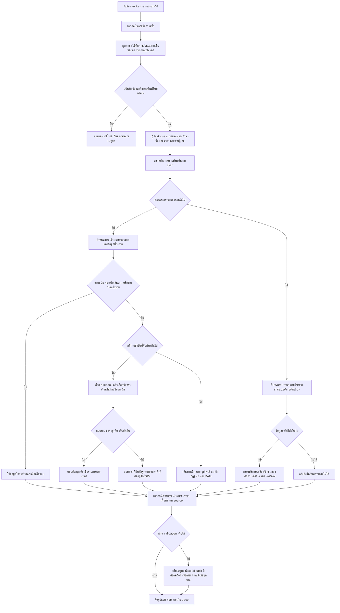

# Flow r30 ฉบับทบทวน 3 — งานที่ทำแล้ว การตรวจจริง และงานที่ยังเหลือ

วันที่ 2 ตุลาคม 2026 ใช้กับรุ่น `2026.10.02-full-improvement-r30-G2` เอกสารนี้แยกสิ่งที่ลงมือทำและทดสอบแล้วออกจากสิ่งที่ยังเป็นงานถัดไป ไม่รับรองว่าทุกคำถามถูก ไม่เปลี่ยนนโยบาย/ราคา/ข้อมูลเจ้าของ และไม่เขียนทับ Gold หรือ log เก่า

## 1. สิ่งที่แก้ในรอบนี้ เรียงตามผลกระทบ

| ลำดับ | สาเหตุที่ยืนยันจากโค้ด/trace | สิ่งที่ทำแล้ว | เกณฑ์พิสูจน์ |
|---|---|---|---|
| P1 | ตัวเลือก 1 หรือ 2 ชั่วโมงถูกอ่านเป็นระยะเดียว | อ่าน duration alternatives ที่มีหน่วย รวมสามตัวเลือกและหน่วยร่วม คิดแต่ละตัวเลือกด้วย SERVICE_FEES เดิม | ยอดและจำนวนรอบทุกตัวเลือก; เวลา/วันที่/รหัสเครื่อง/ช่วง 1–2 ชั่วโมงไม่เป็นตัวเลือก |
| P1 | คำปฏิเสธกลุ่มนักศึกษาถูกใช้ให้สิทธิ์ฟรี | ตัด affiliation ที่ผู้ถามปฏิเสธ; ถ้ากลุ่มจริงยังไม่ชัดให้ถาม | ไม่อ้างสิทธิ์ฟรีให้ผู้ที่ปฏิเสธกลุ่ม; แหล่ง PC ยังบังคับเมื่อมีข้ออ้างราคา |
| P1 | “ค่าเล่นแต่ละเครื่อง” หลุดไปข้อมูล PC เก่า | ใช้รายการแพ็กเกจทุกบริการจากตารางเดียว พร้อมแหล่ง PC วันที่ 2026-07-27 | ต้องครบทุกรายการ/กลุ่มที่เก็บไว้; ไม่สร้างราคาใหม่ |
| P1 | ชื่อปุ่มชนกับคำในชื่อเกม/คำอธิบาย | เลือกชื่อปุ่มก่อน exact / ชื่อย่อยใน source / unique OSA one edit สำหรับชื่อไม่มีเลขและยาวอย่างน้อยสี่ตัว | รหัส R9/Q9/Z9 ที่ไม่มีไม่แทนด้วย R1/R2 และไม่แสดงปุ่มอื่นทั้งหมด |
| P1 | “จองอะไรเพื่อเล่นเกม” เข้า booking steps โดยยังไม่ได้เลือกบริการ | ผูก exact game กับบริการจาก catalog แล้วให้ขั้นตอน; เกม/ภาคไม่ชัดถามต่อ | catalog ไม่ใช้ยืนยัน slot หรือสร้างการจอง |
| P1 | ผู้เล่นหลัก/เปลี่ยนตัว/เลือดและศพไม่ถูกจับเป็นประเด็นกฎ | เพิ่มโครงสร้างข้อความไทย/อังกฤษแบบผูกเกม และดึงข้อกฎ literal จาก rulebook เดียว | ทีม CS2 5 คน; ห้ามเปลี่ยนสมาชิก; VALORANT ปิดเลือด/ศพ; ไม่เอา “หน้างาน” ไปตอบเรื่องเอกสาร |
| P1 | arrival ถูกเหมารวมเป็นเวลาเริ่มแมตช์ | RoV แสดงข้อ 4.1.4 ครบ และแจ้งว่าข้อนี้กล่าวถึงการเริ่มแข่งช้าเกิน 15 นาที | ไม่สร้างเส้นตายการมาถึงอีกข้อจากการตีความ |
| P1 | หน้าเว็บนำ layout direction คะแนนต่ำไปเลือกภาษา แม้ detector ให้ผ่าน | ให้เฉพาะ flag keyboard_layout_mismatch ที่จำแนกแล้วมีผลต่อภาษา | คำไทย/typo ไทยไม่ถูกเปลี่ยนเป็น EN เพราะ mapping candidate; แป้นผิดจริงยังขอพิมพ์ใหม่ |
| P2 | EN fallback เหมารวมไม่มีต้นฉบับเป็นไม่มีคำแปล | แยก missing policy source / missing translation ไม่แนบหน้าแรกเป็นหลักฐานของกฎที่ไม่มี | คำถามถ่ายภาพ/วิดีโอไม่แต่งสิทธิ์/ความยินยอม/พื้นที่ |

## 2. Flow ตอนใช้งานจริง

ข้อจำกัดของ Flow ปัจจุบัน: การจับประเด็น implicit และการรักษาเกมหลัง splitter ยังไม่ครบทุกประโยค รายละเอียดในข้อ 5; validator บางเส้นทางยังตรวจ route/source มากกว่าเนื้อหาทุก proposition ไม่กล่าวว่าการต่อกล่องในภาพพิสูจน์ครบแล้ว

### ราคาและกลุ่ม

1. แยกบริการเดียว/ทุกบริการ/เปรียบเทียบหลายบริการ ระยะเวลาต้องมีหน่วย
2. แยกตัวเลือกจากช่วงเวลา 1–2 ชั่วโมง; ไม่อ่าน PC1 หรือ 09:00 หรือวันที่เป็นระยะเวลา
3. คำปฏิเสธกลุ่ม/ระยะเวลาไม่ถือเป็นข้อยืนยันใหม่ ถ้าต้องใช้ข้อมูลเพิ่มให้ถาม
4. Nintendo ไม่ทราบจำนวนคนแสดงแพ็กเกจที่มี ไม่สมมุติจำนวนคน; VR ราคาต่อรอบกับการกิน slot เป็นคนละการตรวจ
5. ราคา PC ที่เป็นข้อเท็จจริงต้องมี local update; clarification ที่ยังไม่มีราคาไม่ต้องใช้แหล่งราคาเป็นหลักฐาน

### ปุ่มและแพลตฟอร์ม

ใช้ label จากแหล่งจริงก่อนคำอธิบาย typo ที่แก้ได้ต้องมีตัวเลือกเดียวและไม่มีเลข ยังคงหมายเหตุแหล่งรอง ต้องทดสอบด้วยเครื่อง/เกมจริงก่อนรับรอง mapping ของศูนย์ การถามแพลตฟอร์มเมื่อมีหลาย mapping เป็นงานเพิ่มที่ยังไม่ได้ครอบคลุมทุก fallback

### กฎและอังกฤษ

หนึ่งเกมต้องอ้าง rulebook เกมนั้น ทุก proposition ต้องมีข้อกฎรองรับ การมี hit ID หรือ confidence .97 ไม่พิสูจน์ว่าคำตอบครบ .97/.98 ของเส้นทาง literal เป็นค่าความมั่นใจการจับเงื่อนไขตามโค้ด ไม่ใช่คะแนนรับรองผู้จัด อังกฤษใช้คำแปลที่ผูก hash กับ source ไม่แปลเติมข้อมูลที่ไม่มี นโยบายไม่มีต้นฉบับต้องแยกจากต้นฉบับมีแต่คำแปลขาด

### จองและเวลา

ถามว่าง/ไม่ว่างใช้ข้อมูล WordPress สดผ่าน chatbot โดยไม่ต้องเปิด Dashboard แยก ในแพ็กเกจนี้ `dashboard_required=false`, `cache_seconds=0`, `read_only=true` สถานะเชื่อมต่อได้เป็นหลักฐาน transport; fixture ที่รู้คำตอบเป็นหลักฐานคำนวณ occupancy; สถานะจริงต้องเทียบ oracle จริงอีกขั้น การทดสอบ oracle จริงยังพักตามคำขอผู้ใช้ นโยบาย Maintenance/ช่วงเปิดทั่วไปไม่เท่ากับเครื่องว่างในวันนั้น

## 3. Flow ทดสอบที่ทำจริง

1. เก็บ Git status, snapshot app/tests เดิม 248 ไฟล์ และ hash ข้อมูล/booking 584 ไฟล์ก่อนแก้; snapshot เพิ่มก่อน D/E/F/G/G2
2. Inventory `data/eval`, routing, ground_truth และ human_review ทั้ง JSON/JSONL; alias และ subset บันทึกแต่ไม่เอามาบวกเป็นตัวอย่างอิสระ
3. baseline 69 ข้อ: 15 → A 40 → B/C 69; เพิ่มขอบเป็น 79: D 75 → E 78 → F 79; ขอบเพิ่ม 43: baseline F 17 → G 37 → G2 43 การนับนี้เป็นรอบทดสอบจริง ไม่แต่งจำนวน loop
4. unittest ทุกโมดูล 411 ข้อ และ smoke 85 ไฟล์; เกณฑ์ล้าสมัยต้องเทียบ r29/แหล่งเดิมก่อนเรียก regression
5. ทุก input หลัก 20,327 requests / 55,583 grades แยกตาม corpus; ชุดเก่าอีก 970 requests / 981 grades; session 12 เคส/24 turn; guard 500 ทั้ง native detector และ runtime profile
6. sweep ใหญ่ปิด LLM/semantic และใช้ booking unavailable แบบควบคุม; รุ่น G2 ใช้ locale binding แบบ server เพื่อไม่สรุป direct Auto ผิดเป็นเว็บผิด
7. ตรวจเว็บจริงแบบเปิด LLM/semantic: 79 + 43 + 280 + 320 + 128 = 850 เคส ตรวจ source/เนื้อหาตาม oracle ของแต่ละชุด; live/guard ตรวจแยกอีก 44 เคส
8. แยกข้อผิดจริง / source ขาดหรือขัดกัน / Gold/heading/mode เก่า / grader bug / proper names/ภาษา / dependency offline / latency / ambiguity
9. เก็บผลเดิมครบ ถ้า grader ผิดให้สร้างผล rescore อีกไฟล์พร้อมเหตุผล ไม่แก้คำถามหรือ expected เดิม
10. Build แพ็กเกจใหม่ ตรวจ hash/source preservation/API ก่อนเปลี่ยน 8090 เฉพาะ process ที่ยืนยันเป็นของงานนี้ แล้วตรวจ API ซ้ำหลังเปลี่ยน

ผลสุดท้ายและจำนวนที่ผ่านดู `FINAL_RESULTS_TH.md` ในรายงาน r30; ต้องไม่เรียก observation หรือ route-only ว่า answer accuracy

## 4. ทบทวน Flow 10 ประเด็น

| จุดตรวจ | ผลและสิ่งที่ปรับ |
|---|---|
| 1 รักษาไฟล์ | ใช้ snapshot/hash และรายงานใหม่ ไม่ reset Git ไม่แทน Gold |
| 2 เลข/เวลา | duration parser ต้องมีหน่วย มี negative controls รหัสเครื่อง/วันที่/ช่วง |
| 3 คำปฏิเสธ | ตรวจกลุ่ม/ระยะเวลา ไม่ให้สิทธิ์จากข้อความที่ถูกปฏิเสธ |
| 4 แหล่งข้อมูล | ข้ออ้างราคา PC มี local source; no source policy ไม่แนบ homepage เพื่อทำเหมือนยืนยัน |
| 5 ชื่อปุ่ม | exact label และ ambiguity; ไม่แก้รหัสเลข |
| 6 ขอบเขตเกม | exact service choice และชื่อ rulebook; ภาคไม่ชัดถามเพิ่ม |
| 7 ภาษา | เปรียบ ingress/direct พบ candidate คะแนนต่ำมีผลผิด จึงเพิ่ม classified direction gate |
| 8 ประโยคหลายเรื่อง | พบ splitter หลุด target ในชุดเก่า บันทึกเป็นปัญหาจริงที่ยังต้องแก้ |
| 9 หลักฐานทดสอบ | แยก source/content/route/guard/transport/occupancy และ oracle ของคน |
| 10 การเปิดใช้งาน | แพ็กเกจใหม่ทดสอบแยกพอร์ต เก็บรุ่นก่อนและ log ไม่หยุด process อื่น |

ตารางนี้เป็นการตรวจ 10 ประเด็นของเอกสาร ไม่อ้างว่ารันชุดใหญ่ครบ 10 รอบ

## 5. งานต่อ เรียงความสำคัญ และ Flow ที่ต้องใช้

### P1-A: ข้อผิดจริงในกติกา implicit/หลายประเด็น

ตัวอย่างที่ตรวจพบหลัง G2:

- `CS2 ใช้แพลตฟอร์มอะไรและห้ามดัดแปลงตัวเกมไหม`: splitter ส่วนหลังไม่รักษาเกมและไปตอบกฎเสียงดัง ทั้งที่ส่วนแรกมี Steam/ห้ามดัดแปลงแล้ว
- `CS2 ปิดรับสมัครแล้วเพิ่มเพื่อนเข้า roster ได้ปะ`: proposition matcher ไม่อ่านลำดับ “ปิดรับสมัครแล้ว” จึงเลือก roster จำนวน 5 คน แทนข้อห้ามลงทะเบียนหลังปิดรับ
- `RoV ใช้สกินพิเศษได้หรือเปล่า`: คำถาม implicit ไม่เข้า source-detail ที่มี Default skin
- `เทคเคนแต่ละเกมแข่งกี่รอบ`: fallback เลือกหัวข้อ/รูปแบบ แทนจำนวนรอบ; ต้องยืนยันเป้าหมาย Tekken 8 จากชื่อที่ย่อก่อนใช้ clause settings

Flow ต่อ: เก็บ raw/expected/trace → ตรวจข้อ source ครบ → แยก proposition/ตัวเชื่อม/คำปฏิเสธ/qualifier ตามตำแหน่ง → ส่ง game target ไปทุกส่วนที่ยังอ้างถึงเกมเดียวกัน → เลือกข้อ role/action ก่อนคำสถานที่ → ถ้า edition/target กำกวมถามให้ชัด → ตรวจว่าทุก proposition มีผล/เงื่อนไข/ข้อยกเว้นครบ → positive + negative controls + Thai/English + clean/noisy → ชุด strong content และชุด legacy ทั้งหมด → diff ข้อที่เคยผ่านใหม่ตก → วิเคราะห์แล้วเพิ่ม Flow โดยไม่เปลี่ยน Gold เดิม

### P1-B: Oracle เนื้อหาและความต่าง Gold เก่า

บางข้อบังคับคำว่า `Verified game catalog`, mode เก่า หรือ source ID ที่ต่างจาก clause ที่ตอบจริง บาง Gold คาด answer ทั้งที่ source ไม่มี ต้องไม่ลบ fail ทั้งหมวด Flow: เก็บคะแนนเดิม → เทียบ source ทีละข้อ → overlay ใหม่มี must-clause/forbidden/scope → ระบุ reviewer/evidence hash → ตรวจ clean/noisy ด้วย oracle เดียวกัน → เผยทั้งคะแนนเดิมและคะแนน oracle ใหม่

### P1-C: Schedule policy กับ live status

คำถาม Maintenance ทั่วไปบางข้อยังไป live path แล้วไม่ตอบนโยบายส่วนที่มีเมื่อ dependency unavailable Flow: แยก policy question / station status → ตอบ weekly policy ที่ยืนยันได้ก่อน → ดึงสดเฉพาะส่วน occupancy/date override → แสดง dependency failure เฉพาะส่วนสด → เทสขอบ 12:00/13:00, Maintenance, special closure ไทย/อังกฤษและ fixture จองที่รู้ผล ไม่เปลี่ยนเวลาบริการโดยเดา

### P2: ความทนต่อ typo และขอบราคา/ปุ่ม/อังกฤษ

1. คู่ clean/noisy ยังมี regression ภายใต้เกณฑ์เนื้อหาที่เข้มขึ้น ต้องดู span recovery และ target margin ไม่เพิ่ม whole-question alias เป็นหลัก
2. ตรวจ negation สองกลุ่มในประโยคเดียว/กลุ่มผู้ใหญ่ที่ถูกปฏิเสธก่อนคำนวณราคา และชื่อปุ่มเดียวที่มีหลายแพลตฟอร์ม
3. เกม family ไม่ระบุภาค เช่น Call of Duty/Overcooked ให้เสนอภาคจาก catalog เพื่อให้ถามยืนยันได้ง่าย โดยไม่ยืนยันบริการของภาคที่เดา
4. Proper name ภาษาไทยไม่เหมารวมเป็น English prose leakage; ขอชื่ออังกฤษทางการเฉพาะที่ยังไม่มี ไม่แปลชื่อบุคคลเอง
5. แยกประโยคทั่วไปที่ต้องใช้ LLM ออกจาก correctness ของ static sweep; เพิ่ม production model benchmark ที่มีคำตอบจาก source และ timeout gate หลังคอร์ปัสผ่านการทบทวน
6. คิวเมื่อมีคำถาม WordPress ช้า: วัดแยกตอนว่าง/มีโหลด ปรับข้อความรอและ SLA ก่อนเพิ่ม worker/RAM; ผล concurrent 10 ข้อจากการทดสอบชนกันไม่ใช้สรุปเป็น regression

## 6. คำถามที่ต้องเจ้าของ/ผู้จัดตัดสินใจ

- Tekken pause: ข้อห้ามหยุดและข้อที่ผู้เล่นทุกคนยินยอมใช้ร่วมกันอย่างไร เงื่อนไขข้อยกเว้น โทษ และหน่วย round/game/match ใด
- RoV 6.1.5.1: ขอประโยคเต็มหลังคำว่า “ออกจาก”
- Rulebook ทั้งสี่: ชื่อรายการ ปี รุ่น วันที่มีผล และขอบเขตที่ใช้จริง
- ถ่ายภาพ/วิดีโอ: อนุญาตหรือไม่ ขอความยินยอมใคร จำกัดพื้นที่ใด
- อุปกรณ์: รุ่น/จำนวน controller ที่ใช้งานจริง; บุคลากร: ชื่ออังกฤษทางการ
- ค่าสมัคร/อายุ: ข้อกำหนดแต่ละรายการ ไม่ใช้ราคาค่าเครื่องแทน
- Booking จริง: oracle booked/free ยังพักตามผู้ใช้ ทดสอบการเชื่อมต่อ/fixture ต่อได้ แต่ไม่รับรองข้อมูลจริงว่าเทียบตรงแล้ว

ใช้แบบฟอร์มข้อมูลเจ้าของเดิมที่ทำไว้แล้ว ไม่กรอกแทนและไม่เปลี่ยน source จนได้คำยืนยัน
