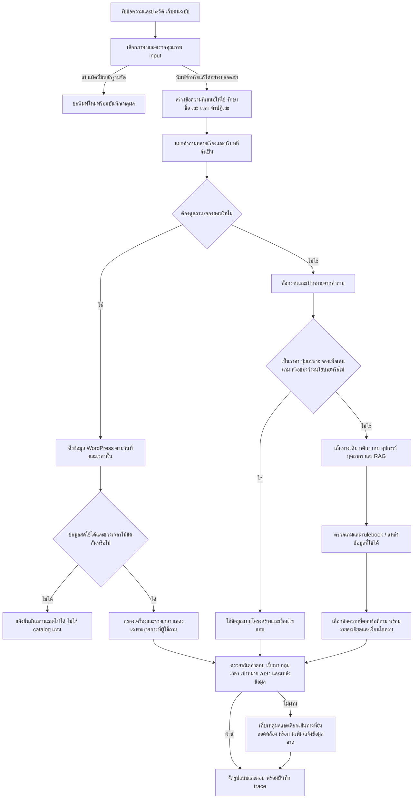

# Flow r30 — การตีความคำถาม เลือกข้อมูล ตอบ และตรวจผล

เอกสารปรับตามการทดสอบจริง 6 ขั้น: แผนเริ่มต้น → baseline 15/69 → A 40/69 → B 69/69 → ขอบ C และ D/E → F 79/79 ทั้งโปรไฟล์พัฒนาและตัวตรวจการพิมพ์แบบเว็บจริง ไม่เปลี่ยนราคา นโยบาย ข้อมูลเจ้าของ หรือ Gold เดิม

## 1. ลำดับที่ต้องทำและเหตุผล

| ลำดับ | ปัญหา | วิธีที่ทำ | เกณฑ์ตรวจ |
|---|---|---|---|
| P1 | ถาม 1 หรือ 2 ชั่วโมงแต่ตอบราคาเดียว | อ่านรายการระยะเวลาแต่ละหน่วย คำนวณแยกจากตารางเดิม รองรับสามตัวเลือกขึ้นไป | ทุกตัวเลือกต้องมีระยะเวลา จำนวนรอบ กลุ่มราคา และยอด; ห้ามเปลี่ยนวันที่/รหัสเครื่องเป็นระยะเวลา |
| P1 | ปฏิเสธกลุ่มนักศึกษาแต่กลับได้สิทธิ์ฟรี | ไม่ถือกลุ่มที่ถูกปฏิเสธเป็นกลุ่มที่ยืนยัน ถ้ายังไม่ทราบกลุ่มให้ถามต่อ | ไม่อ้างยอดฟรีเป็นสิทธิ์ของผู้ถาม; คำถามยืนยันกลุ่มไม่ต้องมีแหล่งราคา PC เพราะยังไม่คำนวณ |
| P1 | ถามราคาทุกบริการแต่ retrieval หยิบข้อความ PC เก่า | ตรวจขอบเขต “แต่ละ/ทั้งหมด” แล้วแสดงทุกแพ็กเกจจาก SERVICE_FEES พร้อมแหล่ง PC เพิ่มเติม | ต้องมีทั้งห้าโซนและทุกแพ็กเกจ; ไม่กล่าวว่า PC ไม่มีราคา; คำว่า “ค่าเล่น” ต้องมีชนิดคำตอบเป็นราคา |
| P1 | ถามปุ่มเฉพาะแต่ได้ปุ่มอื่นทั้งหมด | แยกชื่อปุ่มก่อนคำอธิบาย; exact/ชื่อย่อยจาก source/unique one edit | ยังคงหมายเหตุแหล่งรอง; ปุ่มรหัสที่ไม่มี เช่น R9/Q9 ไม่แทนด้วย R1/R2 และไม่แสดงปุ่มอื่น |
| P1 | ถามว่าจองอะไรเพื่อเล่นเกมแต่ได้แค่ขั้นตอนจอง | แยก game→service จาก catalog แล้วให้ขั้นตอน; ถ้าเกมหรือภาคไม่ชัดให้ถามต่อ | ห้ามอ้างเครื่องว่างจาก catalog; ไม่บอกบริการที่เดาจากเกมอื่น; ไม่สร้างการจอง |
| P2 | ไม่มีนโยบายต้นฉบับแต่บอกแค่ไม่มีคำแปล | ตรวจว่ามีหลักฐานนโยบายจริงหรือไม่ แยก missing source / missing translation | ถ้าไม่มีข้อมูลต้องบอกว่าขาดนโยบาย ถามเจ้าของเรื่องอนุญาต/ความยินยอม/พื้นที่ ห้ามแต่งกฎ |
| P1 | ผ่าน route แต่คำตอบยังผิด | เก็บเกณฑ์เดิมและเพิ่มเกณฑ์เนื้อหา/ข้อห้าม/แหล่งข้อมูล รวมคำถามที่ไม่ควรเข้าเส้นทางใหม่ | แยก route-only, literal content, complete clause, guard, live transport, fixture occupancy |

## 2. Flow ขณะรับคำถาม

### ราคา

1. ระบุบริการและขอบเขต: บริการเดียว/ทุกบริการ/เปรียบเทียบหลายบริการต้องแยกกัน
2. ระยะเวลาต้องมีหน่วย ไม่อ่าน 09:00, 2026-10-01, PC1 เป็นระยะเวลา; range 1–2 ชั่วโมงยังไม่ใช่ alternatives
3. ถ้าระยะเวลาถูกปฏิเสธให้ถามยืนยัน ถ้ากลุ่มถูกปฏิเสธไม่สร้างสิทธิ์กลุ่มใหม่เอง
4. คิดแต่ละตัวเลือกด้วยราคาต่อรอบและการปัดจำนวนรอบเดิม Nintendo ไม่ระบุจำนวนคนแสดงทั้งสองแพ็กเกจ VR ราคาแพ็กเกจไม่ใช่การพิสูจน์สถานะจอง
5. แหล่งราคา PC ต้องมี local update 2026-07-27 เมื่ออ้างราคา คำถามยืนยันที่ยังไม่มีข้ออ้างราคาไม่ต้องบังคับแนบแหล่งราคา

### ปุ่ม

1. ชื่อปุ่มในโครงสร้างคำถามชนะคำทับซ้อนในชื่อเกม/คำอธิบาย
2. แก้ typo เฉพาะชื่อปุ่มยาวอย่างน้อยสี่ตัว ไม่มีเลข ระยะ OSA เท่ากับหนึ่ง และมีตัวเลือกเดียว
3. ห้ามแก้รหัสเลขให้เป็นอีกปุ่ม; ถ้าต้องระบุแพลตฟอร์มให้ถามเพิ่ม
4. แหล่งรองยังต้องแจ้งว่ายังไม่ตรวจด้วยเกมและเครื่องจริงของศูนย์

### เกมเพื่อเลือกบริการจอง

แยกสามระดับ: มีเกมใน catalog → บริการที่มีเกม → มี slot ว่างตามวัน/เวลา รายการ catalog พิสูจน์เฉพาะสองระดับแรก เกมที่ไม่พบหรือภาคกำกวมต้องไม่ตอบขั้นตอนทั่วไปแล้วทำให้เข้าใจว่าเลือกบริการให้ได้แล้ว

### กติกาแข่งขัน

เกมต้องตรงกับ rulebook ข้อกฎที่ถามต้องเลือกครบเงื่อนไขและผลตามกติกา; ความขัดแย้ง/ข้อความถูกตัดต้องระบุ ไม่ใช้ confidence สูงแทนคำยืนยันจากผู้จัด คะแนน .97/.98 ในเส้นทางข้อมูลโครงสร้างหมายถึงความมั่นใจในการจับเงื่อนไข เป็นคนละเรื่องกับความถูกต้องที่ผู้จัดยืนยัน

## 3. Flow ทดสอบและวิเคราะห์

1. เก็บ app/tests เดิม, Git status และ hash 584 ไฟล์ข้อมูลก่อนเริ่ม เก็บ snapshot เพิ่มก่อน D/E/F ทุกครั้ง
2. Inventory ทุกไฟล์ eval และ routing รวม JSON/JSONL ที่ซ้ำ บันทึก alias ไม่เอาชุดซ้ำรวมเป็นความแม่นยำเดียว
3. ทดสอบ 79 กรณีเฉพาะจุดด้วยข้อความไทย/อังกฤษและ typo แล้วตรวจขอบ 17 วิธีทดสอบรวมการไม่ลดความเข้มงวดของ source gate
4. unittest ทุกโมดูล + smoke 85 ไฟล์แยก process; ข้อไม่ผ่านเทียบแพ็กเกจ r29 และอ่าน assertion ก่อนสรุปเป็น regression
5. รันทุก input ที่มี แยก session 12 กรณี/24 turn, guard 500 กรณี, ข้อที่มีแต่ metadata, และต้นฉบับ English shadow ที่ไม่มีคำแปล ใช้ฉบับแปลเครื่องที่มีอยู่เป็นคนละชุด ไม่เรียกเจ้าของรับรอง
6. ชุดใหญ่ใช้ LLM/semantic ปิดและ snapshot booking ที่ unavailable แบบควบคุม เพื่อวัดเส้นทางและคำตอบ static; หลังจากนั้นตรวจ API จริงด้วย LLM/semantic แบบเว็บ การต่อ API ได้ไม่ใช่การพิสูจน์ถูกจอง/ว่าง
7. แต่ละข้อที่ไม่ผ่านต้องมีคำถาม คำตอบจริง mode route เวลา expected contract hits และ trace รวมคะแนน/เหตุผลเลือก candidate ถ้ามี
8. แบ่งปัญหา: โค้ดผิดที่ยืนยันแล้ว / นโยบายหรือ source ขาดหรือขัดแย้ง / Gold หรือ assertion เก่า / เกณฑ์ตรวจเนื้อหาไม่พอ / คำแปลยังไม่รับรอง / บริการหรือ dependency / timeout / input กำกวม
9. เก็บผลทดสอบก่อนและหลังแก้แยกไฟล์ ถ้าพบ gate ผิดให้หยุดเฉพาะงานทดสอบของเรา แก้แล้วเริ่ม final sweep ใหม่ ไม่เอารอบบางส่วนมารายงานเป็นชุดเต็ม
10. Build package ใหม่ ตรวจ hash และ API บนพอร์ตทดสอบก่อนเปลี่ยน 8090 เฉพาะ launcher ที่พิสูจน์ว่าเป็นของงานนี้ ตรวจซ้ำหลังเปลี่ยน เก็บแพ็กเกจและ log เดิม

## 4. ข้อมูลที่ยังต้องเจ้าของ/ผู้จัดให้

- Tekken pause: เงื่อนไขการอนุญาตหยุดและ penalty ใน s03/s07 ใช้ข้อใดเป็นฉบับปัจจุบันและใช้กับ round/game/match อย่างไร
- RoV 6.1.5.1: ขอประโยคฉบับเต็มหลังคำว่า “ออกจาก”
- แต่ละ rulebook: ชื่อรายการ ปี รุ่น วันที่มีผล และขอบเขตที่ใช้จริง
- การถ่ายภาพ/วิดีโอ: อนุญาตหรือไม่ ขอความยินยอมจากใคร และจำกัดพื้นที่ใด
- ข้อมูลอุปกรณ์และชื่อบุคลากร: รุ่น/จำนวน controller ที่ใช้งานจริง และชื่ออังกฤษทางการ
- ค่าสมัคร/อายุผู้แข่ง: ส่งข้อกำหนดของแต่ละรายการ ไม่ใช้ค่าบริการเครื่องแทนค่าสมัคร
- Real booking oracle: ยังพักตามผู้ใช้ ผลสถานะ booked/free ที่รับได้ตอนนี้มาจาก fixture ที่ทราบเฉลยเท่านั้น

## 5. ผลรอบสุดท้าย

ดู FINAL_RESULTS_TH.md และ DETAILED_CAUSE_ANALYSIS_TH.md ในโฟลเดอร์รายงาน r30 หลัง final sweep เสร็จ รายงานต้องมีทั้งจำนวนผ่านและข้อจำกัดของเกณฑ์ ไม่กล่าวว่าคำตอบทุกข้อถูกหรือผู้จัดรับรองแล้ว
