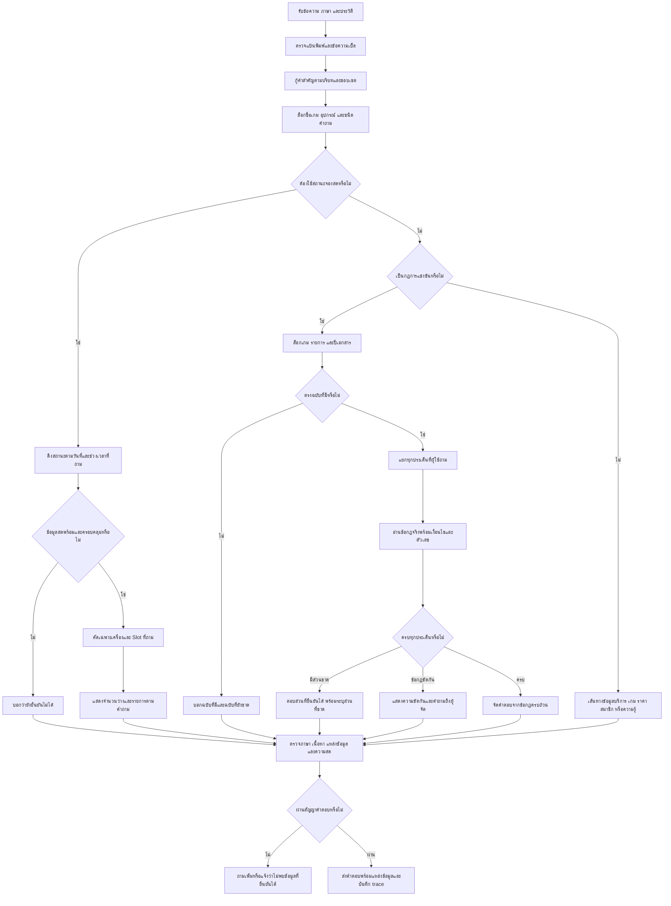

# Flow ฉบับตรวจหลังลงมือ — PSU Esports Chatbot r32

วันที่ 2 ตุลาคม 2026 เวลาไทย • รุ่นแพ็กเกจ final13 • Runtime `2026.10.02-source-content-reliability-r32`

## 1. เป้าหมายและขอบเขต

แก้รายการที่เหลือในระบบจริง: คำพิมพ์ผิดที่ทำให้ข้อมูลสดหลุดเส้นทาง, เกมถูกแต่หัวข้อผิด, คำถามหลายประเด็นตอบขาด, คำตอบมีแต่หัวข้อ, คำจริงกำกวม, เงื่อนไขตรวจเนื้อหา, การสร้างชุดภาษาอังกฤษ, ข้อมูลขาด/ขัดกัน/ผิดปี และคิวเว็บ พร้อมเก็บผลทดสอบที่ตรวจย้อนกลับได้

ผลการทดสอบอัตโนมัติเป็นหลักฐานเฉพาะเคสและเงื่อนไขที่ตรวจ ไม่ใช่การรับรองทุกคำถามหรือการอนุมัตินโยบายของเจ้าของ งานเก็บสถานะจองจริงยังพักตามคำสั่งเดิม เตรียมเครื่องมือตรวจไว้แล้วโดยไม่สร้างการจอง

## 2. Flow รับคำถามถึงตอบ

## 3. การกู้คำผิด

1. เก็บข้อความดิบและข้อความหลังแก้ใน trace ทุกขั้น ไม่ทับ input เดิม
2. ใช้ชื่อที่ลงทะเบียนและศัพท์หัวข้อของระบบ เป็นขอบเขตการเปรียบเทียบ ใช้ OSA/edit distance รองรับเพิ่ม ขาด เบิ้ล และสลับอักษร
3. กู้คำที่มีบริบทสนับสนุน เช่น อุปกรณ์ + เวลา + รูปคำถามสถานะว่าง หรือชื่อเกม + คำถามการแข่งขัน
4. จำกัดจำนวน span และ edit ตามตัวกู้คำเดิม (intent preflight 3 span / 4 edits รวม); ไม่ขยายทั้งพจนานุกรมเพื่อให้ตัวอย่างผ่าน
5. รักษาเลขเครื่อง วันที่ เวลา เวอร์ชันเกม คำปฏิเสธ และคำเชื่อม `และ/กับ/and` ให้ครบ
6. เมื่อ candidate กินคำเชื่อม ให้คำนวณ candidate หัวข้อเดิมซ้ำโดยใช้คำเชื่อมเป็นขอบเขตแข็ง หากไม่มีคำเดียวที่ผ่าน ให้คงข้อความเดิม
7. คำจริงเช่น pay/play ต้องถามกลับเมื่อกำกวม ชื่อบุคคลต้องมีหลักฐานชื่อเดียวกันก่อนเชื่อมข้อมูล
8. candidate ของชื่อเกมและหัวข้อใช้ solver ร่วมกัน แต่การยอมให้ prefix ทับกันใช้เฉพาะหัวข้อเดียวกัน ไม่ผ่อนข้อจำกัดชื่อเกม/เลขรุ่น

ข้อจำกัด: วิธีนี้ยังไม่แก้ทุกคำทั่วไปและทุกประโยคใหม่ การเพิ่มศัพท์ต้องผ่านเคสคำจริงและคำปฏิเสธด้วย

## 4. สถานะจองและเวลาบริการ

- คำถาม “PC1 ตอน 10:00 วางหรือเปล่า” ต้องเข้าเส้นทางสถานะสด เมื่อบริบทครบ จึงไม่ใช้ตารางเปิดบริการแทนการว่าง
- ชื่อหมวดกว้างให้รวบรวมเครื่องของหมวดนั้นและแสดงจำนวนว่าง/ทั้งหมด คำถามหาอุปกรณ์ว่างทุกหมวดให้แสดงเฉพาะรายการว่างตาม Slot ที่ถาม ตาม Flow เดิม
- รักษานโยบาย 12:00–13:00 ไม่เปิดจอง และ VR 30 นาทีครอบคลุมชั่วโมงเต็มตามที่ผู้ใช้ยืนยันไว้ก่อนหน้า; รอบนี้ไม่เปลี่ยนไฟล์ตารางเจ้าของ
- fixture ต้องมีขอบเวลา, approved/cancelled/no-show, VR, Maintenance และวันปิดพิเศษทั้งไทย/อังกฤษ
- หากข้อมูลสดไม่พร้อม ให้ตอบว่ายังยืนยันไม่ได้ แม้รู้ตารางเปิดบริการ
- แยก `transport_http_ok` จาก `occupancy_verified`; ค่า HTTP 200 ไม่ใช่หลักฐานว่าว่างจริง

เครื่องมือตรวจที่เตรียม: `tools/check_saved_booking_oracle_r32.py` อ่าน snapshot ที่บันทึกไว้กับ oracle ที่เจ้าหน้าที่รู้ผลจริง โดยผูก SHA256, วันที่, +07 timestamp, ผู้ยืนยัน, เครื่อง และ Slot ตรวจเฉพาะรายการที่ยืนยัน ไม่รับรองอนาคตหรือเครื่องที่ไม่ตรวจ ใช้ template รุ่น V2 ที่มี `source_snapshot_sha256`

## 5. กฎการแข่งขันและคำถามหลายประเด็น

1. ระบุเกมเดียวหรือหลายเกมให้ชัด อย่าใช้กฎ VALORANT แทน CS2/RoV/Tekken
2. ตรวจปีจากตัวตนเอกสารที่ลงทะเบียน ไม่ใช้วันที่อัปเดตเป็นฉบับกฎ และไม่อนุมานปีของ Tekken ที่เอกสารไม่ระบุ
3. ปีเกิดและยอดเงินสี่หลักไม่ใช่ปีฉบับกฎ; เลขข้อที่มีจุดไม่ถูกดึงเป็นปี
4. สร้างรายการประเด็นจากคำถามก่อนเลือกแหล่งข้อมูล: eligibility, roster, registration, settings, equipment, scope/event information, pause/timeout และ team size ที่มีข้อรองรับ
5. อ่านข้อกฎจริงทั้งเงื่อนไขและตัวเลข ไม่ยอมให้ชื่อหัวข้อ “การตั้งค่าในเกม” เป็นคำตอบรายละเอียด
6. เมื่อมีคำถามขาดข้อมูล เช่นอายุขั้นต่ำ/ค่าสมัคร ให้แยกส่วนที่ขาดออกจากคำถามย่อยที่มีหลักฐาน ตอบข้อคุณสมบัติที่มีและแจ้งว่าข้อมูลอายุยังไม่พบ
7. ถ้าถามอายุอย่างเดียว ไม่แสดงคุณสมบัติทั่วไปแทนเกณฑ์อายุ; ไม่มีแหล่งยืนยันอายุให้ตอบว่ายังไม่พบ
8. RoV 5v5 คือผู้เล่นในเกมฝ่ายละ 5 ไม่ได้ยืนยันจำนวนรายชื่อรวมสำรอง
9. ข้อ Tekken เรื่อง pause ขัดกัน ให้แสดงความขัดกัน ไม่เลือกนโยบายเอง
10. ข้อ RoV ที่ต้นฉบับจบกลางประโยค ให้ขอข้อเต็ม ไม่เติมข้อความด้วยการเดาหรือแปลส่วนที่ขาด

## 6. การตรวจเนื้อหาต้องปรากฏคืออะไร

การได้หมวด `competition_rules` หรือมี source ID ของ CS2 ยังไม่พอ ตัวอย่างคำถาม pause + timeout ต้องมีทั้งข้อ pause พร้อมจำนวน/ระยะเวลา และข้อ timeout พร้อมจำนวน/ระยะเวลา/Freeze time ข้อใดหายต้องไม่ผ่าน

ตัวตรวจอ่านคำถามเองก่อน retrieval แล้วตรวจ source ที่เลือกและข้อความข้อกฎครบถ้วนในคำตอบ ตัวตรวจใหม่ไม่ใช้ประโยคที่ระบบตอบมาสร้างคำตอบคาดหวัง

- positive oracle ใหม่ 30 เคสมีข้อ source ที่ระบุไว้ล่วงหน้าทั้งไทย/อังกฤษ
- oracle partial ใหม่ 8 เคสตรวจข้อ eligibility เต็ม + ข้อความบอกอายุ/ค่าสมัครที่ขาด
- mutation ลบข้อใดข้อหนึ่ง หรือเหลือเพียงหัวข้อ ต้องถูกปฏิเสธ แม้มี source ID ที่ถูก
- คำแปลอังกฤษต้องตรง source hash; ถ้าแปลเก่าหรือไม่มีแปล ให้แจ้ง pending ตามขอบเขต ไม่แปลสดโดยเดาค่านโยบาย
- frozen Gold เดิมคงไว้ การเปลี่ยนสถานะจาก no_answer เป็น partial ทำให้เกณฑ์เก่าบางข้อไม่ผ่าน ซึ่งต้องแสดงแยกจากการตอบข้อเท็จจริงผิด

## 7. ภาษาอังกฤษและการสร้างชุดทดสอบ

ตัวสร้างต้องสร้าง metadata ของ frozen v2 ได้เหมือนเดิม เก็บ English reference ปัจจุบันเป็น sidecar ใหม่ ไม่เขียนทับ Gold แก้ความต่าง reference 6 แถวที่พบ และแยกความเข้ากันได้ย้อนหลังออกจากเนื้อหาปัจจุบัน

Audit กฎพบ 104 แถว มี English text ตรง hash 103 แถว อีกแถวเป็นส่วนที่ต้นฉบับไม่ครบ การมี registry status approved ในโค้ดไม่ยืนยันว่าเจ้าของหรือผู้จัดตรวจเนื้อหาหรือเห็นชอบปีฉบับแล้ว

## 8. คิวเว็บและการรอ

1. คิวรับ TCP ขนาด 16 รองรับ burst สั้น เพื่อให้คำขอไปถึง admission gate ได้ ไม่เพิ่มจำนวนงานประมวลผลหรือ worker
2. เมื่อคิวเต็ม ส่ง HTTP 503 + `retryable:true` + Retry-After เฉพาะกรณีที่ลองซ้ำได้
3. หน้าเว็บลองไม่เกิน 3 ครั้ง เว้น 250–1500 ms และหยุดเริ่ม retry เพิ่มเมื่อเวลาสะสมเกิน 12 วินาที เงื่อนไขนี้ไม่รับรองว่าทุก HTTP call จะจบภายใน 12 วินาที
4. payload/history/session เดิมทุกครั้ง ไม่เพิ่มข้อความผู้ใช้ซ้ำ ขณะรอแสดงสถานะไทย/อังกฤษและปิดปุ่มส่งชั่วคราว
5. network error, JSON เสีย, HTTP 500 และ error ที่ไม่ retryable ไม่ส่งซ้ำอัตโนมัติ
6. เก็บผล idle, cold/loaded และ protocol แยกกัน การทดลอง 10 คำถามไม่ใช่ SLA ของ WordPress หรือจำนวนผู้ใช้สูงสุด

## 9. รอบแก้และข้อที่พบจากการตรวจซ้ำ

| รอบ | สิ่งที่ตรวจพบ | สิ่งที่ปรับ |
|---|---|---|
| 1 | intent และ source requirements ยังไม่ครบ | baseline/snapshot และเพิ่มตัวกู้หัวข้อ/สัญญาเนื้อหา |
| 2 | source oracle ผ่าน 26/30 | เติมการแยกหัวข้อและขอบเขต source |
| 3–5 | แก้คำกิน prefix/คำถูก และแยก RoV team size ไม่สำเร็จบางแบบ | จำกัด overlap ในหัวข้อเดียว รักษาคำจริง และอ่านข้อ 5v5 |
| 6 | source oracle ผ่าน 30/30 | รันชุดใหญ่ทุก corpus ที่ inventoried |
| 7 | หยุดเกิน/การแข่งขันไหน/เครื่องหมายวรรคตอน ถูกแก้เป็นหัวข้อผิด | รักษาคำ threshold, identity และขอบเขต punctuation; API 937/937 ในรุ่นนี้ |
| 8 | กฎผิดปีผ่านการทดสอบ direct แต่เว็บยังตอบ overview ต่อ | เพิ่ม guard ปี source แล้วตรวจ actual HTTP; เก็บผลล้มเหลว 6/24 |
| 9 | answer contract ไม่รู้จัก no_answer mode ของ guard | จำแนก mode ให้ตรงผลจริง; actual HTTP ปี 24/24 |
| 10 | ปีเกิด/ยอดเงินอาจสับสนกับปีฉบับ | เพิ่ม negative bounds และทดสอบเดิมทั้งหมด |
| 11 | burst บางคำขอไม่ถึง HTTP gate | ทดลอง Windows backlog 5 ได้ 6/10 เทียบ 16 ได้ 10/10; ปรับ intake และตรวจ cold helper 10/10 |
| 12 | อายุขั้นต่ำที่ขาดทำให้ eligibility ที่มีหายไป | แยก partial; เคสใหม่ 7/8 พบคำเชื่อมถูกกิน |
| 13 | คุณสมบัตและ ถูกแก้เป็น คุณสมบัติละ | ใช้คำเชื่อมเป็นขอบเขต; partial 8/8 และ source 30/30 ผ่านเว็บ |

ผลแต่ละรอบเก็บแยก ไม่เปลี่ยนคำตอบคาดหวังเดิมเพื่อให้คะแนนผ่าน

## 10. วิธีประเมินและที่มาผล

- ครบ 20,327 requests ไม่ซ้ำ / 55,583 grades; รัน C6 เต็ม แล้ว replay C7 8,526 queries, C10 17 source-abstention queries, C12 17 source-gap queries, C13 3 queries ที่ recovery ทับคำเชื่อม
- C8 พบว่า corpus ชุดใหญ่ไม่มี explicit Gregorian year ในคำถาม จึงเพิ่มชุด HTTP ปี 24 เคสแยก แทนการอ้างว่าชุดใหญ่ครอบคลุมปีแล้ว
- ไม่เรียกผลรวมนี้ว่ารันสดทุกข้อบน final13; ทุกรายการมี execution provenance และเก็บ raw ของรอบที่รันจริง
- คู่พิมพ์ผิด 2,000 ใช้ grader v2 เดียวกันเปรียบเทียบก่อน/หลัง; มี positive content contract 894 คู่เท่านั้น
- รุ่นสุดท้ายทดสอบ unit 464/464 แยกจาก smoke เดิม 71/85, extra 970 requests และ native guard 500
- Human review 120 แถวเป็น observations ไม่มี oracle ที่เจ้าของยืนยัน ห้ามนับเป็นความถูกต้อง 120/120
- ชุด slot จริง 4 HTTP cases ถูก defer เพราะงานเก็บ occupancy พัก; known synthetic booking fixture 31/31 เป็นคนละหลักฐาน

## 11. งานที่ยังต้องพัฒนาและวิธีเดินต่อ

1. **P1: 42 คู่ที่มีเงื่อนไขเนื้อหาบวกยังตก** — ตรวจ source/target/ทุก proposition รายข้อจาก appendix ก่อนแก้ route หรือ renderer แล้วเพิ่ม mutation ที่ลบเนื้อหาจริง
2. **P1: คำสำคัญ/หัวข้อทั่วไปและสมาชิก** — กลุ่ม trace 71 และ 19 คู่ ตามลำดับ ต้องแยกคำผิดออกจากคำจริงและชื่อคนที่ไม่ตรง source; เพิ่ม syntax frames/ศัพท์งานและ target lock โดยไม่เพิ่ม alias ทั้งประโยค
3. **P1: อีก 65 คู่ที่ยังไม่มี positive oracle** — สร้างคำตอบคาดหวังจาก source อย่างอิสระก่อนเรียกว่าคำตอบใดถูก ไม่ใช้ clean answer เป็น Gold อัตโนมัติ
4. **P2: repeat guard** — 500 เคส layout ถูก 500 แต่ repeat ยังมี FN 27 / FP 2; เก็บชุด negative คำจริงและปรับ model/threshold ร่วมกับ downstream recovery ไม่ลด threshold อย่างเดียว
5. **P2: load ที่เกิน burst ที่ทดสอบ** — เพิ่มสถานการณ์ overload ต่อเนื่อง/คำถามที่เรียก LLM และวัดคิวกับ deadline หากนำไปใช้งานหลายคน; คงการจำกัดงานเดิมจนมีหลักฐาน
6. **เจ้าของ/ผู้จัด** — ยืนยันกฎขัดกัน ฉบับปีที่ใช้งานจริง ข้อ RoV เต็ม อายุ/ค่าสมัคร/จำนวนรายชื่อรวมสำรอง และนโยบายถ่ายภาพ; มีคำถามพร้อมใน OWNER_QUESTIONS_TH.md
7. **พักตามผู้ใช้** — real booking occupancy; เมื่อผู้ใช้พร้อมจึงใช้ template V2 และ checker ที่ผูก snapshot แยก transport จาก correctness

การเดินต่อทุกกลุ่ม: หลักฐานต้นฉบับ → oracle อิสระ → baseline/trace → เปลี่ยนเฉพาะจุด → positive/negative/mutation → affected replay → package/hash → actual HTTP → รายงานข้อจำกัด ถ้า source ขาดให้ตอบส่วนที่มีและขอข้อมูลที่ขาด ไม่ใช้การเดา

## 12. การรักษาไฟล์และเปิดใช้งาน

ก่อนแก้ snapshot 423 ไฟล์; ข้อมูลเจ้าของ/Gold 584 hashes ต้องเหมือนเดิม; tests ที่มีเดิม 140 ไฟล์ต้องเหมือนเดิม เก็บแพ็กเกจและ log ทุกรุ่น ไม่มี reset/stash/commit หรือเขียนทับผลทดสอบเดิม

แพ็กเกจส่งมอบคือ `owner_local_delivery_20261002_source_content_reliability_r32_final13/PSU_Esports_Chatbot_Local`; เปิดเว็บจาก launcher ของแพ็กเกจ และตรวจ `/health` + hash ของไฟล์ UI หลังเปิด ใช้พอร์ต 8090 สำหรับลองจริง พอร์ต 8091 ใช้ทดสอบแล้วปิดเฉพาะ process ที่พิสูจน์ว่าเป็นของงานนี้

รายงานและ raw อยู่ที่ `C:\Users\Chokhun\Downloads\Learn-LLM\18_PSU_Esports_Update_Route_Data\reports\r32_all_remaining_20261002_184857_ee7d38`. ดู FINAL_RESULTS_TH.md และ REMAINING_107_ANALYSIS_TH.md เพื่ออ่านข้อที่ผ่าน ข้อที่ยังตก และ trace รายข้อ
