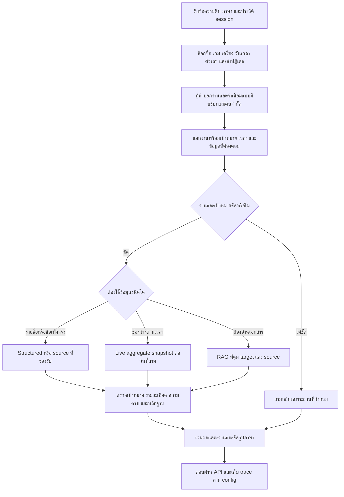

# Flow รวมเพื่อแก้ความเข้าใจคำถามและความถูกต้องของคำตอบ — r20 candidate

วันที่เริ่ม 30 กันยายน 2026; หลักฐานอ้างอิง r19 และ docs/112–116

## วัตถุประสงค์และขอบเขต

พัฒนาตามปัญหาที่เหลือทั้ง 6 กลุ่ม: เลือก static/live, หลายงาน, รายละเอียดที่ถาม, คำผิดหลายจุด, ภาษาอังกฤษ และความน่าเชื่อถือของ evaluator โดยคงข้อแก้ผิดเป้าหมาย r19

งานนี้รวมการออกแบบ ทบทวน ลงมือแก้ logic ที่ยืนยันได้ fixture tests และทดสอบแพ็กเกจ ไม่ย้าย stack ไม่อนุมัติข้อมูลเจ้าของแทนเขา และไม่ถือว่าผล synthetic คือความถูกต้องจากผู้ใช้จริง

## Flow จาก input ถึง output

แผนภาพเป็นโครงพฤติกรรมเป้าหมาย; ลำดับ code จริงมี canonical/protected/English shortcuts อยู่แล้ว ต้องตรวจทุกทางเข้าก่อนแก้ ไม่สร้าง pipeline อีกเส้นที่ bypass ข้อจำกัดเดิม

## ลำดับงาน

P0 เก็บ baseline/backup → P1 เสริมเกณฑ์เนื้อหาเฉพาะข้อที่มีหลักฐาน → P2 static/live → P3 หลายงานและ booking facets → P4 bounded multi-cue recovery ไทย/อังกฤษ → P5 negative controls/fixture/regression → P6 ทดสอบครบ 2,000 คู่ → P7 แพ็กเกจ/API → P8 วิเคราะห์และแก้ Flow ตามผล

ทุกชิ้นเริ่มด้วย failure ที่ทำซ้ำได้ ตามด้วยแก้ขั้นต่ำและตรวจ clean คู่กัน ถ้าพบข้อเสียใหม่ ต้องวิเคราะห์และแก้หรือถอนชิ้นนั้น ก่อนสร้างแพ็กเกจที่สรุปว่าผ่าน gate

## สถานะ

ทบทวนเชิงออกแบบครบ 10 รอบแล้ว ลงมือแก้และวนตามผลทดสอบอีกหลายรอบ ผลแต่ละชิ้นดูสถานะท้ายเอกสารและรายงาน docs/118 การเสร็จของ Flow ไม่ใช่การรับรองว่าคำถามทุกแบบหรือข้อมูลเจ้าของถูกต้องทั้งหมด

## ข้อกำหนดที่ผ่านการตรวจรอบ 1: รักษาสถานะปัจจุบัน

สำรอง source ที่จะปรับจาก working tree พร้อม hash ไม่ใช้ reset/revert เก็บ manifest ของ curated/locales/GT/calendar เจ้าของ ขอสิทธิ์เขียนผ่านระบบก่อนแก้ สร้าง report/แพ็กเกจชื่อใหม่ทุกครั้ง ตัวรันต้องปฏิเสธ output ที่มีอยู่ เว้นแต่เป็น resume ที่ตรวจ hash/config และ prefix IDs ได้จริง

## ข้อกำหนดที่ผ่านการตรวจรอบ 2: จุดผสานในโค้ดเดิม

ใช้ recover_intent_cues ที่ engine และ preprocess ใช้อยู่; เพิ่ม provenance ที่ preflight โดยไม่ส่งข้อความแก้ทั้งหมดผ่าน splitter ใหม่ ก่อน canonical shortcut ถ้ามี recovery ต้องข้าม shortcut ที่อาจตอบงานเดียว เก็บ competition_rule_query และ damage policy เป็นหนึ่งคำถามตามข้อยกเว้นเดิม ตรวจ flag canonical เปิด/ปิดกับข้อที่เกี่ยว

## ข้อกำหนดที่ผ่านการตรวจรอบ 3: การเลือกแหล่งข้อมูล

กู้คำประเภท game/games/equipment เฉพาะกรอบคำถามรายการ แล้วใช้ผลเดียวกันที่ static/live gate และตัวตอบ ไม่แก้ available ให้แปลว่าช่องจองโดยตัวมันเอง รายการเกมมีคำ today/now ยังอาจเป็น catalog; ส่วน is PC1 available now เป็นสถานะสด ต้องตรวจ object+operation ไม่ใช้เวลาอย่างเดียว ถ้าถามทั้งสองให้แยกงานก่อนเรียก live

## ข้อกำหนดที่ผ่านการตรวจรอบ 4: ความครบและการส่งต่อเป้าหมาย

กู้คำเชื่อมไทยระยะ 1 เฉพาะระหว่างสอง operation ที่ชัดและมี target/context ไม่สร้าง alias อล้วรายคำ ทดสอบขอบติดกันและมีช่องว่าง ส่งต่อบริการเฉพาะเมื่อส่วนถัดไปไม่ระบุบริการใหม่ คง negation/จองแล้ว/compound policy/game titles ที่มี and ไว้ จำกัดไม่เกิน 3 tasks ตาม splitter เดิม เพิ่ม trace child outcome และ validation เพื่อ audit จำนวนงานที่ตอบจริง

## ข้อกำหนดที่ผ่านการตรวจรอบ 5: รายละเอียดและภาษาอังกฤษ

กู้ information/booking/payment และ zone เฉพาะ syntax ที่ชัด แล้วให้ FAQ sub-intent ที่มีอยู่ตอบ ตรวจ required fields และ payment limit ตาม rule source เดิม ห้ามสร้างเลข deadline/ราคาใหม่ ห้ามเอา localization draft เข้า approved หาก source จริงยังไม่รองรับต้องคง no-answer/localization pending พร้อม source ไม่ถือว่า typo fix แก้ coverage ได้ทุกข้อ

## ข้อกำหนดที่ผ่านการตรวจรอบ 6: ขอบเขตการกู้หลาย cue

กู้สูงสุด 3 spans ต่อการเรียก ไม่เกิน 4 character edits รวม ความยาว input ไม่เกิน 180 และไม่แก้ URL; แต่ละ span มี observed/intended/distance/start/reason คำจริงที่ชนกันให้คงเดิมหรือถามกลับ แยก exact token ที่ต้องป้องกัน รวม identifier วันที่ เวลา และคำปฏิเสธ ตรวจ idempotence และ flag recovery off ใช้ syntax anchor เพื่อกันคำในชื่อเกม ไม่เพิ่ม phrase alias ตามทุก testcase

## ข้อกำหนดที่ผ่านการตรวจรอบ 7: การวัดผลที่ไม่หลอกตัวเอง

คง legacy scorer/GT frozen และแสดง scorer v2 บน output เดียวกัน เพิ่ม all-groups เฉพาะ source-supported pilot พร้อม source refs บันทึก positive_contract_present และ evidence level ว่าเนื้อหายังไม่ได้ตรวจเมื่อ contract ว่าง live_unavailable เป็น external_blocked ไม่ใช่ verified_booking_correct; unknown mode ต้องเป็น unknown ไม่เดาว่าตอบสำเร็จ เพราะไม่พบคำว่า no_answer ตรวจ scorer กับคำตอบจำลองที่ผิด/ขาดเพื่อพิสูจน์ว่าจับได้

## ข้อกำหนดที่ผ่านการตรวจรอบ 8: oracle และสิ่งที่พักไว้

แยก tests สามชั้น: classifier ไม่ควร fetch, pipeline กับ fixture slots ว่าง/จองที่รู้ค่า และ HTTP แพ็กเกจที่ปิด live ไม่มีการสร้าง/ยกเลิก booking ตรวจไทยอังกฤษ เครื่องเฉพาะ หมวดรวม source invalid/wrong date และวันที่ปิดโดยชุดเดิมที่มี oracle ทดสอบ static ไม่แตะ fetch ทั้ง fast และ English adapters เก็บ real WordPress oracle ไว้คิวตามคำขอเจ้าของ ไม่ขอข้อมูลจริงซ้ำในรอบนี้

## ข้อกำหนดที่ผ่านการตรวจรอบ 9: ชุดทดสอบและเกณฑ์รับ

ใช้ focused cases ที่มี all-groups/forbidden targets, generated one-edit holdout จากคำบอกงานไม่สร้าง alias ให้ exact typo, negative controls, tests r19 และ calendar/live/source เดิม แล้ว full2k ไทยพันอังกฤษพัน แบบ deterministic trace exceptions latency route/status/content แยกภาษา บันทึก r18 delta และ affected-domain r19 delta เฉพาะ IDs ที่มี baseline ห้ามอ้าง full r19 baseline ที่ไม่เคยรัน สอบสวนทุก clean/noisy ที่เคยผ่านแล้วตกใหม่ก่อนยอมรับ

## ข้อกำหนดที่ผ่านการตรวจรอบ 10: การส่งมอบและ loop หลัง test

สร้างแพ็กเกจ r20 ใน output ใหม่ ตรวจ manifest/launcher/source hash ใช้พอร์ตว่างแยก ไม่หยุด runtime ผู้ใช้ ทดสอบ API locale/debug/plain และ static/live unavailable โดยไม่รวม log ทดสอบเข้า package path จริง แล้วหยุดเฉพาะ process ทดลอง เก็บ snapshot Flow 10 รอบก่อนลงมือ จากนั้นบันทึกการปรับ Flow รอบ post-test แยก ระบุ implemented/verified/pending/deferred เป็นรายชิ้น ไม่สัญญา accuracy100 หรือ production SLA

## ประวัติการทบทวน

- รอบ 1 — ตรวจ baseline และสิทธิ์เขียน: หาก backup จาก Git HEAD จะสูญเสียงาน r18/r19 ที่ยังไม่ commit; หลักฐาน git_status_before มี engine/preprocess/structured/identity เปลี่ยนอยู่ → ปรับข้อกำหนดตามหัวข้อรอบนั้น
- รอบ 2 — ตรวจทางเข้าและลำดับ shortcut: engine.answer มี canonical shortcut ก่อน split; _answer_single มี protected/target/live ก่อน English; splitter ไม่ใช่ task_splitter.py แยกไฟล์ → ปรับข้อกำหนดตามหัวข้อรอบนั้น
- รอบ 3 — ตรวจความหมาย static กับ live: is_live_booking_question กัน games/equipment เฉพาะสะกดตรง; available+Cockpit ชนะเมื่อ games ผิด → ปรับข้อกำหนดตามหัวข้อรอบนั้น
- รอบ 4 — ตรวจหลายงานและคำเชื่อม: splitter กู้ cue เดียว; อล้วจองยังไงไม่เกิดขอบเขตงาน ราคาเร็วตอบจบ → ปรับข้อกำหนดตามหัวข้อรอบนั้น
- รอบ 5 — ตรวจ booking sub-intent และ source: what information ที่ผิดหล่นไป rule ขั้นตอนทั่วไป; _answer_booking_intent มี user info/payment timeout ที่ใช้ข้อมูลเดิมได้อยู่แล้ว → ปรับข้อกำหนดตามหัวข้อรอบนั้น
- รอบ 6 — ตรวจ false correction และงบ: แก้ทุกคำด้วย nearest word จะเปลี่ยน rice/price pay/play หรือชื่อเกมที่เป็นคำทั่วไป; OSA tie ต้องไม่เลือกตามลำดับ list → ปรับข้อกำหนดตามหัวข้อรอบนั้น
- รอบ 7 — ตรวจ evaluator และตัวหาร: 1,107/2,000 ไม่มี positive content requirement; all-groups ต้องใช้ AND หลายงาน live_lookup_required ยังผ่าน unavailable → ปรับข้อกำหนดตามหัวข้อรอบนั้น
- รอบ 8 — ตรวจ fixture booking และข้อมูลเจ้าของ: API 200 หรือ source=remote_csv_live ไม่พิสูจน์ว่าผลแต่ละเครื่องถูก; mock ที่ผิดจุดอาจยังดึง API จริง → ปรับข้อกำหนดตามหัวข้อรอบนั้น
- รอบ 9 — ตรวจ holdout และ regression: ทดสอบเฉพาะ examples 8 ข้ออาจซ่อนผลเสียในหมวดอื่นและการซ่อมเกิน; r19 ยังไม่ได้ full2k → ปรับข้อกำหนดตามหัวข้อรอบนั้น
- รอบ 10 — ตรวจแพ็กเกจ การสิ้นสุด และแผนย้อนกลับ: เอกสารที่บอกเสร็จทุกขั้นทั้งที่ไม่เปิด model/WordPress/load ทำให้ผิดสถานะ; launcher อาจวิ่งกลับ runtime เก่า → ปรับข้อกำหนดตามหัวข้อรอบนั้น

## รอบ 11 หลัง focused v1

**หลักฐาน:** focused v1 ผ่าน 22/24; alcoholic ไม่อยู่ในตัวตรวจ modifier และ public-access guard ชนะวิธีจองที่รับกลุ่มผู้ใช้มาจากงานราคา

**ปรับ Flow:** เพิ่ม alcoholic ในกลุ่มความหมาย alcohol ที่มี source เดิม และให้คำถามวิธีจองที่ชัดไปขั้นตอนจองแทน permission guard; required groups ต้องจับทั้งราคาและสลิป

**เกณฑ์ที่เพิ่ม:** ข้อเทียบ live-specific-th เดิมบังคับคำ ถูกจอง แต่คำตอบ ไม่ว่างตลอดช่วง ก็ตรง oracle ต้องเทียบ baseline ด้วย contract เดียวกัน; เก็บ baseline เดิมและรันแพ็กเกจ r19 ใหม่ได้ 9/24

## รอบ 12 หลัง full candidate v2

**หลักฐาน:** ครบ 2,000 คู่ clean1790 noisy1641; เหลือคำเชื่อม/บุพบท/กริยาสั้น ทำให้หลายบริการหรือจำนวน session หาย และ pay ถูกเลือกเป็นราคา

**ปรับ Flow:** เพิ่ม one-edit grammar recovery เฉพาะรูปประโยคที่ระบุ operation; split for/in/on หลายบริการ; แยก payment deadline/method ออกจาก fee amount โดยไม่เปลี่ยนข้อเท็จจริง

**เกณฑ์ที่เพิ่ม:** คงคำจริง pay/play/rice และคำปฏิเสธ; ต้องมี test ภาษาอังกฤษหลายบริการและ booking/payment facets เป็นคนละ task

## รอบ 13 หลัง negative boot probe

**หลักฐาน:** How do I boot a PC ถูกแก้เป็น book แม้ focused31และtests115ผ่าน แสดงว่าชุด positive อย่างเดียวไม่พอ

**ปรับ Flow:** คำสั้นที่ผิดแบบแทนตัวหนึ่งต้องผ่านทั้ง OSA และตำแหน่งแป้นข้างเคียง; ขาด/เบิ้ล/สลับใช้ OSA ตามเดิม เพิ่ม boot/cook/hook/far controls

**เกณฑ์ที่เพิ่ม:** หยุด TH v3 ที่ยังไม่ครบโดยเก็บไฟล์ partial; EN v3ครบแต่ไม่ใช้เป็นผลส่งมอบ เริ่ม full gate ทั้งสองภาษาใหม่หลังแก้ พร้อม source hash manifest
